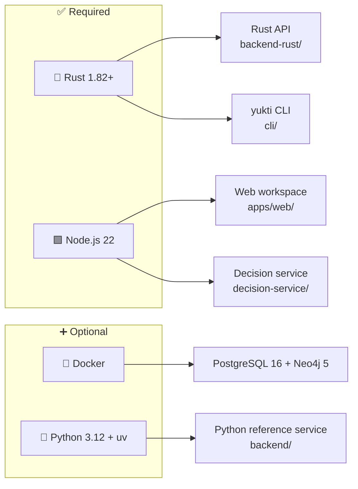

<div align="center">


# 📦 YUKTI — Requirements

**Everything you need installed to build, run and test YUKTI.**

[What you need at minimum](#-the-short-version) · [Software](#-1-software-to-install) · [Hardware](#-2-hardware) · [Libraries per component](#-3-libraries-used-by-each-component) · [Optional services](#-4-optional-services) · [Check your setup](#-5-check-that-everything-is-installed)

</div>

---

## ⚡ The short version

To see YUKTI working you need **only three tools**:

| | Tool | Version | Why you need it | Get it |
|---|---|---|---|---|
| 🧰 | **Git** | 2.40 or newer | To download the project | [git-scm.com](https://git-scm.com) |
| 🦀 | **Rust** (with `cargo`) | stable, **1.82 or newer** | Builds and runs the API and the `yukti` CLI | [rustup.rs](https://rustup.rs) |
| 🟩 | **Node.js** (with `npm`) | **22 LTS**, npm 10+ | Builds and runs the web workspace | [nodejs.org](https://nodejs.org) |

Everything else on this page is **optional**. You do not need a database, Docker or Python to run the full investigation workflow.

> **Don't want to build anything?** The `yukti` CLI has a one-line installer that downloads a ready-made program with the API bundled inside it. See [Installing without building](#-installing-without-building) below.

---

## 🧭 Which parts need what?



| Component | Folder | Needs | Required? |
|---|---|---|---|
| **Rust API** — the forensic engine | `backend-rust/` | Rust | ✅ Yes |
| **Web workspace** — the investigator UI | `apps/web/` | Node.js | ✅ Yes (for the UI) |
| **`yukti` CLI** — the terminal client | `cli/` | Rust | Recommended |
| **PostgreSQL + Neo4j** — persistence and knowledge graph | `docker-compose.graph.yml` | Docker | ➕ Optional |
| **Python service** — original reference implementation | `backend/` | Python 3.12, uv | ➕ Optional |
| **Decision service** — reserved for future on-device AI | `decision-service/` | Node.js | ➕ Optional |

---

## 💻 1. Software to install

### Required

| Software | Minimum version | How to check | Notes |
|---|---|---|---|
| Git | 2.40 | `git --version` | |
| Rust toolchain | 1.82 (stable) | `rustc --version` · `cargo --version` | Install with [rustup](https://rustup.rs). **Windows:** use the default *MSVC* toolchain, which needs the "Desktop development with C++" workload from Visual Studio Build Tools. |
| Node.js | 22 LTS | `node --version` | Ships with npm. |
| npm | 10 | `npm --version` | |

### Optional

| Software | Minimum version | How to check | Used for |
|---|---|---|---|
| Docker + Docker Compose | Docker 24, Compose v2 | `docker compose version` | Running PostgreSQL and Neo4j locally |
| Python | 3.12 | `python3 --version` | The Python reference service and its tests |
| uv | any recent | `uv --version` | Python dependency manager ([astral.sh/uv](https://astral.sh/uv)) |
| FFmpeg | 6+ | `ffmpeg -version` | Video keyframe extraction in the Python service, and its video tests |

### Supported operating systems

| OS | Status |
|---|---|
| 🍎 macOS 13+ (Intel and Apple Silicon) | ✅ Supported |
| 🐧 Linux (Ubuntu 22.04+ or similar) | ✅ Supported, and used by CI |
| 🪟 Windows 10 / 11 | ✅ Supported. See the [build portability notes](docs/architecture/rust-build-portability-audit.md) if linking fails. |

A modern browser (Chrome, Edge, Firefox, Safari or Brave) is needed to open the web workspace.

---

## 🖥️ 2. Hardware

| | Minimum | Recommended |
|---|---|---|
| **CPU** | 2 cores | 4+ cores (faster first build) |
| **Memory (RAM)** | 4 GB | 8 GB, or 16 GB if you also run Neo4j |
| **Free disk space** | 3 GB | 6 GB (Rust build caches are large) |
| **Network** | Needed once, to download dependencies | After that, everything runs offline |

> **First build takes a while.** The first `cargo run` downloads and compiles the Rust libraries, which can take 3–10 minutes. Later runs start in seconds.

No GPU is needed. YUKTI's analysis is deterministic: it uses no machine-learning model and no cloud service.

---

## 📚 3. Libraries used by each component

You **do not install these by hand**. Each component's package manager reads its own manifest and downloads them automatically:

| Component | Manifest | Install command |
|---|---|---|
| Rust API | [`backend-rust/Cargo.toml`](backend-rust/Cargo.toml) | `cargo build` (automatic on `cargo run`) |
| `yukti` CLI | [`cli/Cargo.toml`](cli/Cargo.toml) | `cargo install --path .` |
| Web workspace | [`apps/web/package.json`](apps/web/package.json) | `npm ci` |
| Decision service | [`decision-service/package.json`](decision-service/package.json) | `npm ci` |
| Python service | [`backend/pyproject.toml`](backend/pyproject.toml), or [`requirements.txt`](requirements.txt) | `uv sync`, or `pip install -r requirements.txt` |

The tables below explain what each library is for.

### 🦀 Rust API — `backend-rust/`

| Library | Version | What it does in YUKTI |
|---|---|---|
| `axum` | 0.7 | The HTTP web framework that serves the API, including multipart file upload |
| `tokio` | 1.40 | The async runtime that runs the server and background work |
| `tower-http` | 0.5 | Request tracing and CORS, so the web app can call the API |
| `serde`, `serde_json` | 1.0 | Converting data to and from JSON |
| `sha2`, `hex` | 0.10, 0.4 | **SHA-256 fingerprints** of every exhibit |
| `hmac` | 0.12 | Keyed hashes for privacy-safe graph identifiers |
| `chrono`, `chrono-tz` | 0.4, 0.10 | Dates, times and **IANA time zones** (e.g. `Asia/Kolkata`) |
| `csv` | 1.3 | Reading call detail records (CDRs) and tower dumps |
| `regex` | 1.10 | Finding phone numbers, IMEI and IMSI in text |
| `uuid` | 1.10 | Unique IDs for cases, evidence and runs |
| `sqlx` | 0.8 | PostgreSQL access and versioned database migrations (optional at run time) |
| `reqwest` | 0.12 | HTTP client used to talk to Neo4j (optional at run time) |
| `thiserror`, `anyhow` | 1.0 | Clear, typed error messages |
| `tracing`, `tracing-subscriber` | 0.1, 0.3 | Structured logs |
| `bytes`, `futures-util`, `async-trait` | — | Async plumbing |
| *Test only:* `tower`, `hyper`, `http-body-util`, `tempfile` | — | Calling the API in tests without a network; temporary evidence folders |

### ⌨️ `yukti` CLI — `cli/`

| Library | Version | What it does in YUKTI |
|---|---|---|
| `clap`, `clap_complete` | 4.6 | Commands, options, help text and shell completion |
| `reqwest` | 0.12 | Talking to the API over HTTP |
| `tokio` | 1.40 | Async runtime |
| `serde`, `serde_json` | 1.0 | Reading API responses and printing `--json` output |
| `sha2` | 0.10 | Re-checking each exhibit's SHA-256 on your own machine |
| `qrcode` | 0.14 | Printing the **case seal** as a QR code |
| `anstyle`, `terminal_size` | — | Colours and layout that fit your terminal |

### 🖥️ Web workspace — `apps/web/`

| Library | Version | What it does in YUKTI |
|---|---|---|
| `react`, `react-dom` | 18.3 | The user interface |
| `cytoscape` | 3.35 | Drawing the **knowledge graph** |
| `lucide-react` | 0.454 | Icons |
| `clsx`, `tailwind-merge` | — | Combining CSS classes |
| *Build:* `vite`, `typescript`, `@vitejs/plugin-react` | 5.4, 5.6, 4.3 | Dev server, type checking and production build |
| *Styling:* `tailwindcss`, `postcss`, `autoprefixer` | 3.4, 8.4, 10.4 | CSS |
| *Tests:* `vitest`, `@testing-library/react`, `@testing-library/jest-dom`, `jsdom` | 2.1, 16, 6.6, 25 | Component and unit tests |

### 🐍 Python reference service — `backend/` *(optional)*

| Library | Version | What it does |
|---|---|---|
| `fastapi` | ≥ 0.115 | Web framework |
| `uvicorn[standard]` | ≥ 0.30 | Server |
| `pydantic`, `pydantic-settings` | ≥ 2.8, ≥ 2.4 | Data validation and settings |
| `python-multipart` | ≥ 0.0.9 | File uploads |
| `tzdata` | ≥ 2024.1 | Time-zone database |
| *Tests:* `pytest`, `httpx` | ≥ 8.3, ≥ 0.27 | Test runner and API test client |

### 🧠 Decision service — `decision-service/` *(optional)*

| Library | Version | What it does |
|---|---|---|
| `typescript`, `tsx` | 5.6, 4.19 | Language and dev runner |
| `vitest` | 2.1 | Tests |
| `@types/node` | 22.8 | Node.js type definitions |

---

## 🗄️ 4. Optional services

YUKTI runs fully **without** these. Without PostgreSQL it stores cases and evidence on disk ("filesystem mode"). Add them when you want a database-backed chain-of-custody ledger and graph queries.

| Service | Version | Port | Started by | What it adds |
|---|---|---|---|---|
| 🐘 **PostgreSQL** | 16 (`postgres:16-alpine`) | 5432 | `docker compose -f docker-compose.graph.yml up -d` | Permanent storage for cases, evidence, extraction runs, reconstructions, and an **append-only, hash-chained custody ledger** |
| 🕸️ **Neo4j** | 5.26 Community | 7474 (HTTP), 7687 (Bolt) | same command | The **knowledge graph**: neighbours of an entity and paths between entities |

Configuration for both is read from environment variables. Every variable and its default is listed in [`backend-rust/.env.example`](backend-rust/.env.example), and the [setup guide](docs/development/setup-guide.md#5-optional-postgresql-and-neo4j) shows how to set them on macOS, Linux and Windows.

---

## ✅ 5. Check that everything is installed

Copy and paste this. Every line should print a version number.

```bash
git --version          # 2.40+
rustc --version        # 1.82+
cargo --version
node --version         # v22.x
npm --version          # 10+
# optional
docker compose version
python3 --version      # 3.12+
uv --version
```

After installing YUKTI, one command checks the whole setup:

```bash
yukti doctor
```

It prints **PASS**, **WARN** or **FAIL** for the configuration, the API, the database, the graph and the case API, with a hint on how to fix each failure. `OK with warnings` is a good result: the warnings just mean the optional databases aren't running.

---

## 🚀 Installing without building

If you only want to **use** YUKTI from the terminal, you need nothing from this page except an internet connection. The installer downloads a ready-built `yukti` with the API bundled inside it:

```bash
# macOS / Linux
curl -fsSL https://raw.githubusercontent.com/NotKrish019/SutramPrototype/main/cli/install/install.sh | sh
```

```powershell
# Windows (PowerShell)
irm https://raw.githubusercontent.com/NotKrish019/SutramPrototype/main/cli/install/install.ps1 | iex
```

Then run `yukti demo` for a guided tour. The illustrated walkthrough is in [`docs/guides/YUKTI-Installation-and-Usage-Guide.pdf`](docs/guides/YUKTI-Installation-and-Usage-Guide.pdf).

---

<div align="center">

**Next:** [README — set up and run](README.md#-quick-start) · [Project documentation](docs/PROJECT_DOCUMENTATION.md) · [Setup guide](docs/development/setup-guide.md)

</div>
