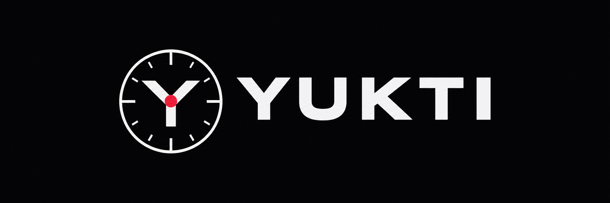
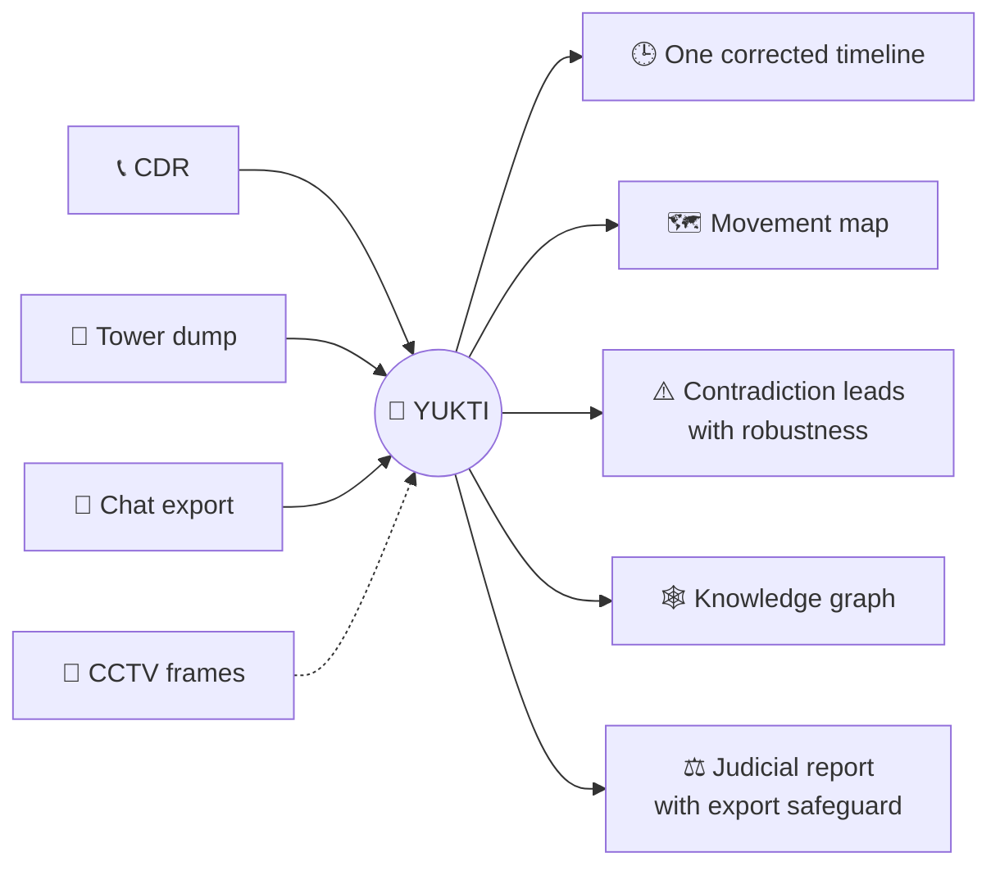
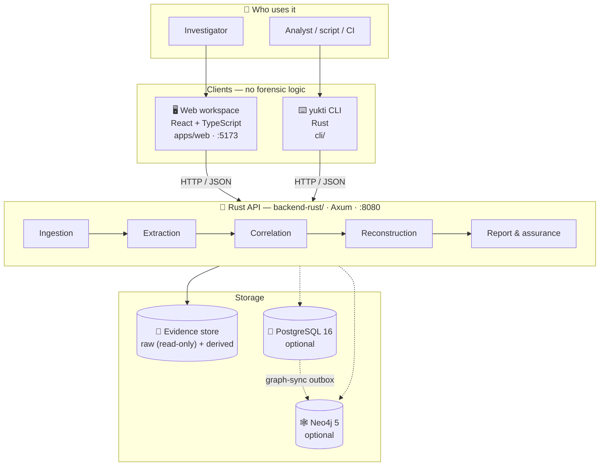
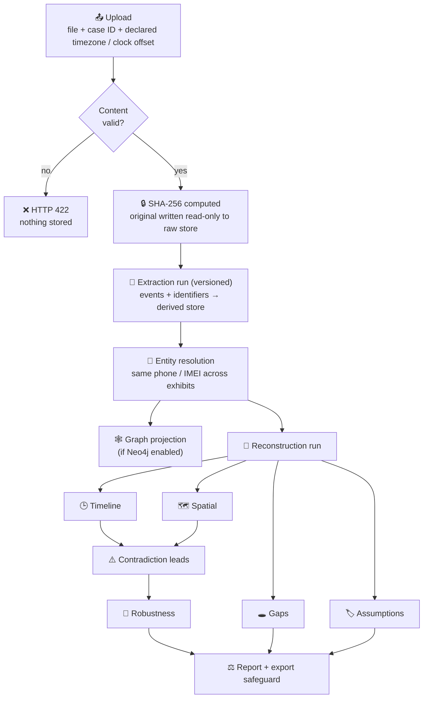
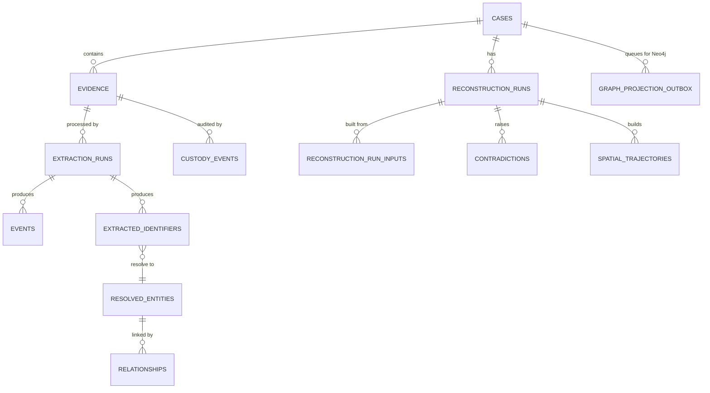
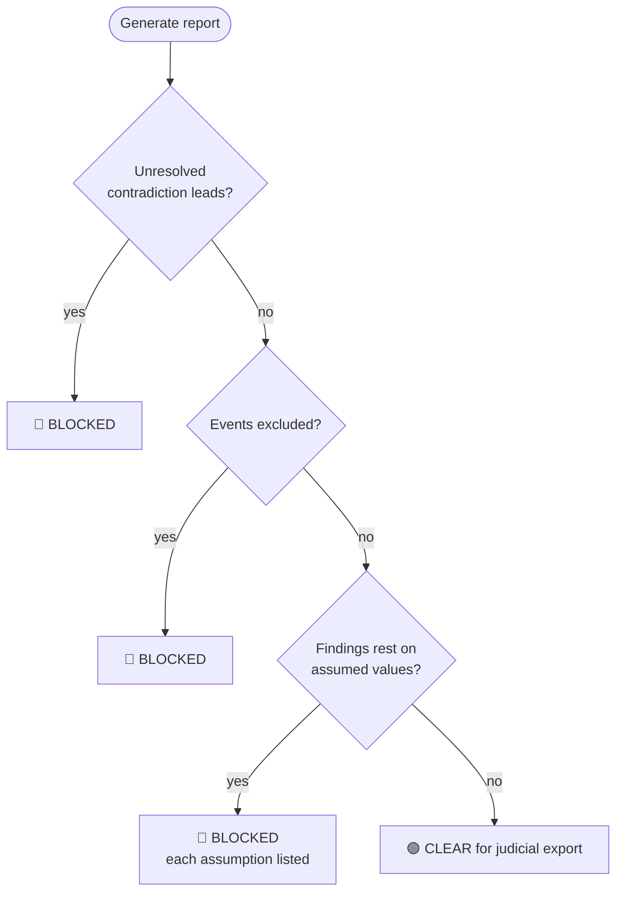
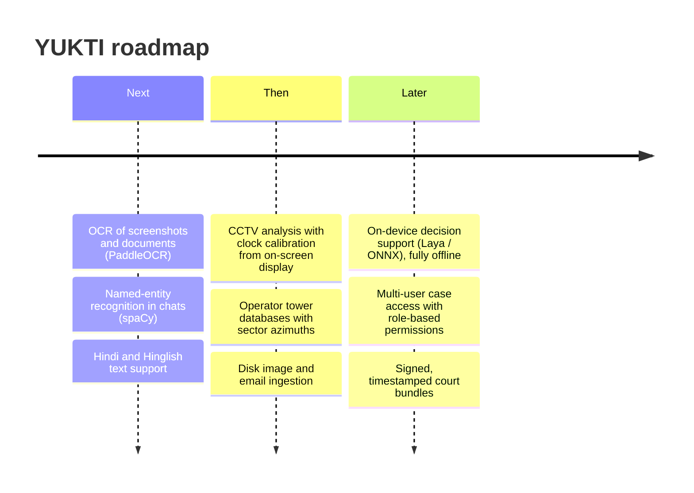

<div align="center">



# YUKTI — Project Documentation

### AI-Powered Digital Evidence Correlation and Crime Reconstruction Platform

**SUTRAM 2026 · ISEA–IGDTUW National Hackathon**

*Version 0.2 · November 2026 · All data in this document is synthetic*

</div>

---

## 📑 Contents

1. [Executive summary](#1-executive-summary)
2. [Problem statement](#2-problem-statement)
3. [Objectives](#3-objectives)
4. [Proposed solution](#4-proposed-solution)
5. [System architecture](#5-system-architecture)
6. [Methodology](#6-methodology)
7. [Implementation](#7-implementation)
8. [Technologies used](#8-technologies-used)
9. [Results](#9-results)
10. [Limitations](#10-limitations)
11. [Future scope](#11-future-scope)
12. [Conclusion](#12-conclusion)
13. [Appendix A — Glossary](#appendix-a--glossary)
14. [Appendix B — How to reproduce the results](#appendix-b--how-to-reproduce-the-results)
15. [Appendix C — API at a glance](#appendix-c--api-at-a-glance)

---

## 1. Executive summary

> **In one sentence:** YUKTI takes the scattered digital evidence of a case — phone call records, tower dumps, chat exports — and turns it into **one timeline, one map and one list of things that don't add up**, while showing exactly which piece of evidence every conclusion came from and how sure it can be.

Investigators today check each kind of evidence on its own and line up thousands of timestamps by hand. Different sources use different clocks and time zones, and a phone's "location" is usually just the tower it connected to. Mistakes are easy, and the one contradiction that matters is easy to miss.

YUKTI automates this. It:

- 🔒 **fingerprints** every file with SHA-256 the moment it arrives and never changes the original;
- 🔎 **extracts** events and identifiers (phone numbers, IMEI, IMSI, towers, timestamps);
- 🔗 **links** the same phone or person across different sources;
- 🕒 **rebuilds the timeline** on one corrected clock, with an honest *uncertainty window* around every time;
- 🗺️ **rebuilds movement** and flags journeys that are physically impossible;
- ⚖️ **measures how strong each contradiction is** — how wrong the clocks or locations would have to be before it disappears;
- 📄 **produces a judicial report** that refuses to be exported while any finding still rests on a guess.

What makes YUKTI different is its **forensic honesty**. It never silently guesses. Every value it had to assume is labelled, every contradiction is a *lead* for a person to check rather than a verdict, and similarity is never presented as proof of identity.

| | |
|---|---|
| **Delivered** | A Rust forensic API, a React investigator workspace, the `yukti` command-line tool, optional PostgreSQL + Neo4j storage |
| **Tests** | **1,236 automated tests, all passing**, run on every push by GitHub Actions |
| **Data** | Synthetic only. No real person, number or case appears anywhere in the project. |

---

## 2. Problem statement

### 2.1 The situation today

A typical case today has evidence from many sources:

| Source | Example | What it tells you |
|---|---|---|
| 📞 **Call detail records (CDRs)** | One operator's log of calls for a number | Who called whom, when, and through which tower |
| 📡 **Tower dumps** | Every number seen on one tower in a time range | Which phones were near a place |
| 💬 **Chat exports** | A WhatsApp `.txt` export from a seized phone | What was said, and when |
| 🎥 **CCTV** | Footage from a shop's DVR | What a camera saw, by the DVR's own clock |

Each source is usually analysed **separately**, often in spreadsheets. Bringing them together is slow and error-prone because:

1. **The clocks disagree.** A DVR may run two minutes fast. One operator logs in IST, another in UTC. A chat export shows minutes, not seconds.
2. **Locations are approximate.** A CDR gives a *tower*, not a position. The phone could be anywhere in that tower's coverage area, which may be several kilometres across.
3. **Volume hides the signal.** Thousands of rows make it easy to miss the one pair of events that cannot both be true.
4. **Conclusions lose their source.** By the time a finding reaches a report, the link back to the exact file, row and timestamp is often lost — and that link is what a court will ask for.
5. **Tools overstate certainty.** Many tools present an inferred location or a similarity score as if it were a fact.

### 2.2 Why it matters

In court, a defence lawyer will ask two questions about every digital finding:

> *"How do you know this evidence wasn't altered?"* and *"How sure are you — what if the clock or the location was wrong?"*

Today's manual process struggles to answer either one with precision.

### 2.3 Problem statement

> **Build a platform that ingests multimodal digital evidence, extracts and correlates the people, devices, places and events across sources, reconstructs the timeline and movements of a case, detects contradictions, and supports the investigator's decisions — while preserving forensic integrity, keeping every conclusion traceable to its evidence, and never presenting an inference as an observed fact.**

---

## 3. Objectives

| # | Objective | How we measure success | Achieved |
|---|---|---|---|
| O1 | **Preserve evidence integrity** | Every exhibit is SHA-256 hashed on arrival; originals are never modified; any later change is detected | ✅ |
| O2 | **Extract structured events** from CDRs, tower dumps and chat exports | Events and identifiers extracted with the source row/line kept | ✅ |
| O3 | **Correlate entities across sources** | The same phone in two exhibits resolves to one entity in a knowledge graph | ✅ |
| O4 | **Reconstruct one timeline** across different clocks and time zones | All events on one corrected UTC clock, each with an uncertainty window | ✅ |
| O5 | **Reconstruct movement** | Trajectories built and impossible journeys flagged | ✅ |
| O6 | **Detect contradictions honestly** | Conflicts raised as *leads* with an explanation and limitations, never as verdicts | ✅ |
| O7 | **Quantify how robust each lead is** | A numeric "breaking point" per lead, verified by recomputation | ✅ |
| O8 | **Keep every finding traceable** | Any finding can be traced to evidence ID, SHA-256 and source record | ✅ |
| O9 | **Produce a court-ready report** with a safety gate | Export is blocked while any finding rests on an assumption or unresolved lead | ✅ |
| O10 | **Make it usable** | A web workspace for investigators and a CLI for analysts and automation | ✅ |
| O11 | **Process CCTV and images** | Keyframe hand-off and frame provenance | 🟡 Partial |
| O12 | **On-device AI decision support** (OCR, NER, Laya / ONNX) | — | 🔜 Planned |

---

## 4. Proposed solution

### 4.1 The idea in one picture



### 4.2 Five design principles

These principles drive every feature in YUKTI. They come directly from how evidence is challenged in court.

| | Principle | What it means in practice |
|---|---|---|
| 1 | 🔒 **Evidence is immutable** | The original file is written once, read-only. All processing writes *new* records to a separate store. |
| 2 | 🔗 **Everything is traceable** | Every finding carries the evidence ID, the file's SHA-256 and the exact row or line it came from. |
| 3 | 👁️ **Observed ≠ inferred** | A time zone that wasn't declared, a clock offset that wasn't measured, a location taken from a tower — each is **labelled** as an assumption. Nothing is silently defaulted. |
| 4 | ⚠️ **Leads, not verdicts** | A contradiction is an *investigative lead* with a neutral explanation (for example: shared SIM, cloned SIM, clock error). It is never a finding of guilt or identity. |
| 5 | 🧮 **No fabricated confidence** | YUKTI shows no made-up probabilities or weights. Where it measures strength, it uses real quantities — minutes of clock error, kilometres of location error — that a person can check. |

### 4.3 What the investigator gets

| Feature | The question it answers |
|---|---|
| **Evidence intake** | *Is this exactly the file we seized?* |
| **Temporal reconstruction** | *In what order did things happen, on one clock?* |
| **Spatial reconstruction** | *Where was each device, and could it have moved that fast?* |
| **Contradiction leads** | *What in the evidence cannot all be true at once?* |
| **Breaking-point robustness** | *How wrong would we have to be for this lead to disappear?* |
| **Evidence gaps** | *What is missing, and what should we request next?* |
| **What-if simulation** | *What changes if the DVR was 3 minutes fast, or we exclude one exhibit?* |
| **Provenance** | *Which file, row and hash does this conclusion rest on?* |
| **Custody verification + case seal** | *Can we prove nothing changed since ingestion?* |
| **Defence challenge view** | *Where would a defence lawyer attack this case first?* |
| **Judicial report + Section 63 certificate draft** | *Is this ready for court, and if not, why not?* |

---

## 5. System architecture

### 5.1 Components

YUKTI is a **monorepo** with one engine and several ways to use it. All forensic logic lives in the Rust API. The web workspace and the CLI are *clients*: they only call the API over HTTP, so they can never disagree about a result.



| Component | Folder | Language | Role |
|---|---|---|---|
| **Rust API** | `backend-rust/` | Rust (Axum, SQLx) | The forensic engine: every pipeline stage, persistence and the HTTP API |
| **Web workspace** | `apps/web/` | TypeScript (React, Vite) | Investigator UI: intake, timeline, map, contradictions, graph, report |
| **`yukti` CLI** | `cli/` | Rust | Terminal client; also bundles the API for one-line installs |
| **Python service** | `backend/` | Python (FastAPI) | The original implementation, kept as the reference for some algorithms |
| **Decision service** | `decision-service/` | TypeScript (Node.js) | Reserved for future on-device AI inference (Laya / ONNX) |
| **Shared contracts** | `shared/` | JSON / docs | Canonical field names and enums for Case, Evidence, Entity, Event, Relationship |

### 5.2 Two ways to run

| | **Filesystem mode** (default) | **Database mode** (optional) |
|---|---|---|
| Needs | Nothing extra | PostgreSQL 16 and Neo4j 5 (via Docker) |
| Cases and evidence | JSON files on disk | PostgreSQL tables |
| Custody ledger | File hashes only | Append-only, **hash-chained** ledger |
| Knowledge graph | — | Neo4j, fed from PostgreSQL through an outbox |
| Best for | Demos, laptops, offline field use | Team deployments |

The same code runs in both modes. When a database is missing, the API says so (`/health/ready` reports `degraded`) instead of failing.

### 5.3 Data flow



**The golden rule:** arrows only point forward. No stage ever writes back to the original evidence.

### 5.4 Database design (database mode)

The PostgreSQL schema is created by versioned SQL migrations in `backend-rust/migrations/`. The main tables:



- **`evidence`** stores the SHA-256, size, MIME type, storage path, and the declared timezone and clock offset.
- **`extraction_runs`** are *versioned*: re-processing with a different timezone creates a new run with its own configuration hash. Only one run per exhibit is active; old runs are kept.
- **`custody_events`** is the append-only custody ledger. Each entry includes the hash of the previous entry, so tampering with history breaks the chain.
- **`graph_projection_outbox`** guarantees Neo4j receives every committed change (the *transactional outbox* pattern).
- Also: `validation_issues` (why a file or row was rejected) and `video_artifacts` (frame hashes and provenance).

---

## 6. Methodology

This section explains, step by step, how YUKTI turns files into findings. Each step names the module that does it.

### 6.1 Ingestion — *"Is this exactly the file we seized?"*

**Module:** `backend-rust/src/ingestion/`

1. **Validate the content.** The API checks what the file actually contains, not just its extension. A `.csv` that isn't a CDR is rejected with HTTP 422, and nothing is stored.
2. **Fingerprint it.** SHA-256 is computed over the exact bytes received.
3. **Store it read-only** in the raw evidence store. Processing never touches this copy again.
4. **Record the context** the investigator declares: the source's time zone (e.g. `Asia/Kolkata`) and any known clock offset. If none is declared, YUKTI records *"not declared"* — it never quietly assumes UTC.
5. **Return a receipt** with the hash. The CLI re-computes the SHA-256 on the investigator's own machine and compares; a mismatch stops with exit code `7`.

### 6.2 Extraction — *"What happened in this file?"*

**Module:** `backend-rust/src/extraction/`

| Source | Parser | What it produces |
|---|---|---|
| CDR / tower dump (`.csv`) | `cdr.rs` | One event per row: caller, receiver, time, duration, tower |
| Chat export (`.json`) | `chat.rs` | One event per message: sender, recipients, time, text |
| WhatsApp export (`.txt`, Android and iOS) | `whatsapp.rs` | One event per message, multi-line messages joined, system notices recognised |

- **Identifiers** (phone numbers, IMEI, IMSI) are found by pattern and normalised — `09811002233` and `+919811002233` become the same number. Each keeps its exact character position in the source.
- **Time precision is recorded, not invented.** A WhatsApp time with only minutes gets `MINUTE` precision. Day/month order (`03/04`) is proven from the data when possible; otherwise DD/MM is used and **labelled as assumed**.
- **Every extraction is a versioned run** with a configuration hash and a result hash, so the same input and settings always produce the same, checkable output.

### 6.3 Correlation — *"Is this the same phone in both files?"*

**Module:** `backend-rust/src/correlation/`, `backend-rust/src/graph/`

- **Entity resolution** merges identical normalised identifiers across exhibits into one entity (one phone number seen by two operators becomes one node).
- **Relationships** such as `COMMUNICATED_WITH` and `LOCATED_AT` are created from the events, each marked as *observed* (it's in the record) or *inferred*.
- The result is **projected into Neo4j** as a knowledge graph, where an investigator can ask *"who is connected to this number?"* or *"what is the shortest path between these two people?"*.
- **Privacy:** graph identifiers are derived with a keyed hash (HMAC), so raw phone numbers need not be exposed as graph keys.

### 6.4 Temporal reconstruction — *"In what order did things happen?"*

**Module:** `backend-rust/src/reconstruction/temporal.rs`

Every timestamp is read in its source's time zone, converted to UTC, and corrected by the source's clock offset. The offset is applied **exactly once**:

```text
corrected_UTC  =  parse(raw_timestamp, in source_timezone)  +  clock_offset
```

Then, instead of pretending a time is a perfect point, YUKTI turns it into an **uncertainty window** `[start, end)` based on how precise the source really is:

| Precision | Example raw time | Window |
|---|---|---|
| `EXACT_SECOND` | `21:45:12` | 1 second |
| `MINUTE` | `21:45` (WhatsApp) | the whole minute, `[21:45:00, 21:46:00)` |
| `HOUR` | `21h` | the whole hour |
| `DAY` | `10 Nov` | the whole day (in the source's local time) |
| `ESTIMATED` | "around 21:45" | ± 15 minutes by default (configurable) |

Additional rules:

- **Daylight-saving traps are rejected, not guessed.** A local time that occurs twice (fall-back) or never (spring-forward) is excluded with a clear reason.
- **Overlapping windows** are marked `CONCURRENT_UNCERTAIN` — YUKTI won't claim an order the evidence can't support.
- Events that can't be placed (bad timestamp, invalid time zone) are **excluded individually**, and the rest of the case still reconstructs.

An illustration of three sources placed on one corrected UTC clock:

```text
 corrected UTC  15:25        15:26        15:27        15:28        15:29        15:30
                  |            |            |            |            |            |
 Tower dump       ▌ Noida                                |            |            |
 WhatsApp                                                [████████████]            |
 Operator CDR                                                                      ▌ Saket

 ▌ = EXACT_SECOND (1-second window)      [████] = MINUTE (the whole minute)
```

Because every event carries its window, later steps can ask *"is there **any** moment in these windows that makes this possible?"* instead of trusting a single, falsely precise time.

### 6.5 Spatial reconstruction — *"Where was the device, and could it move that fast?"*

**Module:** `backend-rust/src/reconstruction/spatial.rs`

1. Each event's location comes from its tower. YUKTI looks up the tower's **representative centroid** and labels it `COORDINATES_INFERRED_FROM_TOWER_ID` — *"the device may have been anywhere in the cell"*.
2. Events for the same entity are joined into a **trajectory**, and consecutive points into **movement segments**.
3. The distance of each segment is the **great-circle (Haversine) distance** on the WGS-84 Earth.
4. The required speed uses the **most generous** reading of the time windows:

```text
maximum time available  =  end of window B  −  start of window A
minimum speed required  =  distance  ÷  maximum time available
```

If even this most generous speed exceeds the reference threshold (**180 km/h** by default, configurable), the segment is flagged.

### 6.6 Contradiction detection — *"What can't all be true at once?"*

**Module:** `backend-rust/src/reconstruction/contradictions.rs`

A contradiction lead is raised **only if no possible pair of moments** inside the two uncertainty windows allows the journey. This is called *existential feasibility*: YUKTI gives the evidence every benefit of the doubt before raising anything.

| Lead type | Meaning |
|---|---|
| `SPATIAL_TRANSIT_IMPOSSIBLE` | The distance can't be covered at the reference speed in the time available |
| `TEMPORAL_ACTIVITY_INFEASIBLE` | Two activities can't both happen in the available time |

Each lead includes:

- the two events and their evidence IDs and hashes;
- a **neutral explanation** listing innocent possibilities: shared or cloned SIM, dual-SIM device, clock error, data error;
- its **limitations**, including every assumption it rests on.

### 6.7 Breaking-point robustness — *"How wrong would we have to be?"*

**Module:** `backend-rust/src/reconstruction/robustness.rs`

This is YUKTI's answer to cross-examination. For each lead, it **solves for the exact amount of error** that would make the lead disappear:

| Dimension | Question | Notes |
|---|---|---|
| ⏱️ **Clock** | How far apart must the two devices' clocks be? | If both events come from **one exhibit**, they share one clock, so a constant offset cancels out — the lead *can't* be explained by clock error. |
| 📍 **Location** | How many kilometres of combined location error? | Matters because tower locations are approximate. |
| 🚗 **Threshold** | At what reference speed would the lead stop firing? | Reported for context only; it's the investigator's chosen benchmark. |

Each lead is then put in a **published triage band** — not a probability:

| Class | Rule | Meaning |
|---|---|---|
| ✕ **FRAGILE** | clock margin < 2 min **or** location margin < 2 km | An ordinary error could dissolve it. Treat as unconfirmed. |
| ◐ **SENSITIVE** | between the two | Holds against small errors. Corroborate the weaker assumption. |
| ✓ **ROBUST** | clock margin ≥ 15 min (or not applicable) **and** location margin ≥ 10 km | Survives every realistic error considered. Still a lead, not proof. |

**Every boundary is verified by recomputation:** YUKTI re-runs the same functions that raised the lead just inside and just outside each margin, and reports `boundary verified`.

### 6.8 Gaps, what-if and provenance

| Feature | Module | How it works |
|---|---|---|
| 🕳️ **Evidence gaps** | `reconstruction/gaps.rs` | Rule-based detection of what limits the case — e.g. `MISSING_CORROBORATION` (a lead rests on one exhibit), `UNCALIBRATED_CLOCK`, `EVENT_WITHOUT_COORDINATES` — each with severity, impact and a suggested next request (e.g. *"obtain the second operator's CDR"*). |
| 🔀 **What-if** | `reconstruction/scenario.rs` | Re-runs the reconstruction with changed assumptions (clock offsets, time zone, threshold, excluded exhibits) and shows the difference from the baseline. **Nothing is stored**, so the investigator's real view is never overwritten. |
| 🧾 **Provenance** | `reconstruction/traceability.rs` | Traces any finding back to its evidence IDs, SHA-256 hashes, extraction runs and source records. |

### 6.9 Assurance — custody, seal and report

**Modules:** `custody_audit.rs`, `reconstruction/report.rs`

- **Custody verification** re-hashes every stored exhibit *now* and compares with the hash recorded at ingestion. In database mode it also walks the hash-chained ledger.
- **Case seal:** one SHA-256 over all exhibits, computed from a published recipe, printed as text and a QR code. Anyone can recompute it from the exhibit list.

  ```text
  seal = SHA-256( "yukti-case-seal-v1\n" + case_id + "\n"
                  + for each exhibit, sorted by ID:  evidence_id + " " + sha256 + "\n" )
  ```

- **Judicial report** with a disclaimer, evidence inventory, timeline, leads, limitations and an **export safeguard**:



- **Section 63 certificate draft** (Bharatiya Sakshya Adhiniyam, 2023): the CLI fills in hashes, audit result and seal from recorded data, leaves everything YUKTI cannot know blank, and always marks it **DRAFT** for an officer and an expert to complete and sign.

---

## 7. Implementation

### 7.1 Repository structure

```text
.
├── backend-rust/            🦀 Rust API — the forensic engine
│   ├── src/ingestion/          validation, SHA-256, immutable storage
│   ├── src/extraction/         CDR, chat JSON, WhatsApp .txt, identifiers
│   ├── src/correlation/        entity resolution, relationships
│   ├── src/graph/              Neo4j projection, outbox, queries, privacy
│   ├── src/reconstruction/     temporal, spatial, contradictions, robustness,
│   │                           gaps, scenario (what-if), traceability, report, video
│   ├── src/persistence/        PostgreSQL repositories
│   ├── src/custody_audit.rs    re-hash, ledger check, case seal
│   ├── src/api/routes/         HTTP endpoints (thin; logic lives in the modules)
│   ├── migrations/             versioned SQL schema
│   └── tests/                  integration tests
├── apps/web/                🖥️ React investigator workspace + public site
├── cli/                     ⌨️ yukti command-line client and installers
├── backend/                 🐍 Python FastAPI reference implementation
├── decision-service/        🧠 Node.js service for future on-device AI
├── shared/                  📐 Canonical schemas and enums (team-governed)
├── data/synthetic/          🧪 Synthetic evidence with SHA-256 checksums
├── docs/                    📚 Architecture, API, decisions (ADRs), guides
└── docker-compose.graph.yml 🐳 PostgreSQL 16 + Neo4j 5
```

### 7.2 Backend (Rust API)

- **Layered design.** Route handlers in `api/routes/` only parse requests and format responses. All business logic is in the domain modules, which are plain Rust functions and are tested directly.
- **Typed errors.** One `AppError` type maps every failure to a clear HTTP status and JSON message. Errors are never swallowed.
- **Deterministic.** The same inputs and settings always produce the same output and the same result hash.
- **Two binaries.** `sutram-backend-rust` (the API) and `graph-sync` (moves queued changes from PostgreSQL into Neo4j).
- **About 30 HTTP endpoints** — see [Appendix C](#appendix-c--api-at-a-glance).

### 7.3 Web workspace

- **Public site** (`/`) explaining the product, and the **investigator workspace** (`/workspace`).
- The workspace sidebar follows the investigation: **Overview → 1 Evidence Intake → 2 Temporal → 3 Spatial → 4 Contradictions → 5 Video → 6 Judicial Report**, plus **Knowledge Graph** and **Evidence Correlation**.
- **Live or demo.** When the API is reachable, the workspace shows live data. When it isn't, it switches to built-in synthetic cases so the UI can always be explored — and a status indicator says which mode is active.
- Network calls live in `services/`, state in hooks, and the graph is drawn with **Cytoscape**. Uncertainty windows are drawn as hatched bands on the timeline.

### 7.4 `yukti` command-line tool

- 20+ commands covering the full workflow: `case`, `evidence`, `reconstruction`, `timeline`, `spatial`, `contradictions`, `gaps`, `provenance`, `robustness`, `challenge`, `whatif`, `ask`, `replay`, `custody verify`, `certificate`, `report`, `graph`, `doctor`, `demo`.
- **`yukti ask "…"`** answers plain-English questions **from the evidence only**, citing file, record and original timestamp — and refuses when the evidence doesn't answer. It uses fixed rules, **not a language model**, so it cannot make things up.
- **`--json`** on every command for scripting, and documented **exit codes** (e.g. `7` = integrity failure) for automation.
- **One-line installers** for macOS, Linux and Windows download a ready build with the API bundled inside, so a non-developer can run `yukti demo` in minutes.

### 7.5 Quality engineering

| Practice | How |
|---|---|
| **Automated tests** | `cargo test` (Rust), `vitest` (web, decision service), `pytest` (Python) |
| **Continuous integration** | GitHub Actions runs every suite on every push to `main` (`ci.yml`, `backend-rust.yml`, `cli.yml`) |
| **Releases** | `release.yml` builds the CLI for each platform |
| **Type safety** | Rust's compiler; TypeScript in `strict` mode; Python type hints |
| **Decisions recorded** | Architecture Decision Records in `docs/decisions/` |
| **Synthetic data only** | `data/synthetic/`, each file with a `.sha256` checksum |
| **Shared contracts** | `shared/` changes need agreement from the whole team |

### 7.6 Team

| Member | Area |
|---|---|
| **Member 1** — AI/ML & evidence intelligence | Extraction, identifiers, entity resolution, cross-source similarity |
| **Member 2** — Backend & data engineering | API, PostgreSQL, Neo4j, ingestion, graph persistence |
| **Member 3** — Frontend & visualisation | Investigator workspace, graph and timeline UI |
| **Member 4** — Forensic intelligence & integration | Reconstruction, contradiction detection, video, assurance |

---

## 8. Technologies used

| Layer | Technology | Why we chose it |
|---|---|---|
| **API language** | 🦀 **Rust** (2021 edition) | Memory safety without a garbage collector; predictable speed on large evidence files; strong types catch mistakes at compile time |
| **Web framework** | **Axum 0.7** + **Tokio** | Fast, async, and built on well-tested libraries |
| **Database access** | **SQLx 0.8** | SQL checked against types; versioned migrations |
| **Relational database** | 🐘 **PostgreSQL 16** | Reliable source of truth; transactions for the custody ledger and outbox |
| **Graph database** | 🕸️ **Neo4j 5.26** | Natural fit for "who is connected to whom" questions |
| **Cryptography** | **SHA-256** (`sha2`), **HMAC** | Industry-standard integrity fingerprints; privacy-safe identifiers |
| **Time** | **chrono** + **chrono-tz** (IANA database) | Correct time zones and daylight-saving handling |
| **Frontend** | ⚛️ **React 18** + **TypeScript 5** + **Vite 5** | Fast, typed, component-based UI |
| **Styling** | **Tailwind CSS 3** | Consistent design quickly |
| **Graph visualisation** | **Cytoscape.js 3** | Interactive, large-graph rendering |
| **CLI** | **clap 4** | Clear commands, help text and shell completion |
| **Reference backend** | 🐍 **Python 3.12**, **FastAPI**, **Pydantic 2** | Fast prototyping of algorithms before porting to Rust |
| **Decision service** | 🟩 **Node.js 22** + TypeScript | Keeps future AI inference isolated from the main API |
| **Testing** | `cargo test`, **Vitest**, **Testing Library**, **pytest** | One test runner per language |
| **DevOps** | 🐳 **Docker Compose**, **GitHub Actions** | One-command databases; tests on every push |
| **Diagrams & docs** | Mermaid, Markdown | Diagrams that live with the code |

The full list of libraries and versions is in [`REQUIREMENTS.md`](../REQUIREMENTS.md).

---

## 9. Results

### 9.1 Automated tests

All suites were run on **24 November 2026** on the `main` branch. **Every test passed.**

| Component | Test suites | Tests | Result |
|---|---|---:|---|
| 🦀 Rust API (`backend-rust`) | unit + 10 integration suites | **195** | ✅ all passed |
| ⌨️ `yukti` CLI (`cli`) | unit + 7 integration suites | **188** | ✅ all passed |
| 🖥️ Web workspace (`apps/web`) | 20 test files | **264** | ✅ all passed |
| 🐍 Python reference (`backend`) | pytest | **587** | ✅ all passed |
| 🧠 Decision service | vitest | **2** | ✅ all passed |
| | **Total** | **1,236** | ✅ **0 failures** |

What the Rust tests cover includes: real multipart upload → real extraction → reconstruction; byte-level integrity of stored evidence; a declared clock offset applied exactly once; daylight-saving gaps rejected; deterministic repeated runs; robustness boundaries; custody re-hashing; WhatsApp parsing; and video frame hand-off.

### 9.2 End-to-end demonstration on a synthetic case

We ran the full pipeline on the bundled synthetic case in `data/synthetic/demo/`, using the CLI against a fresh API (filesystem mode, no database).

**The evidence:**

| Exhibit | What it contains |
|---|---|
| `carrier_a_cdr.csv` | The suspect number's own operator: Saket (Delhi) at 21:00, Mumbai BKC at 21:30 and 23:10 IST |
| `carrier_b_tower_dump.csv` | A second operator's tower dump placing the same number in Noida Sector 62 at 20:55:10 IST |
| `whatsapp_chat.txt` | An Android WhatsApp export between the suspect and a courier |

**What YUKTI produced:**

| Measure | Result |
|---|---|
| Exhibits ingested and hashed | **3 / 3** — two `TABULAR_CSV`, one `CHAT_EXPORT` (auto-detected) |
| Timeline events | **8**, all strictly ordered, **0** excluded |
| Trajectories / movement segments | **7** / **3** (**2** exceed the 180 km/h reference) |
| Labelled assumptions | **20** across 8 events (time zone not declared on event ×8, clock offset not declared ×8, coordinates from tower ×4) |
| Contradiction leads | **7** → **5 ROBUST**, **1 SENSITIVE**, **1 FRAGILE** |
| Evidence gaps | **15** (3 high: missing corroboration · 12 medium: uncalibrated clocks, events without coordinates) |
| Custody verification | **3 / 3 VERIFIED_MATCH** — every stored file byte-identical to what was ingested |
| Case seal | `b49bc5e7…6ca6f4` (SHA-256, with QR code) |
| Judicial export | 🔴 **BLOCKED** — correctly, with the reasons listed |

**The two most instructive leads:**

| | Noida → Saket | Saket → Mumbai |
|---|---|---|
| Distance | 19.81 km | 1,141.02 km |
| Time available (most generous) | at most 4 min 51 s | at most 30 min 01 s |
| Sources | **two** operators → two clocks | **one** operator → one clock |
| Clock margin | **1 min 45 s** | **not applicable** (shared clock cancels out) |
| Location margin | **5.26 km** | **1,050.97 km** |
| Speed needed to dissolve | 245 km/h | 2,281 km/h |
| Class | ✕ **FRAGILE** | ✓ **ROBUST** |
| What it means | A two-minute disagreement between the operators' clocks could explain it. **Corroborate before relying on it.** | No realistic clock or tower error explains it. Still a lead (shared or cloned SIM, data error) — not proof. |

> **Why this matters.** A naive tool would report *two impossible journeys* and stop. YUKTI tells the investigator that one of them could vanish with an ordinary two-minute clock difference, while the other survives any realistic error — exactly the distinction a court will probe. We confirmed this independently with a what-if run: shifting the clock beyond the computed margin removes exactly the leads marked fragile.

### 9.3 Why the report is BLOCKED — and why that's correct

The demo data doesn't declare clock offsets, and its locations come from towers. YUKTI therefore refuses to clear the report and lists exactly what must be resolved. **This is the intended behaviour:** the system won't let an assumption reach a courtroom disguised as a fact. When an investigator declares the missing values and resolves each lead, the safeguard turns 🟢 CLEAR (this path is covered by automated tests).

### 9.4 Objectives met

| Objective | Status |
|---|---|
| O1–O10 (integrity, extraction, correlation, timeline, movement, contradictions, robustness, traceability, report, usability) | ✅ Implemented and tested |
| O11 (CCTV / video) | 🟡 Frame hand-off and frame provenance implemented; full video analysis planned |
| O12 (OCR, NER, on-device AI) | 🔜 Planned; service shell in place |

---

## 10. Limitations

We list these openly, in the same spirit as the product.

| Area | Limitation |
|---|---|
| **Evidence types** | CDRs, tower dumps and chat exports (JSON, WhatsApp `.txt`) are supported. Disk images, packet captures, emails and images are not yet. |
| **Video** | Keyframe hand-off and provenance exist, but no automatic recognition is performed on frames. |
| **AI features** | OCR (PaddleOCR), named-entity recognition (spaCy) and on-device inference (Laya / ONNX) are planned, not built. |
| **Tower locations** | Centroids come from a small built-in lookup table; real deployments need an operator tower database with sector azimuths. |
| **Clock calibration** | Declared clock offsets are applied as supplied and are not independently verified. |
| **Live databases** | Most persistence and graph tests use generated queries and mocks rather than a live PostgreSQL / Neo4j server. |
| **Contract decisions** | Some reconstruction contract decisions (DEC-001…DEC-007) are proposals awaiting formal team sign-off. |
| **Legal** | The Section 63 certificate is a drafting aid, not legal advice; its layout must be checked against the official text. |
| **Scale** | Tested on demonstration-sized cases; large-scale performance benchmarking is future work. |

---

## 11. Future scope



| Direction | What it adds |
|---|---|
| 🔤 **OCR and NER** | Pull phone numbers, names and places out of screenshots, scanned documents and free text |
| 🇮🇳 **Indian-language support** | Hindi and Hinglish chats; Indian number formats and operator conventions are already handled |
| 🎥 **Full CCTV intelligence** | Read the on-screen clock to calibrate the DVR automatically; link frames to timeline events |
| 📡 **Real tower data** | Operator databases with sector direction, shrinking location uncertainty from kilometres to hundreds of metres |
| 🧠 **On-device AI** | Run models locally through the decision service, so sensitive evidence never leaves the station |
| 👥 **Team deployment** | Logins, roles, audit of who viewed or changed what |
| ⚖️ **Court bundles** | Digitally signed, trusted-timestamped exports with the case seal embedded |
| 📈 **Scale** | Streaming ingestion and benchmarks on million-row tower dumps |

---

## 12. Conclusion

YUKTI shows that digital-evidence correlation can be **automated without becoming a black box**. It ingests evidence with cryptographic integrity, extracts and links what matters across sources, rebuilds a case's timeline and movements on one honest clock, and raises contradictions as leads — each with a measured breaking point, a neutral explanation and a full trail back to the original bytes.

Most importantly, YUKTI knows the difference between **what the evidence shows** and **what it had to assume**, and it refuses to let the second pass as the first. That is what makes its output useful to an investigator — and defensible in front of a judge.

---

## Appendix A — Glossary

| Term | Plain meaning |
|---|---|
| **CDR** (Call Detail Record) | An operator's log of calls: who, whom, when, how long, which tower |
| **Tower dump** | Every phone seen by a particular tower in a time range |
| **IMEI / IMSI** | The handset's serial number / the SIM card's subscriber number |
| **SHA-256** | A 64-character fingerprint of a file. Change one byte and the fingerprint changes completely. |
| **Chain of custody** | The record proving evidence wasn't altered from seizure to court |
| **Case seal** | One fingerprint that covers every exhibit in a case |
| **Uncertainty window** | The time range an event really could have happened in, given how precise the source is |
| **Clock offset** | How far a device's clock was from the true time |
| **Tower centroid** | A representative point for a tower's coverage area — not where the phone actually was |
| **Lead** | Something worth checking. Not a conclusion. |
| **Breaking point** | The amount of error that would make a lead disappear |
| **Observed vs. inferred** | Read directly from evidence vs. worked out or assumed by the system |
| **Knowledge graph** | A network of people, phones and places, with lines for how they're connected |
| **Export safeguard** | The rule that blocks a court report while it still rests on assumptions |

## Appendix B — How to reproduce the results

**Requirements:** see [`REQUIREMENTS.md`](../REQUIREMENTS.md). Run from the repository root.

```bash
# 1. All test suites
(cd backend-rust && cargo test)
(cd cli && cargo test)
(cd apps/web && npm ci && npm test)
(cd backend && uv sync --extra dev && uv run pytest)
(cd decision-service && npm ci && npm test)

# 2. The end-to-end demo
cd backend-rust && cargo run --bin sutram-backend-rust      # terminal 1, keep running
cd cli && cargo install --path .                            # terminal 2
yukti case create --title "Demo"                            # copy the UUID
export YUKTI_CASE=<uuid>
for f in carrier_a_cdr.csv carrier_b_tower_dump.csv whatsapp_chat.txt; do
  yukti evidence ingest data/synthetic/demo/$f --source-timezone Asia/Kolkata --auto-extract
done
yukti reconstruction run
yukti robustness
yukti gaps
yukti custody verify
yukti report
```

Or simply run **`yukti demo`** for a guided tour of the same case.

## Appendix C — API at a glance

Base URL: `http://127.0.0.1:8080`. Paths starting with `…/` are under `/api/v1/cases/:case_id` or `/api/v1/evidence/:evidence_id`.

| Area | Endpoint | Purpose |
|---|---|---|
| Health | `GET /health` · `GET /health/ready` | Is the API up; are the databases ready |
| Cases | `GET/POST /api/v1/cases` · `GET /api/v1/cases/:case_id` | List, create, read |
| Evidence | `POST /api/v1/evidence/upload` | Validate, hash, store (and optionally extract) |
| | `GET …/evidence` · `GET /api/v1/evidence/:evidence_id` | List, read receipt |
| Extraction | `POST …/extract` · `POST …/reprocess` · `GET …/extraction` · `GET …/extraction/runs` | Run, re-run (versioned), read |
| Reconstruction | `POST/GET …/reconstruction` · `GET …/timeline` · `…/spatial` · `…/contradictions` | Full run and each part |
| Traceability | `GET …/reconstruction/provenance` · `GET …/findings/:finding_id/provenance` | Finding → evidence |
| Gaps | `GET …/reconstruction/gaps` | What's missing |
| What-if | `POST …/reconstruction/simulate` | Re-run under other assumptions, nothing stored |
| Robustness | `GET …/robustness` | Breaking point of each lead |
| Custody | `GET …/custody/verify` | Re-hash, ledger check, case seal |
| Report | `GET …/report` | Judicial report and export status |
| Graph | `GET …/graph/summary` · `…/graph/entities/:id/neighbors` · `…/graph/path` | Knowledge-graph queries |

Full request and response formats: [Reconstruction API guide](api/reconstruction-api.md) · [OpenAPI specification](api/openapi.json).

---

<div align="center">

**YUKTI** · Built for SUTRAM 2026 · ISEA–IGDTUW National Hackathon

[README](../README.md) · [Requirements](../REQUIREMENTS.md) · [Documentation index](README.md)

</div>
