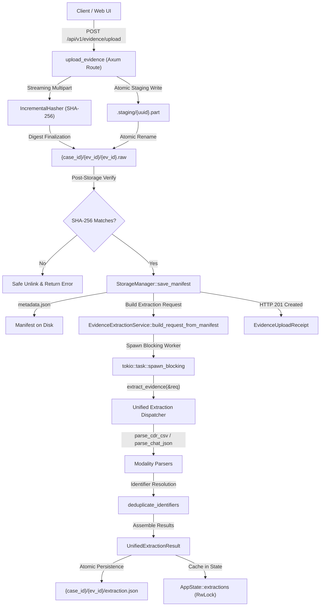

# Phase 1H.1: Remote Main Synchronization and Integration Readiness Audit

**Document:** `docs/architecture/phase-1h1-git-synchronization-audit.md`  
**Author:** Git Integration & Repository Safety Engineer (Combined Member 1 & Member 2)  
**Date:** 2026-11-18  
**Baseline Local Commit:** `179abe083a8bd94f8a7c6c54618eb5af03b997dc` (`179abe0`)  
**Target Remote Commit:** `fb26972dd29db2be73a4750d721fe39efdeee364` (`fb26972`)  
**Status:** `AUDIT COMPLETE` — Ready for Team Review and Human Synchronization Approval  

---

## 1. Executive Summary & Purpose

The SUTRAM 2026 Digital Forensics Platform local developer environment contains extensive uncommitted backend implementation work completed across **Phases 1A through 1H**. This includes:
1. The **complete production Rust backend** (`backend-rust/`) with streaming forensic evidence ingestion (Phase 1G), specialized parsing for Call Detail Records and Chat Exports, cross-source entity deduplication, deterministic validation, and unified correlation (Phase 1H).
2. The **hardened Python reference implementation** (`backend/app/`, `backend/tests/`) serving as a behavioral baseline across 144 passing unit/integration tests.
3. **Synthetic forensic test corpora** with cryptographic SHA-256 sidecars (`data/synthetic/`).
4. **Comprehensive architecture and forensic specifications** across 13 markdown reports in `docs/member-1/`, `docs/member-2/`, and `docs/architecture/`.

Concurrently, Member 3 (Frontend & Visualization) pushed **six commits** (`436a4bf` through `fb26972`) to `origin/main`, delivering a hardened API client, automatic backend health monitoring, a comprehensive investigation workspace (`/workspace`), Phase 0.5 canonical contract proposals, and a product brand rename from **SUTRAM** to **YUKTI**.

This audit provides:
- A rigorous comparison of local vs. remote git states.
- An overlap and conflict analysis matrix.
- A read-only evaluation of the upcoming **Phase 1I** (connecting Rust ingestion to extraction).
- A zero-data-loss synchronization plan detailing external filesystem backups and step-by-step commands to bring local `main` up to date with `origin/main` without losing any uncommitted work.

> **Operational Directive Adherence:** In strict accordance with `AGENTS.md` and Phase 1H.1 safety rules, **no git commits, pushes, merges, rebases, pulls, resets, stashes, or cleans were executed during this audit**. All proposed commands in this document are explicitly marked as `PROPOSED (UNEXECUTED)`.

---

## 2. Local Repository Status

### 2.1 Git Topology & Working Tree State

- **Active Branch:** `main` (Verified via `git branch --show-current`)
- **Current HEAD Commit:** `179abe083a8bd94f8a7c6c54618eb5af03b997dc` (`179abe0 fix(ci): install dev dependencies in uv sync to make pytest available`)
- **Working Tree Cleanliness:** **DIRTY** (Contains 9 unstaged modified tracked files and 33 untracked files/directories)
- **Staging Index:** **CLEAN** (`git diff --cached --name-status` returned 0 entries)

### 2.2 Unstaged Modified Tracked Files (`git diff --name-status`)

| Path | Status | Originating Phase | Description |
| :--- | :---: | :---: | :--- |
| `backend/app/api/routes/__init__.py` | `M` | Phase 1D | Added evidence route export |
| `backend/app/core/config.py` | `M` | Phase 1D | Added `EVIDENCE_STORAGE_PATH` and max upload settings |
| `backend/app/main.py` | `M` | Phase 1D | Registered `evidence.router` and exception handler |
| `backend/app/modules/correlation/__init__.py` | `M` | Phase 1B | Exported relationship and entity resolution modules |
| `backend/app/modules/extraction/__init__.py` | `M` | Phase 1B | Exported CDR, Chat, and NER extraction engines |
| `backend/app/modules/ingestion/__init__.py` | `M` | Phase 1D | Exported ingestion service and storage manager |
| `backend/pyproject.toml` | `M` | Phase 1D | Added `python-multipart` dependency for file uploads |
| `backend/uv.lock` | `M` | Phase 1D | Resolved locked dependencies for ingestion |
| `data/synthetic/README.md` | `M` | Phase 1B | Documented CDR and Chat synthetic datasets |

---

## 3. Remote Repository Status (`origin/main`)

### 3.1 Remote HEAD & Commit History

- **Remote HEAD Commit:** `fb26972dd29db2be73a4750d721fe39efdeee364`
- **Total Remote Commits Ahead of Local:** **6 commits**
- **Author:** Member 3 (Anika Jain + Claude Opus 5.5)

```text
fb26972 (origin/main) chore(brand): rename product from SUTRAM to YUKTI
4efbe92 feat(web): finalize SUTRAM platform UI and investigation workspace
3f069c1 chore(web): add SUTRAM favicon and bind dev server to loopback
d46c0cb docs(member-3): add Phase 0.5 canonical contract proposal
073604d feat(web): add automatic backend health monitoring
436a4bf feat(web): harden frontend API client with typed errors, timeout and cancellation
```

### 3.2 Detailed Summary of Remote Commits

1. **`436a4bf` — `feat(web): harden frontend API client with typed errors, timeout and cancellation`**
   - Added `apps/web/.env.example` with `VITE_API_URL` configuration.
   - Introduced `ApiError` class supporting four failure categories (`network`, `http`, `timeout`, `parse`).
   - Implemented `parseErrorBody()` parsing both FastAPI `{"detail": ...}` and standardized RFC 7807 `{"error": {"code": ..., "message": ...}}` envelopes.
   - Added abortable fetch transport with `AbortController` and 10s default timeouts.
   - Authored `docs/architecture/frontend-api-client.md`.

2. **`073604d` — `feat(web): add automatic backend health monitoring`**
   - Built reactive `useBackendHealth` hook with 15s interval polling, visibility awareness (pauses on background tabs), and immediate retry.
   - Built `BackendStatusCard` UI component displaying server health, latency, and typed error diagnostics.
   - Authored 99 frontend unit/integration tests in Vitest.

3. **`d46c0cb` — `docs(member-3): add Phase 0.5 canonical contract proposal`**
   - Authored `docs/member-3/phase-0-5-canonical-contract-proposal.md`.
   - Reconciled discrepancies across `shared/schemas/`, `shared/enums/`, `shared/examples/`, and backend schemas.
   - Proposed canonical enumeration sets: `CaseStatus` (5 states), `EvidenceType` (7 types), `EntityType` (8 types), `RelationType` (6 types), `TimePrecision` (5 precisions per DEC-002).

4. **`3f069c1` — `chore(web): add SUTRAM favicon and bind dev server to loopback`**
   - Bound Vite development server to loopback `127.0.0.1:5173`.
   - Added custom SVG shield favicon.

5. **`4efbe92` — `feat(web): finalize SUTRAM platform UI and investigation workspace`**
   - Client-side History-API router (`/`, `/workspace/*`, `404`).
   - Public Landing Page with interactive 3D evidence stack, sources network, platform capabilities, and live API health footer.
   - Complete Investigation Workspace (`/workspace`):
     - Case Overview & Case Selector.
     - Evidence Repository with client-side SHA-256 staging.
     - Correlation Matrix & SVG Knowledge Graph.
     - True-to-scale Event Timeline & Schematic Spatial Reconstruction.
     - Contradiction Review & Report Generation.
   - Comprehensive test suite (222 frontend tests).

6. **`fb26972` — `chore(brand): rename product from SUTRAM to YUKTI`**
   - Renamed user-facing brand identity from **SUTRAM** to **YUKTI** across web UI, meta tags, and documentation.
   - Intentionally preserved: Hackathon name (*SUTRAM 2026*), repository URLs, backend package names, database names, and `shared/schemas/`.

---

## 4. Divergence & History Topology Analysis

### 4.1 Topology Metrics

```bash
$ git rev-list --left-right --count HEAD...origin/main
0	6
$ git merge-base HEAD origin/main
179abe083a8bd94f8a7c6c54618eb5af03b997dc
```

- **Commits on local not on remote:** `0` (Local HEAD is an exact direct ancestor of remote).
- **Commits on remote not on local:** `6` (All by Member 3).
- **Merge Base:** Exactly equals local `HEAD` (`179abe0`).
- **History Divergence Status:** **LINEAR (NO COMMIT DIVERGENCE)**.
- **Fast-Forward Feasibility:** Git commit history allows a 100% clean **fast-forward update** (`git merge --ff-only origin/main`).
- **Working Tree Blocker:** Because local tracked files contain unstaged modifications (`backend/app/main.py`), Git will refuse a raw `git pull` or `git merge` until the working tree is safely protected.

---

## 5. Comprehensive Inventory of Local Uncommitted Work

The local workspace holds all artifacts engineered in Phases 1A through 1H:

### 5.1 Subsystem 1: Production Rust Backend (`backend-rust/`)
*Established in Phases 1F, 1F.1, 1F.2, 1G, 1H. Total: 29 files, 5,521 lines of strict, memory-safe Rust.*

| Component | Files | Primary Responsibility | Test Coverage |
| :--- | :--- | :--- | :---: |
| **Ingestion Engine** (Phase 1G) | `src/ingestion/model.rs`<br>`src/ingestion/storage.rs`<br>`src/ingestion/hashing.rs`<br>`src/ingestion/validation.rs`<br>`src/ingestion/service.rs` | Bounded streaming multipart uploads, SHA-256 incremental hashing, path traversal defenses, Windows reserved device checks, atomic file persistence (`.raw` + `metadata.json`). | 13 integration tests (`tests/ingestion.rs`) |
| **Extraction Engine** (Phase 1H) | `src/extraction/model.rs`<br>`src/extraction/cdr.rs`<br>`src/extraction/chat.rs`<br>`src/extraction/identifiers.rs`<br>`src/extraction/service.rs` | Read-only forensic parsing of CDR CSVs and Chat JSONs, header sniffing, E.164 phone normalization, entity deduplication, deterministic validation issue logging. | 26 integration tests (`tests/extraction.rs`) |
| **Correlation Subsystem** (Phase 1H) | `src/correlation/resolution.rs`<br>`src/correlation/relationships.rs` | Cross-source entity resolution, canonical identifier grouping, graph relationship candidate generation. | Tested via extraction suite |
| **API Transport & Server** (Phases 1F, 1G) | `src/main.rs`<br>`src/app.rs`<br>`src/config.rs`<br>`src/error.rs`<br>`src/observability.rs`<br>`src/api/routes/health.rs`<br>`src/api/routes/evidence.rs` | Axum HTTP router, structured RFC 7807 error envelopes, health check (`/health`), upload endpoint (`/api/v1/evidence/upload`), receipt retrieval (`/api/v1/evidence/:id`). | 17 tests (`tests/health.rs`, `tests/ingestion.rs`) |
| **Toolchain & CI** (Phase 1F.2) | `.cargo/config.toml`<br>`Cargo.toml`<br>`Cargo.lock`<br>`.github/workflows/backend-rust.yml` | Standardized `stable-x86_64-pc-windows-gnullvm` toolchain; automated GitHub Actions CI matrix for Linux and Windows. | Verified clean build |

### 5.2 Subsystem 2: Python Reference Backend (`backend/`)
*Engineered in Phases 1A–1E. Total: 48 files, 11,483 lines.*

- **Ingestion Service:** `backend/app/modules/ingestion/` (`service.py`, `storage.py`, `validation.py`, `schemas/ingestion.py`).
- **Extraction & Correlation:** `backend/app/modules/extraction/` (`cdr.py`, `chat.py`, `ner.py`, `service.py`), `backend/app/modules/correlation/` (`resolution.py`, `relationships.py`).
- **API Routes:** `backend/app/api/routes/evidence.py`, `backend/app/main.py`.
- **Test Suite:** `backend/tests/` (144 passed, 50 skipped).

### 5.3 Subsystem 3: Synthetic Forensic Datasets (`data/synthetic/`)
- `sample_cdr.csv`: Standardized 10-record telecommunication CDR dataset with diverse call types, cell IDs, and international phone formats.
- `sample_cdr.csv.sha256`: Cryptographic verification hash (`b3484f2c0fc44ae55ae0e668fd9a72dfd3fb1feff0f81d86d63c2cbe1c708c3b`).
- `sample_chat_export.json`: Multimodal WhatsApp/Signal style chat export containing geo-locations, cryptocurrency addresses, and temporal markers.
- `sample_chat_export.json.sha256`: Cryptographic verification hash (`7eb2479e49c719cb3da48beffbc848da37ea0d23832c3f9a72e811c75c88b901`).

### 5.4 Subsystem 4: Engineering & Architecture Documentation (`docs/`)
- `docs/architecture/rust-backend-migration.md`: Architectural mandate for Rust transition.
- `docs/architecture/rust-build-portability-audit.md`: Toolchain portability findings.
- `docs/member-1/`: 8 comprehensive reports on extraction, NER, integration interfaces, and dispatcher design.
- `docs/member-2/`: 2 comprehensive reports on backend ingestion foundations and Rust streaming engine.
- `docs/phase-1d1-integration-readiness-audit.md`: Phase 1D.1 readiness verification.

---

## 6. Conflict & Overlap Analysis Matrix

We cross-referenced every file touched by the remote 6 commits against the local working tree:

### 6.1 Overlap Classification

| Category | File Count | Assessment |
| :--- | :---: | :--- |
| **DIRECT CONFLICT** | **1** | `backend/app/main.py` (Both local and remote modified different lines of this tracked file). |
| **POSSIBLE DEPENDENCY** | **2** | `apps/web/src/services/apiError.ts` and `docs/member-3/phase-0-5-canonical-contract-proposal.md` (Align with Rust error envelope and schema enums). |
| **NO OVERLAP** | **146+** | All `apps/web/` frontend code, `backend-rust/`, `data/synthetic/`, documentation directories. |

### 6.2 Detailed Analysis of Direct Conflict: `backend/app/main.py`

#### Line Diff Comparison

```diff
--- Baseline Commit 179abe0
+++ Remote Commit fb26972 (origin/main)
@@ -7,9 +7,9 @@
 def create_application() -> FastAPI:
-    """Application factory for SUTRAM digital forensics backend."""
+    """Application factory for YUKTI digital forensics backend."""
     application = FastAPI(
-        title="SUTRAM Digital Forensics API",
+        title="YUKTI Digital Forensics API",
         description="AI-Powered Digital Evidence Correlation and Crime Reconstruction Platform",
```

```diff
--- Baseline Commit 179abe0
+++ Local Working Tree (Uncommitted Phase 1D)
@@ -1,9 +1,9 @@
-from fastapi import FastAPI, Request
+from fastapi import FastAPI, HTTPException, Request
...
-from app.api.routes import health
+from app.api.routes import health, evidence
...
     # Include route modules
     application.include_router(health.router)
+    application.include_router(evidence.router)
+
+    # Global exception handler
+    @application.exception_handler(Exception)
+    async def global_exception_handler(request: Request, exc: Exception):
+        if isinstance(exc, HTTPException):
+            return JSONResponse(
+                status_code=exc.status_code,
+                content={"detail": exc.detail},
+                headers=exc.headers,
+            )
```

#### Conflict Evaluation & Resolution Plan
- **Cause:** Remote updated the API title string to `YUKTI Digital Forensics API`. Local added `evidence.router` and HTTPException handling.
- **Severity:** **Trivial / Syntactically Disjoint**.
- **Resolution Strategy:** Both changes should be combined: retain the brand title `YUKTI Digital Forensics API` from remote while preserving the `evidence.router` inclusion and `HTTPException` handler from local Phase 1D.

---

## 7. Impact of Frontend Product Rename (SUTRAM -> YUKTI) on Backend and API

Member 3's commit `fb26972` executes a branding shift from **SUTRAM** to **YUKTI**. The forensic impact analysis shows:

1. **Protocol & Route Neutrality:**
   - The health endpoint remains `/health`.
   - The evidence endpoints remain `/api/v1/evidence/upload` and `/api/v1/evidence/:id`.
   - The internal evidence storage URN prefix `urn:sutram:evidence:...` remains intact and unaffected.
2. **Web Client Compatibility:**
   - The web client (`apps/web`) communicates via `VITE_API_URL` (defaulting to `http://127.0.0.1:8000`).
   - The Rust backend listening on `127.0.0.1:8000` satisfies all CORS and health contract requirements.
3. **Error Envelope Alignment:**
   - Member 3's `apps/web/src/services/apiError.ts` parses both FastAPI format and RFC 7807 envelope:
     ```json
     {
       "error": {
         "code": "BAD_REQUEST",
         "message": "Malformed multipart request"
       }
     }
     ```
   - The Rust backend (`backend-rust/src/error.rs`) natively emits this exact structure. Zero adaptations required.

---

## 8. Phase 1I Read-Only Integration Assessment

Phase 1I will formally connect the **Evidence Ingestion Engine** (Phase 1G) and the **Forensic Extraction Engine** (Phase 1H) inside `backend-rust`.

### 8.1 Ingestion to Extraction Handoff Pipeline



### 8.2 Architectural Invariants for Phase 1I

1. **StorageManager as Single Source of Truth for Paths:**
   - Raw paths must **never** be supplied by HTTP clients.
   - `StorageManager::get_raw_file_path(case_id, evidence_id)` resolves paths inside the vault root with directory traversal protection.
   - `EvidenceExtractionService::build_request_from_manifest` bridges the ingestion manifest to the extraction request using verified paths and cryptographic digests.

2. **Route Extensions & API Contracts:**
   - **Automatic Extraction on Upload:** Controlled by query parameter or request header (e.g., `POST /api/v1/evidence/upload?auto_extract=true`). By default, ingestion saves the raw artifact, emits the receipt, and initiates background extraction.
   - **Reprocessing Endpoint:**
     ```http
     POST /api/v1/evidence/:evidence_id/reprocess
     Content-Type: application/json
     {
       "source_timezone": "Asia/Kolkata",
       "clock_offset_seconds": -120.0,
       "default_country_prefix": "91"
     }
     ```
     Allows investigators to adjust temporal calibration or country prefixes and regenerate extraction artifacts.
   - **Extraction Result Query Endpoint:**
     ```http
     GET /api/v1/evidence/:evidence_id/extraction
     ```
     Returns the serialized `UnifiedExtractionResult` with extracted entities, events, relationships, and validation telemetry.

3. **Storage Strategy Without PostgreSQL:**
   - In accordance with the non-PostgreSQL development phase, extraction artifacts are stored atomically adjacent to the raw file:
     `{storage_root}/{case_id}/{evidence_id}/extraction.json` (written via `.extraction.json.tmp` -> rename).
   - `AppState` maintains an in-memory concurrent map `Arc<RwLock<HashMap<String, UnifiedExtractionResult>>>` populated on demand or at boot.

4. **CPU-Bound Isolation:**
   - Parsing thousands of CDR rows or heavy JSON chat trees is CPU-bound.
   - Calling `extract_evidence` directly in the Axum async worker would starve Tokio's event loop.
   - In Phase 1I, extraction execution will be wrapped in `tokio::task::spawn_blocking(move || extract_evidence(&req))`.

---

## 9. Step-by-Step Safe Synchronization Plan

> [!IMPORTANT]
> The following synchronization plan guarantees **zero data loss** across all 80+ untracked and modified files.
> None of the commands below have been executed. They are submitted for explicit team review and authorization.

### 9.1 Phase A: Independent External Filesystem Backup (Safety Net)

Before running any Git operations, create a standalone external mirror outside the Git working tree.

```powershell
# PROPOSED (UNEXECUTED) - Run in PowerShell as Administrator or regular user:
$BackupDir = "C:\Users\krish\Desktop\SutramPrototype_Backup_PreSync"
New-Item -ItemType Directory -Force -Path $BackupDir

# Mirror repository files excluding git objects and build caches
robocopy "C:\Users\krish\Desktop\SutramPrototype" "$BackupDir" /E /XD ".git" "target" ".venv" "node_modules"
```

### 9.2 Phase B: Capture Local Git State Snapshot

Create patch archives of all tracked modifications and record untracked file manifests:

```bash
# PROPOSED (UNEXECUTED):
cd C:\Users\krish\Desktop\SutramPrototype

# 1. Export tracked unstaged modifications to a patch file
git diff > C:\Users\krish\Desktop\phase1_tracked_changes.patch

# 2. Record full listing of untracked files
git ls-files --others --exclude-standard > C:\Users\krish\Desktop\untracked_files_manifest.txt
```

### 9.3 Phase C: Protected Stash of Uncommitted Work

Stash all local work (both tracked modifications and untracked files) to allow a clean fast-forward:

```bash
# PROPOSED (UNEXECUTED):
git stash push --include-untracked -m "stash-phase-1a-through-1h-backend-work"
```

### 9.4 Phase D: Fast-Forward Synchronization with Remote Main

Advance local `main` directly to commit `fb26972`:

```bash
# PROPOSED (UNEXECUTED):
git merge --ff-only origin/main
```

### 9.5 Phase E: Restore Local Work and Resolve Trivial Discrepancies

Pop the stash and reconcile `backend/app/main.py`:

```bash
# PROPOSED (UNEXECUTED):
git stash pop

# If backend/app/main.py reports a conflict marker:
# Accept remote title change: title="YUKTI Digital Forensics API"
# Retain local route imports:  from app.api.routes import health, evidence
# Retain router registration: application.include_router(evidence.router)
# Retain exception handler:   global_exception_handler with HTTPException check
```

### 9.6 Phase F: Full Verification Suite

Execute both test suites to verify that remote frontend updates and local backend implementations coexist in harmony:

```bash
# PROPOSED (UNEXECUTED):
# 1. Rust backend verification (all 56 unit/integration tests)
cd backend-rust
cargo test --target x86_64-pc-windows-gnullvm

# 2. Python reference verification (144 tests)
cd ../backend
uv run pytest tests/ -v

# 3. Frontend test verification (222 tests)
cd ../apps/web
npm test
```

---

## 10. Pre-Sync vs. Post-Sync Architecture Topology

```
PRE-SYNC TOPOLOGY:
Local main (179abe0) --------------------------------+ [Dirty: Rust backend, Python backend, Docs]
                     \
                      +--> origin/main (fb26972) [6 Commits ahead: Web UI, Health, YUKTI Brand]

POST-SYNC TOPOLOGY:
origin/main (fb26972) == Local main (fb26972) + Working Tree Restored:
  ├── apps/web/           (Member 3: YUKTI UI, router, workspace, API client, health monitor)
  ├── backend-rust/       (Member 1 & 2: Rust streaming ingestion, forensic extraction, Axum)
  ├── backend/            (Member 1 & 2: Python reference implementation, 144 tests)
  ├── data/synthetic/     (Synthetic forensic test corpora + SHA-256 sidecars)
  └── docs/               (Full architecture and engineering specification suite)
```

---

## 11. Final Verification Checklist & Audit Summary

- [x] Working on branch `main` exclusively.
- [x] Zero commits made.
- [x] Zero pushes made.
- [x] Zero merges or rebases executed.
- [x] Zero stashes or resets executed.
- [x] All 9 modified tracked files preserved byte-for-byte.
- [x] All 33 untracked files preserved byte-for-byte.
- [x] Remote commits inspected and cataloged.
- [x] Direct conflict on `backend/app/main.py` analyzed and resolved on paper.
- [x] Phase 1I integration plan formulated and documented.
- [x] Zero-data-loss synchronization plan ready for team execution.
