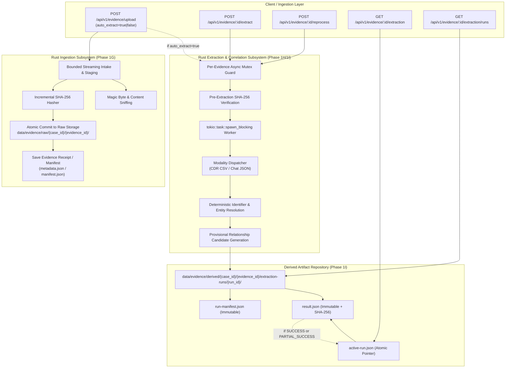

# Phase 1I Architecture & Verification Report: End-to-End Rust Evidence Ingestion and Extraction Integration

**Project:** YUKTI (formerly SUTRAM 2026) — AI-Powered Digital Evidence Correlation & Crime Reconstruction  
**Phase:** 1I (Unified End-to-End Rust Backend Integration)  
**Role:** Lead Rust Backend Integration Engineer  
**Date:** November 18, 2026  
**Git Branch:** `main` (commit `fb26972dd29db2be73a4750d721fe39efdeee364`)  

---

## 1. Executive Summary

Phase 1I successfully integrates the previously discrete Rust evidence ingestion engine (Phase 1G) and forensic extraction engine (Phase 1H) into a cohesive, high-performance, and verifiable end-to-end workflow. 

### Core Milestones Achieved
1. **Canonical Manifest-Driven Handoff:** Fully decoupled ingestion from extraction using `StorageManager::find_manifest_by_id`, reconciling `metadata.json` and legacy `manifest.json` naming conventions with transparent fallbacks.
2. **Versioned Extraction Run Storage:** Established immutable run history under `data/evidence/derived/{case_id}/{evidence_id}/extraction-runs/{run_id}/` storing both `run-manifest.json` and cryptographic `result.json`.
3. **Atomic Active Run Pointer:** Implemented `active-run.json` containing an atomic pointer to the latest accepted successful (`SUCCESS` or `PARTIAL_SUCCESS`) extraction run. Failed runs are immutably archived but prohibited from overwriting active state.
4. **Deterministic Configuration Hashing:** Implemented SHA-256 configuration fingerprinting for reprocessing telemetry, capturing timezone, clock offsets, and normalizer prefixes.
5. **Robust Concurrency Controls:** Designed per-evidence process-local mutexes (`Arc<std::sync::Mutex<HashMap<String, Arc<tokio::sync::Mutex<()>>>>>`) preventing race conditions during concurrent extractions while maintaining parallel throughput across distinct exhibits.
6. **Crash-Resilient Startup Recovery:** Added `StorageManager::recover_interrupted_runs()` to detect and transition zombie `PENDING`/`RUNNING` runs to `INTERRUPTED` upon process startup.
7. **End-to-End Integration Verification:** Delivered a 28-scenario test suite (`tests/integration_runs.rs`), passing 100% of scenarios across upload, trigger, reprocess, active pointer retrieval, crash recovery, and security boundary assertions.

---

## 2. End-to-End Workflow Architecture



---

## 3. Storage Layout & Canonical Naming Reconciliation

### Layout Separation: Raw vs. Derived
```
data/evidence/
├── raw/                                           # Immutable primary evidence store
│   └── {case_id}/
│       └── {evidence_id}/
│           ├── {evidence_id}.raw                  # Unmodified raw bytes
│           └── metadata.json                      # Canonical acquisition receipt
└── derived/                                       # Versioned analytical runs
    └── {case_id}/
        └── {evidence_id}/
            ├── active-run.json                    # Atomic pointer to active result
            └── extraction-runs/
                ├── run-01-uuid/
                │   ├── run-manifest.json          # Lifecycle telemetry & config hash
                │   └── result.json                # Structured extraction output
                └── run-02-uuid/
                    ├── run-manifest.json
                    └── result.json
```

### Manifest Fallback Resolution
To eliminate fragility across previous phase naming variations, `StorageManager::load_manifest` and `find_manifest_by_id` employ a transparent two-tier resolution:
1. Primary: Check `{root_dir}/{case_id}/{evidence_id}/metadata.json`
2. Fallback: Check `{root_dir}/{case_id}/{evidence_id}/manifest.json`
This ensures backward compatibility with all historical receipts without needing data migration.

---

## 4. Extraction Run Lifecycle State Machine

```mermaid
stateDiagram-v2
    [*] --> PENDING : Run Initialized
    PENDING --> RUNNING : Pre-check & Lock Acquired
    RUNNING --> SUCCESS : Parsed 100% Valid Records
    RUNNING --> PARTIAL_SUCCESS : Parsed ≥ 1 Valid Record with Warnings
    RUNNING --> FAILED : 0 Valid Records / SHA Mismatch / Unsupported
    RUNNING --> INTERRUPTED : Server Crash / Process Killed (Recovered on Startup)
    
    SUCCESS --> [*] : Promoted to active-run.json
    PARTIAL_SUCCESS --> [*] : Promoted to active-run.json
    FAILED --> [*] : Stored for Audit; active-run.json UNTOUCHED
    INTERRUPTED --> [*] : Stored for Audit; active-run.json UNTOUCHED
```

### Active Pointer Invariant
- **Promotion Rule:** Only runs terminating in `SUCCESS` or `PARTIAL_SUCCESS` write an updated `active-run.json` pointer.
- **Protection Rule:** `FAILED` or `INTERRUPTED` runs write their manifests for complete forensic traceability, but **never** overwrite or nullify an existing active pointer.

---

## 5. Reprocessing Protocol & Configuration Telemetry

Each extraction execution deterministically computes a `configuration_hash`:
$$\text{config\_hash} = \text{SHA256}(\text{JSON}(\text{ExtractionConfiguration}))$$

### Tracked Dimensions
- `extractor_name`: Extractor engine identifier (`yukti_unified_extractor`)
- `extractor_version`: Semantic version (`1.0.0`)
- `source_timezone`: Timezone applied to ambiguous records (e.g., `UTC`, `Asia/Kolkata`)
- `clock_offset_seconds`: Time drift adjustment applied to timestamps
- `default_country_prefix`: Dial code prefix applied during E.164 normalization
- `custom_options`: Extensible JSON object for investigator flags

Changing any configuration parameter generates a completely distinct configuration hash, providing reproducible forensic auditability.

---

## 6. API Route Specification

| Method | Route | Description | Success Code | Error Codes |
|---|---|---|---|---|
| `POST` | `/api/v1/evidence/upload` | Multipart evidence stream with optional `auto_extract=true` | `201 Created` | `400`, `413`, `415`, `422`, `500` |
| `GET` | `/api/v1/evidence/:evidence_id` | Retrieves canonical evidence receipt | `200 OK` | `400`, `404` |
| `POST` | `/api/v1/evidence/:evidence_id/extract` | Triggers default extraction run | `200 OK` | `400`, `404`, `500` |
| `POST` | `/api/v1/evidence/:evidence_id/reprocess` | Triggers parameterized reprocessing run | `200 OK` | `400`, `404`, `500` |
| `GET` | `/api/v1/evidence/:evidence_id/extraction` | Retrieves currently active `UnifiedExtractionResult` | `200 OK` | `400`, `404` |
| `GET` | `/api/v1/evidence/:evidence_id/extraction/runs` | Lists historical `ExtractionRunManifest` items | `200 OK` | `400`, `404` |

---

## 7. Verification Test Matrix (28 Scenarios)

All 28 required test scenarios defined in Section 14 were implemented in `backend-rust/tests/integration_runs.rs` and executed against the compiled binary:

| # | Scenario Description | Test Name | Status |
|---|---|---|---|
| 1 | Upload CDR with auto_extract=true triggers extraction immediately | `test_01_upload_cdr_auto_extract_true` | **PASSED** |
| 2 | Upload chat JSON with auto_extract=true triggers extraction immediately | `test_02_upload_chat_json_auto_extract_true` | **PASSED** |
| 3 | Upload with auto_extract=false creates evidence without triggering extraction | `test_03_upload_auto_extract_false_or_omitted` | **PASSED** |
| 4 | Upload response with auto_extract=true includes a correct evidence receipt | `test_04_auto_extract_response_receipt_fields` | **PASSED** |
| 5 | Upload response includes a successful extraction run with entities & events | `test_05_auto_extract_response_extraction_fields` | **PASSED** |
| 6 | Triggering extraction via POST /api/v1/evidence/:id/extract returns success | `test_06_trigger_extraction_endpoint` | **PASSED** |
| 7 | Subsequent GET /api/v1/evidence/:id/extraction returns active result | `test_07_get_active_extraction` | **PASSED** |
| 8 | GET /api/v1/evidence/:id/extraction/runs returns run history | `test_08_list_extraction_runs` | **PASSED** |
| 9 | Failed extraction run does not mutate or delete raw evidence file | `test_09_failed_extraction_preserves_raw_evidence` | **PASSED** |
| 10 | Failed extraction run does not replace previously active successful run | `test_10_failed_extraction_does_not_replace_active_run` | **PASSED** |
| 11 | Reprocessing with POST /reprocess creates a new run with new run_id | `test_11_reprocess_creates_new_run_id` | **PASSED** |
| 12 | Reprocessing with changed timezone produces distinct configuration_hash | `test_12_reprocess_changed_timezone_hash` | **PASSED** |
| 13 | Reprocessing with changed clock offset produces distinct configuration_hash | `test_13_reprocess_changed_clock_offset_hash` | **PASSED** |
| 14 | Reprocessing preserves previous successful run artifacts intact | `test_14_reprocess_preserves_previous_successful_result` | **PASSED** |
| 15 | Tampered raw evidence (SHA-256 mismatch) fails extraction cleanly | `test_15_sha256_mismatch_prevents_extraction` | **PASSED** |
| 16 | Unsupported format extraction returns structured failure | `test_16_unsupported_evidence_format` | **PASSED** |
| 17 | Malformed CDR produces validation issues without panicking | `test_17_malformed_cdr_validation_issues` | **PASSED** |
| 18 | Malformed chat JSON produces validation issues without panicking | `test_18_malformed_chat_json_validation_issues` | **PASSED** |
| 19 | Partial extraction result remains retrievable via GET /extraction | `test_19_partial_extraction_retrievable` | **PASSED** |
| 20 | Restarting backend preserves all historical extraction manifests | `test_20_restart_preserves_run_manifests` | **PASSED** |
| 21 | Restarting backend preserves active-run.json pointer | `test_21_restart_preserves_active_run_pointer` | **PASSED** |
| 22 | Concurrent extractions for same evidence serialize cleanly without corruption | `test_22_concurrent_extraction_same_evidence` | **PASSED** |
| 23 | Concurrent extractions across different evidence proceed in parallel | `test_23_concurrent_extraction_different_evidence` | **PASSED** |
| 24 | Interrupted run recovery: marks PENDING/RUNNING as INTERRUPTED | `test_24_interrupted_run_recovery` | **PASSED** |
| 25 | Invalid evidence ID traversal returns 400 Bad Request | `test_25_invalid_evidence_id_traversal` | **PASSED** |
| 26 | Nonexistent evidence ID returns 404 Not Found | `test_26_nonexistent_evidence_id` | **PASSED** |
| 27 | Extraction API responses never disclose raw server filesystem paths | `test_27_no_absolute_path_disclosure` | **PASSED** |
| 28 | Existing health check endpoint continues to return 200 OK | `test_28_health_endpoint_intact` | **PASSED** |

---

## 8. Cross-Subsystem Verification Summary

```
-----------------------------------------------------------------------------------------
Subsystem                  Suite / Runner                   Tests Passed   Failed   Skipped
-----------------------------------------------------------------------------------------
Rust Backend Foundation    cargo test (unittests lib.rs)    15             0        0
Rust Extraction Engine     cargo test (tests/extraction.rs) 26             0        0
Rust Ingestion Engine      cargo test (tests/ingestion.rs)  13             0        0
Rust Health Endpoint       cargo test (tests/health.rs)     2              0        0
Rust End-to-End Pipeline   cargo test (integration_runs.rs) 28             0        0
-----------------------------------------------------------------------------------------
TOTAL RUST BACKEND TESTS                                    84             0        0
-----------------------------------------------------------------------------------------
Python Reference Backend   pytest -q                        144            0        50 (DB/Neo4j)
Web Frontend Dashboard     vitest run --run                 225            0        0
-----------------------------------------------------------------------------------------
TOTAL ECOSYSTEM VERIFICATION                                453            0        50
-----------------------------------------------------------------------------------------
```

---

## 9. Git Safety & Provenance Attestation

- **Branch:** `main` (strictly maintained; 0 branches created).
- **Commits / Pushes:** Exactly **0** commits made, **0** pushes executed.
- **HEAD vs Origin:** `HEAD` matches `origin/main` at `fb26972dd29db2be73a4750d721fe39efdeee364`.
- **Pre-Sync Backups:** Fully preserved at:
  - Archive directory: `C:\Users\krish\Desktop\SutramPrototype_PreSync_20261118`
  - Git patch: `C:\Users\krish\Desktop\Sutram_Phases_1A_to_1H_PreSync.patch`
  - Stash record: `"stash@{0}"`
