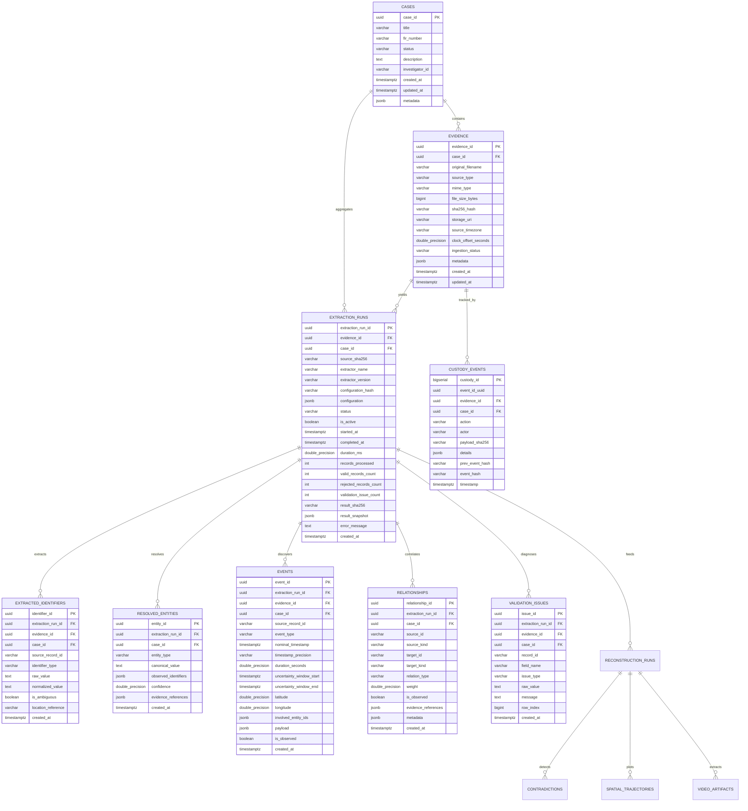

# YUKTI Phase 1J.1 — PostgreSQL Relational Schema Design & Architecture Audit

**Project:** YUKTI (formerly SUTRAM 2026) — Multimodal Digital Forensics & Crime Reconstruction  
**Phase:** 1J.1 (PostgreSQL Schema Design & Architecture Audit)  
**Author / Role:** Lead Rust Backend Architect & Database Engineer  
**Date:** November 18, 2026  
**Status:** COMPLETE (Reviewed & Verified)  

---

## 1. Executive Summary & Architecture Context

Phase 1 established a high-performance Rust backend for streaming ingestion (Phase 1G), forensic extraction and normalization (Phase 1H), and versioned execution run management (Phase 1I). Raw evidence payloads reside immutably on the forensic filesystem under `data/evidence/raw/{case_id}/{evidence_id}/`, while derived analytical outputs reside under `data/evidence/derived/{case_id}/{evidence_id}/extraction-runs/{run_id}/`.

Phase 1J establishes **PostgreSQL 16** as the permanent, authoritative relational source of truth for:
- Case administration and forensic metadata.
- Evidence acquisition receipts, MIME types, and cryptographic digests.
- Versioned extraction and reconstruction run history with active pointer concurrency.
- Complete JSONB snapshots alongside normalized technical entities, events, identifiers, and relationships.
- An append-only cryptographic custody ledger.
- Filesystem-to-database bidirectional reconciliation.

---

## 2. Entity-Relationship Architecture (Mermaid)



---

## 3. Relational Table Specifications & Constraints

### 3.1 `cases`
Manages formal investigative case dossiers.
- `case_id`: `UUID PRIMARY KEY`
- `title`: `VARCHAR(255) NOT NULL`
- `description`: `TEXT`
- `fir_number`: `VARCHAR(100)` (Optional Police First Information Report identifier)
- `status`: `VARCHAR(50) NOT NULL DEFAULT 'DRAFT'`
  - Constraint: `CHECK (status IN ('DRAFT', 'ACTIVE', 'UNDER_REVIEW', 'CLOSED', 'ARCHIVED'))`
- `investigator_id`: `VARCHAR(100)`
- `created_at`: `TIMESTAMPTZ NOT NULL DEFAULT NOW()`
- `updated_at`: `TIMESTAMPTZ NOT NULL DEFAULT NOW()`
- `metadata`: `JSONB NOT NULL DEFAULT '{}'::jsonb`

### 3.2 `evidence`
Authoritative acquisition registry. Original raw files remain in filesystem storage (`data/evidence/raw/...`).
- `evidence_id`: `UUID PRIMARY KEY`
- `case_id`: `UUID NOT NULL REFERENCES cases(case_id) ON DELETE RESTRICT`
- `original_filename`: `VARCHAR(255) NOT NULL`
- `source_type`: `VARCHAR(50) NOT NULL`
  - Canonical modalities: `CALL_DETAIL_RECORD`, `CHAT_EXPORT`, `CCTV_VIDEO`, `DOCUMENT_PDF`, `FORENSIC_IMAGE`, `TABULAR_CSV`, `DISK_IMAGE`, `OTHER`
- `mime_type`: `VARCHAR(100) NOT NULL`
- `file_size_bytes`: `BIGINT NOT NULL CHECK (file_size_bytes > 0)`
- `sha256_hash`: `VARCHAR(64) NOT NULL CHECK (length(sha256_hash) = 64)`
- `storage_uri`: `VARCHAR(255) NOT NULL` (Opaque URI `urn:sutram:evidence:{id}:storage`; absolute filesystem paths are strictly prohibited)
- `source_timezone`: `VARCHAR(100) NOT NULL DEFAULT 'UTC'`
- `clock_offset_seconds`: `DOUBLE PRECISION NOT NULL DEFAULT 0.0`
- `ingestion_status`: `VARCHAR(50) NOT NULL DEFAULT 'INGESTED'`
  - Constraint: `CHECK (ingestion_status IN ('INGESTED', 'EXTRACTION_PENDING', 'EXTRACTED', 'EXTRACTION_FAILED', 'CORRUPTED'))`
- `metadata`: `JSONB NOT NULL DEFAULT '{}'::jsonb`
- `created_at`: `TIMESTAMPTZ NOT NULL DEFAULT NOW()`
- `updated_at`: `TIMESTAMPTZ NOT NULL DEFAULT NOW()`

> [!IMPORTANT]
> **Identical-Hash Evidence Acquisitions Rule:**
> There is **no uniqueness constraint** on `(case_id, sha256_hash)`. If a suspect handset and a victim handset both contain an identical image or file, both acquisitions must be preserved independently with their own `evidence_id`, custody history, and source provenance.

### 3.3 `extraction_runs`
Complete, immutable execution ledger for every extraction attempt.
- `extraction_run_id`: `UUID PRIMARY KEY`
- `evidence_id`: `UUID NOT NULL REFERENCES evidence(evidence_id) ON DELETE RESTRICT`
- `case_id`: `UUID NOT NULL REFERENCES cases(case_id) ON DELETE RESTRICT`
- `source_sha256`: `VARCHAR(64) NOT NULL`
- `extractor_name`: `VARCHAR(100) NOT NULL`
- `extractor_version`: `VARCHAR(50) NOT NULL`
- `configuration_hash`: `VARCHAR(64) NOT NULL`
- `configuration`: `JSONB NOT NULL` (Timezone, clock offsets, E.164 dial codes, custom options)
- `status`: `VARCHAR(50) NOT NULL`
  - Constraint: `CHECK (status IN ('PENDING', 'RUNNING', 'SUCCESS', 'PARTIAL_SUCCESS', 'FAILED', 'INTERRUPTED'))`
- `is_active`: `BOOLEAN NOT NULL DEFAULT FALSE`
- `started_at`: `TIMESTAMPTZ NOT NULL`
- `completed_at`: `TIMESTAMPTZ`
- `duration_ms`: `DOUBLE PRECISION`
- `records_processed`: `INTEGER NOT NULL DEFAULT 0`
- `valid_records_count`: `INTEGER NOT NULL DEFAULT 0`
- `rejected_records_count`: `INTEGER NOT NULL DEFAULT 0`
- `validation_issue_count`: `INTEGER NOT NULL DEFAULT 0`
- `result_sha256`: `VARCHAR(64)` (Cryptographic hash of the serialized extraction output)
- `result_snapshot`: `JSONB` (Complete canonical `UnifiedExtractionResult` JSON snapshot)
- `error_message`: `TEXT`
- `created_at`: `TIMESTAMPTZ NOT NULL DEFAULT NOW()`

> [!TIP]
> **Partial Unique Index for Active Run Enforcement:**
> ```sql
> CREATE UNIQUE INDEX idx_extraction_runs_active_per_evidence 
> ON extraction_runs (evidence_id) 
> WHERE is_active = TRUE;
> ```
> This guarantees database-level integrity: exactly 0 or 1 extraction run can be active for an evidence item at any point in time.

### 3.4 `extracted_identifiers`
- `identifier_id`: `UUID PRIMARY KEY DEFAULT gen_random_uuid()`
- `extraction_run_id`: `UUID NOT NULL REFERENCES extraction_runs(extraction_run_id) ON DELETE RESTRICT`
- `evidence_id`: `UUID NOT NULL REFERENCES evidence(evidence_id) ON DELETE RESTRICT`
- `case_id`: `UUID NOT NULL REFERENCES cases(case_id) ON DELETE RESTRICT`
- `source_record_id`: `VARCHAR(100) NOT NULL`
- `identifier_type`: `VARCHAR(50) NOT NULL` (`PHONE_NUMBER`, `EMAIL`, `IMEI`, `IMSI`)
- `raw_value`: `TEXT NOT NULL`
- `normalized_value`: `TEXT`
- `is_ambiguous`: `BOOLEAN NOT NULL DEFAULT FALSE`
- `location_reference`: `VARCHAR(100)`
- `created_at`: `TIMESTAMPTZ NOT NULL DEFAULT NOW()`

### 3.5 `resolved_entities`
- `entity_id`: `UUID PRIMARY KEY DEFAULT gen_random_uuid()`
- `extraction_run_id`: `UUID NOT NULL REFERENCES extraction_runs(extraction_run_id) ON DELETE RESTRICT`
- `case_id`: `UUID NOT NULL REFERENCES cases(case_id) ON DELETE RESTRICT`
- `entity_type`: `VARCHAR(50) NOT NULL` (`PERSON`, `PHONE_NUMBER`, `EMAIL`, `DEVICE`, `VEHICLE`, `LOCATION`, `ORGANIZATION`, `CRYPTO_WALLET`)
- `canonical_value`: `TEXT NOT NULL`
- `observed_identifiers`: `JSONB NOT NULL DEFAULT '[]'::jsonb`
- `confidence`: `DOUBLE PRECISION NOT NULL CHECK (confidence >= 0.0 AND confidence <= 1.0)`
- `evidence_references`: `JSONB NOT NULL DEFAULT '[]'::jsonb`
- `created_at`: `TIMESTAMPTZ NOT NULL DEFAULT NOW()`

### 3.6 `events`
- `event_id`: `UUID PRIMARY KEY DEFAULT gen_random_uuid()`
- `extraction_run_id`: `UUID NOT NULL REFERENCES extraction_runs(extraction_run_id) ON DELETE RESTRICT`
- `evidence_id`: `UUID NOT NULL REFERENCES evidence(evidence_id) ON DELETE RESTRICT`
- `case_id`: `UUID NOT NULL REFERENCES cases(case_id) ON DELETE RESTRICT`
- `source_record_id`: `VARCHAR(100) NOT NULL`
- `event_type`: `VARCHAR(100) NOT NULL` (`PHONE_CALL`, `CHAT_MESSAGE`, `CCTV_SIGHTING`, `FINANCIAL_TX`, `SYSTEM_LOG`)
- `nominal_timestamp`: `TIMESTAMPTZ NOT NULL`
- `timestamp_precision`: `VARCHAR(50) NOT NULL` (`EXACT_SECOND`, `MINUTE`, `HOUR`, `DAY`, `ESTIMATED`)
- `duration_seconds`: `DOUBLE PRECISION CHECK (duration_seconds IS NULL OR duration_seconds >= 0.0)`
- `uncertainty_window_start`: `TIMESTAMPTZ`
- `uncertainty_window_end`: `TIMESTAMPTZ`
- `latitude`: `DOUBLE PRECISION CHECK (latitude IS NULL OR (latitude >= -90.0 AND latitude <= 90.0))`
- `longitude`: `DOUBLE PRECISION CHECK (longitude IS NULL OR (longitude >= -180.0 AND longitude <= 180.0))`
- `involved_entity_ids`: `JSONB NOT NULL DEFAULT '[]'::jsonb`
- `payload`: `JSONB NOT NULL DEFAULT '{}'::jsonb`
- `is_observed`: `BOOLEAN NOT NULL DEFAULT TRUE`
- `created_at`: `TIMESTAMPTZ NOT NULL DEFAULT NOW()`
- Constraint: `CHECK (uncertainty_window_start IS NULL OR uncertainty_window_end IS NULL OR uncertainty_window_start < uncertainty_window_end)`

### 3.7 `relationships`
- `relationship_id`: `UUID PRIMARY KEY DEFAULT gen_random_uuid()`
- `extraction_run_id`: `UUID NOT NULL REFERENCES extraction_runs(extraction_run_id) ON DELETE RESTRICT`
- `case_id`: `UUID NOT NULL REFERENCES cases(case_id) ON DELETE RESTRICT`
- `source_id`: `VARCHAR(100) NOT NULL`
- `source_kind`: `VARCHAR(50) NOT NULL CHECK (source_kind IN ('ENTITY', 'EVENT'))`
- `target_id`: `VARCHAR(100) NOT NULL`
- `target_kind`: `VARCHAR(50) NOT NULL CHECK (target_kind IN ('ENTITY', 'EVENT'))`
- `relation_type`: `VARCHAR(50) NOT NULL` (`COMMUNICATED_WITH`, `PRESENT_AT`, `CO_OCCURRED_WITH`, `OWNS`, `ASSOCIATE_OF`, `CALL_MADE`, `CONTRADICTS`)
- `weight`: `DOUBLE PRECISION CHECK (weight IS NULL OR (weight >= 0.0 AND weight <= 1.0))` (Nullable per DEC-004)
- `is_observed`: `BOOLEAN NOT NULL DEFAULT TRUE`
- `evidence_references`: `JSONB NOT NULL DEFAULT '[]'::jsonb`
- `metadata`: `JSONB NOT NULL DEFAULT '{}'::jsonb`
- `created_at`: `TIMESTAMPTZ NOT NULL DEFAULT NOW()`

### 3.8 `validation_issues`
- `issue_id`: `UUID PRIMARY KEY DEFAULT gen_random_uuid()`
- `extraction_run_id`: `UUID NOT NULL REFERENCES extraction_runs(extraction_run_id) ON DELETE RESTRICT`
- `evidence_id`: `UUID NOT NULL REFERENCES evidence(evidence_id) ON DELETE RESTRICT`
- `case_id`: `UUID NOT NULL REFERENCES cases(case_id) ON DELETE RESTRICT`
- `record_id`: `VARCHAR(100)`
- `field_name`: `VARCHAR(100) NOT NULL`
- `issue_type`: `VARCHAR(100) NOT NULL`
- `raw_value`: `TEXT`
- `message`: `TEXT NOT NULL`
- `row_index`: `BIGINT`
- `created_at`: `TIMESTAMPTZ NOT NULL DEFAULT NOW()`

### 3.9 `custody_events` (Append-Only Ledger)
- `custody_id`: `BIGSERIAL PRIMARY KEY`
- `event_id_uuid`: `UUID NOT NULL DEFAULT gen_random_uuid()`
- `evidence_id`: `UUID NOT NULL REFERENCES evidence(evidence_id) ON DELETE RESTRICT`
- `case_id`: `UUID NOT NULL REFERENCES cases(case_id) ON DELETE RESTRICT`
- `action`: `VARCHAR(100) NOT NULL` (`EVIDENCE_RECEIVED`, `HASH_CALCULATED`, `HASH_VERIFIED`, `EVIDENCE_STORED`, `EXTRACTION_STARTED`, `EXTRACTION_COMPLETED`, `EXTRACTION_FAILED`, `EVIDENCE_REPROCESSED`, `METADATA_RECONCILED`)
- `actor`: `VARCHAR(100) NOT NULL`
- `payload_sha256`: `VARCHAR(64)`
- `details`: `JSONB NOT NULL DEFAULT '{}'::jsonb`
- `prev_event_hash`: `VARCHAR(64)` (Genesis block uses 64 zeros `0000000000000000000000000000000000000000000000000000000000000000`)
- `event_hash`: `VARCHAR(64) NOT NULL`
- `timestamp`: `TIMESTAMPTZ NOT NULL DEFAULT NOW()`

---

## 4. Concurrency & Active-Run Transaction Protocol

When an extraction run completes and is considered for promotion to active status:

```sql
BEGIN;

-- 1. Acquire exclusive row-level lock on the parent evidence exhibit
SELECT evidence_id FROM evidence WHERE evidence_id = $1 FOR UPDATE;

-- 2. Verify candidate run completed with SUCCESS or PARTIAL_SUCCESS
SELECT status FROM extraction_runs 
WHERE extraction_run_id = $2 AND evidence_id = $1;

-- 3. Mark previous active run as inactive (if any exists)
UPDATE extraction_runs 
SET is_active = FALSE 
WHERE evidence_id = $1 AND is_active = TRUE;

-- 4. Promote candidate run to active
UPDATE extraction_runs 
SET is_active = TRUE 
WHERE extraction_run_id = $2;

COMMIT;
```

If a concurrent process attempts to promote another run for the same exhibit, it waits on the `SELECT ... FOR UPDATE` lock, preventing duplicate active pointers or corrupted state.

---

## 5. Filesystem-to-Database Reconciliation Protocol

The reconciliation engine operates idempotently without modifying raw files:
1. **Scan `data/evidence/raw/`**: Discover `{case_id}/{evidence_id}/metadata.json` (or `manifest.json`).
2. **Cryptographic Check**: Verify `{evidence_id}.raw` against stored SHA-256.
3. **Database Insertion**:
   - Ensure `cases` row exists (or auto-create default case if absent).
   - If `evidence` row is missing, insert with acquisition details and emit `METADATA_RECONCILED` custody event.
4. **Scan `data/evidence/derived/`**:
   - Discover historical runs under `extraction-runs/{run_id}/run-manifest.json` and `result.json`.
   - If missing in `extraction_runs`, insert historical run manifest and JSONB snapshot.
   - Inspect `active-run.json`: align `is_active = TRUE` with the pointer if run status is accepted.
5. **Report Generation**: Return structured summary detailing registered exhibits, reconciled runs, and any detected discrepancies (without deleting any file).

---

## 6. Phase 1K Reconstruction Schema Integration

To prepare for Phase 1K without breaking changes, the following tables are designed and reserved:
- `reconstruction_runs`: Versioned runs for temporal/spatial/video reconstruction.
- `contradictions`: Detected spatio-temporal contradictions referencing conflicting events.
- `spatial_trajectories`: Interpolated spatio-temporal path sequences.
- `video_artifacts`: Derived frame hashes, PTS timestamps, and FFprobe telemetry.

All reconstruction entities reference `case_id`, `evidence_id`, and `extraction_run_id`, maintaining seamless traceability into Phase 2A knowledge graph projections.
