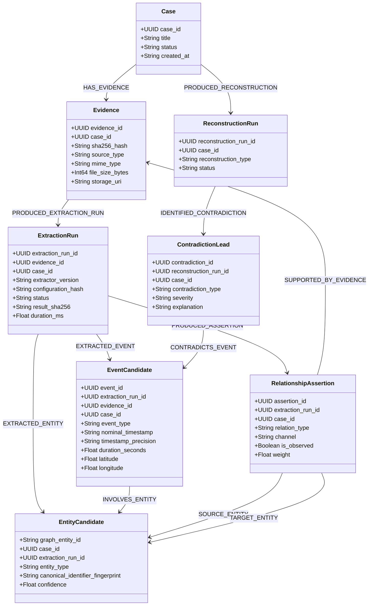

# Forensic Knowledge Graph Data Model & Identifier Privacy Specification (Phase 2A.2)

**Document:** `docs/architecture/phase-2a2-forensic-graph-data-model.md`  
**Date:** November 19, 2026  
**Status:** APPROVED  
**Scope:** YUKTI Knowledge Graph Schema, Nodes, Edges, Case Scoping, and HMAC Privacy  

---

## 1. System of Record & Derived Graph Principles

1. **PostgreSQL Authoritative System of Record:** PostgreSQL 16 stores the immutable ground truth, complete extraction snapshots, and cryptographic audit ledgers.
2. **Neo4j Derived Projection:** Neo4j stores an idempotent, explainable graph projection optimized for multi-hop relationship traversal, timeline visual sequencing, and contradiction exploration.
3. **Strict Case Isolation:** No entity, identifier, event, or edge may cross case boundaries. All graph queries and node keys are explicitly scoped by `case_id`.
4. **Forensic Provenance & Immutability:** Every graph node and edge explicitly references its parent extraction run, reconstruction run, or evidence exhibit.
5. **Neutral Investigative Semantics:** Graph connections denote analytical links or observed communication events, never assertions of guilt, deception, or criminal liability.

---

## 2. Graph Node Taxonomy



---

## 3. Node & Edge Definitions

### Node Properties & Keys:
1. **`:Case`**:
   * Stable Key: `case_id` (UUID).
   * Properties: `title`, `status`, `created_at`.
2. **`:Evidence`**:
   * Stable Key: `evidence_id` (UUID).
   * Properties: `case_id`, `sha256_hash`, `source_type`, `mime_type`, `file_size_bytes`, `storage_uri`, `source_timezone`, `clock_offset_seconds`.
   * *Security Rule:* Absolute server filesystem paths are never stored.
3. **`:ExtractionRun`**:
   * Stable Key: `extraction_run_id` (UUID).
   * Properties: `evidence_id`, `case_id`, `source_sha256`, `extractor_name`, `extractor_version`, `configuration_hash`, `status`, `is_active`, `result_sha256`, `duration_ms`.
4. **`:EntityCandidate`**:
   * Stable Key: `graph_entity_id` = `"{case_id}:{canonical_identifier_fingerprint}"`
   * Properties: `case_id`, `extraction_run_id`, `entity_type`, `fingerprint`, `confidence`.
   * *Forensic Rule:* An EntityCandidate is a technical entity reference, not conclusive proof of human identity.
5. **`:EventCandidate`**:
   * Stable Key: `event_id` (UUID).
   * Properties: `extraction_run_id`, `evidence_id`, `case_id`, `source_record_id`, `event_type`, `nominal_timestamp`, `timestamp_precision`, `duration_seconds`, `uncertainty_start`, `uncertainty_end`, `latitude`, `longitude`, `is_observed`.
6. **`:RelationshipAssertion`**:
   * Stable Key: `assertion_id` (UUID).
   * Properties: `extraction_run_id`, `case_id`, `relation_type`, `channel`, `is_observed`, `weight`.
7. **`:ReconstructionRun`**:
   * Stable Key: `reconstruction_run_id` (UUID).
   * Properties: `case_id`, `reconstruction_type`, `status`, `started_at`, `completed_at`.
8. **`:ContradictionLead`**:
   * Stable Key: `contradiction_id` (UUID).
   * Properties: `reconstruction_run_id`, `case_id`, `contradiction_type`, `severity`, `neutral_explanation`, `min_required_speed_kmh`.
   * *Forensic Rule:* Zero accusations of guilt, fraud, or intentional fabrication. Strictly investigative lead terminology.

### Allowed Edge Types:
* `HAS_EVIDENCE`
* `PRODUCED_EXTRACTION_RUN`
* `EXTRACTED_ENTITY`
* `EXTRACTED_EVENT`
* `PRODUCED_ASSERTION`
* `INVOLVES_ENTITY`
* `SOURCE_ENTITY`
* `TARGET_ENTITY`
* `SUPPORTED_BY_EVIDENCE`
* `PRODUCED_RECONSTRUCTION`
* `HAS_TIMELINE_EVENT`
* `HAS_SPATIAL_OBSERVATION`
* `DERIVED_VIDEO_ARTIFACT`
* `IDENTIFIED_CONTRADICTION`
* `CONTRADICTS_EVENT`

---

## 4. Technical Identifier Privacy (HMAC-SHA-256)

Technical identifiers (phone numbers, email addresses, IMEI, IMSI) are sensitive personal information.
To prevent leaking sensitive data into the graph database while maintaining graph correlation:

1. **PostgreSQL Ground Truth:** Original raw and normalized identifiers remain stored exclusively in PostgreSQL `extracted_identifiers` under strict access controls.
2. **Keyed HMAC-SHA-256 Fingerprinting:**
   In Neo4j, the entity node key and search index use a keyed cryptographic HMAC:
   $$\text{Fingerprint} = \text{Hex}(\text{HMAC-SHA256}(K, \text{case\_id} \parallel \text{":"} \parallel \text{identifier\_type} \parallel \text{":"} \parallel \text{normalized\_value}))$$
   * Secret Key $K$ is provided via environment variable `GRAPH_IDENTIFIER_HMAC_KEY`.
   * Key is never persisted in Neo4j, logs, or Git.
   * Scoping by `case_id` guarantees that identical phone numbers across different cases produce distinct fingerprints, preserving strict case isolation.
3. **Fallback when Key is Missing:**
   * If `GRAPH_IDENTIFIER_HMAC_KEY` is unset, cross-run identifier correlation in Neo4j is disabled.
   * Entities are scoped strictly per extraction run: `"{case_id}:{run_id}:{entity_id}"`.
   * Graph status API reports `identifier_privacy: "hmac_key_unconfigured"`.

---

## 5. Neo4j Schema Constraints & Indexes (Cypher DDL)

Executed idempotently during graph engine initialization:

```cypher
// Uniqueness Constraints
CREATE CONSTRAINT cst_case_unique IF NOT EXISTS FOR (c:Case) REQUIRE c.case_id IS UNIQUE;
CREATE CONSTRAINT cst_evidence_unique IF NOT EXISTS FOR (e:Evidence) REQUIRE e.evidence_id IS UNIQUE;
CREATE CONSTRAINT cst_run_unique IF NOT EXISTS FOR (r:ExtractionRun) REQUIRE r.extraction_run_id IS UNIQUE;
CREATE CONSTRAINT cst_entity_unique IF NOT EXISTS FOR (ent:EntityCandidate) REQUIRE ent.graph_entity_id IS UNIQUE;
CREATE CONSTRAINT cst_event_unique IF NOT EXISTS FOR (ev:EventCandidate) REQUIRE ev.event_id IS UNIQUE;
CREATE CONSTRAINT cst_assertion_unique IF NOT EXISTS FOR (rel:RelationshipAssertion) REQUIRE rel.assertion_id IS UNIQUE;
CREATE CONSTRAINT cst_reconstruction_unique IF NOT EXISTS FOR (rec:ReconstructionRun) REQUIRE rec.reconstruction_run_id IS UNIQUE;
CREATE CONSTRAINT cst_contradiction_unique IF NOT EXISTS FOR (lead:ContradictionLead) REQUIRE lead.contradiction_id IS UNIQUE;

// Performance Indexes
CREATE INDEX idx_case_evidence IF NOT EXISTS FOR (e:Evidence) ON (e.case_id);
CREATE INDEX idx_case_entity IF NOT EXISTS FOR (ent:EntityCandidate) ON (ent.case_id);
CREATE INDEX idx_case_event IF NOT EXISTS FOR (ev:EventCandidate) ON (ev.case_id, ev.nominal_timestamp);
CREATE INDEX idx_case_contradiction IF NOT EXISTS FOR (lead:ContradictionLead) ON (lead.case_id);
CREATE INDEX idx_entity_fingerprint IF NOT EXISTS FOR (ent:EntityCandidate) ON (ent.fingerprint);
```
