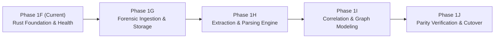

# ADR 001: Strategic Migration of Application Backend to Rust

**Status:** Accepted  
**Date:** 2026-11-18  
**Author:** Backend Architecture Team (SUTRAM 2026)  
**Supersedes:** Python FastAPI as primary production application backend (`backend/` designated as transitional reference)

---

## 1. Context and Decision

The SUTRAM Digital Evidence Correlation and Crime Reconstruction Platform must ingest, parse, hash, correlate, and analyze high-volume, multimodal digital evidence (e.g., Call Detail Records, cellular tower dumps, forensic disk extractions, packet captures, chat exports, and CCTV/video streams).

We have made the architectural decision to **transition all production application backend functionality to Rust**.

A dedicated Rust backend workspace (`backend-rust/`) is established as the permanent foundation. The existing Python FastAPI backend (`backend/`) is transitioned to a **temporary migration reference** and will remain completely intact to serve as the behavioral ground truth until full feature and test parity are demonstrated.

---

## 2. Technical and Forensic Rationale

1. **Deterministic Memory Safety & Zero-Cost Resource Management:**
   Digital forensics pipelines process multi-gigabyte evidence files concurrently. Rust’s ownership and borrow checker guarantee memory safety without the non-deterministic latency or stop-the-world pauses of garbage collection.

2. **High-Throughput Raw Binary Parsing & Cryptographic Integrity:**
   Forensic compliance requires continuous calculation of cryptographic hashes (SHA-256, SHA-3) and bit-level inspection of binary evidence dumps (pcap, raw disk images, EXIF metadata, video frames). Rust provides bare-metal performance, SIMD acceleration, and memory-mapped file I/O (`mmap`) without Python runtime interpretation overhead.

3. **Fearless Concurrency with Tokio:**
   Tokio provides a multi-threaded work-stealing async runtime capable of handling thousands of concurrent ingestion streams, background normalization tasks, and database transactions with minimal CPU and memory footprint.

4. **Strict Type Safety for Forensic Chain of Custody:**
   In digital forensics, data corruption or unhandled runtime exceptions can compromise chain of custody and court admissibility. Rust eliminates entire classes of bugs at compile time (null pointer dereferences, data races, uncaught type coercions).

5. **Resource Efficiency in Constrained Environments:**
   Investigative field units or edge nodes operating with limited compute or battery power benefit directly from Rust’s minimal memory footprint and fast binary execution.

---

## 3. Technology Foundation

- **HTTP Web Framework:** **Axum 0.7**  
  Built on top of `tokio`, `tower`, and `hyper`. Axum provides macro-free routing, type-safe extractors, clean separation of concerns, and native interoperability with Tower middleware (`TraceLayer`, `CorsLayer`, `TimeoutLayer`).
- **Async Runtime:** **Tokio 1.40** with the `full` feature set for asynchronous I/O, timers, synchronization primitives, and signal handling.
- **Serialization & Validation:** **Serde** (`serde`, `serde_json`) for fast, zero-copy JSON deserialization and strict schema enforcement matching SUTRAM canonical contracts.
- **Error Handling:** **Thiserror** for strongly-typed domain errors and central `IntoResponse` mapping that generates consistent, RFC 7807-compliant JSON error envelopes while preserving server-side internal tracing logs.
- **Observability:** **Tracing** (`tracing`, `tracing-subscriber`) providing structured, contextual, span-based logging with ANSI/JSON formatters and dynamic environment level filtering (`RUST_LOG`).
- **Persistence Layer Direction:** **SQLx** for compile-time verified asynchronous PostgreSQL queries and connection pooling, ensuring compile-time validation of database schemas and migrations.

---

## 4. Status of Existing System Components

| Component | Repository Path | Architectural Role & Migration Status |
| :--- | :--- | :--- |
| **Rust Backend** | `backend-rust/` | **Primary Production Backend.** Houses all future ingestion, extraction, correlation, and API gateway services. |
| **Python Backend** | `backend/` | **Transitional Migration Reference.** Retained strictly as behavioral ground truth. No new business features will be added. Must not be deleted or renamed until full parity verification. |
| **Decision Service** | `decision-service/` | **Specialized ONNX / Laya Inference Service.** Continues as a dedicated Node.js 22 LTS microservice, isolating heavy ML model runtimes from high-throughput backend I/O. |
| **Web Frontend** | `apps/web/` | **Preserved Client Layer.** React + TypeScript + Vite + Tailwind CSS remains the unified investigator dashboard, communicating with the backend over standardized HTTP/JSON REST APIs. |
| **Shared Contracts** | `shared/schemas/` | **Immutable Canonical Contracts.** Universal data schemas remain the shared truth across Rust, Python, TypeScript, and Node.js. |

---

## 5. Transitional Guidelines & Python Backend Role

To safeguard project momentum and avoid integration regressions:
- **Ground Truth Specification:** The Python implementation (`backend/app/modules/`, `backend/app/schemas/`) serves as the functional and structural specification for data structures, regex patterns, parsing rules, and API response structures.
- **Parity Requirement:** Every ported feature must have equivalent unit and integration tests in `backend-rust/tests/` matching or exceeding the test assertions in `backend/tests/`.
- **Zero Modifications to Reference Code:** To maintain clean git history and clear parity baselines, no new backend business logic or modules will be committed to `backend/`.
- **Decommissioning Gate:** The Python backend will only be deprecated and removed after all migration phases are complete, automated end-to-end integration tests pass, and team alignment is confirmed.

---

## 6. Migration Roadmap

The migration to the Rust backend is structured across targeted, verifiable phases:

1. **Phase 1F (Completed): Rust Backend Foundation**
   - Axum 0.7 + Tokio 1.40 server initialization.
   - Structured configuration via environment variables (`HOST`, `PORT`, `RUST_LOG`).
   - Strongly typed error handling (`AppError`) and RFC 7807 error envelopes.
   - Structured tracing subscriber with request instrumentation.
   - Health check endpoint (`GET /health`) with automated integration tests.
   - Dedicated GitHub Actions CI pipeline (`.github/workflows/backend-rust.yml`).

2. **Phase 1G: Forensic Ingestion & File Processing Engine**
   - Multipart file upload streaming directly to disk with constant memory overhead.
   - Streaming SHA-256 and SHA-3 cryptographic hash computation.
   - Evidence metadata extraction, deduplication, and forensic audit logging.
   - SQLx integration with PostgreSQL for case and evidence records.

3. **Phase 1H: Evidence Extraction & Parsing Engine**
   - Native Rust parsers for structured forensic formats (CDR CSV, chat logs, device dumps).
   - High-throughput regex, tokenization, and deterministic entity extraction (phone numbers, IMEIs with Luhn checksum validation, IP addresses, emails, timestamps).
   - Forensic provenance tracking (byte offsets, line indices, evidence IDs).

4. **Phase 1I: Cross-Source Correlation & Graph Engine**
   - High-performance entity resolution (phonetic matching, Jaro-Winkler / Levenshtein similarity, normalized identifiers).
   - In-memory graph processing and Neo4j / Bolt driver persistence.
   - Temporal and spatial event indexing.

5. **Phase 1J: Full Cutover & Deprecation**
   - Comprehensive automated parity test suite verifying identical outputs between Rust and Python.
   - Frontend API client cutover to `backend-rust/`.
   - Formal deprecation and removal of transitional Python reference service.
