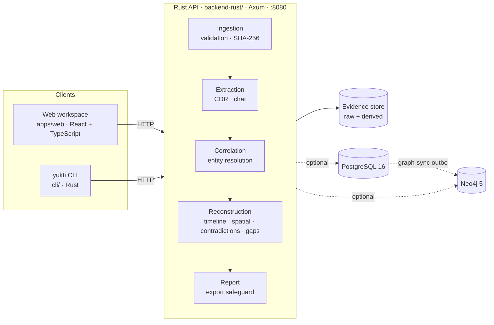

# YUKTI Digital Forensics: System Architecture Overview

## 1. Components

| Component | Folder | Role |
|---|---|---|
| **Rust API** | `backend-rust/` | The application backend: every forensic stage, persistence and the HTTP API. Runs without any database, in filesystem mode. |
| **Web workspace** | `apps/web/` | The investigator UI. It talks to the Rust API over HTTP and contains no forensic logic. |
| **`yukti` CLI** | `cli/` | A command-line client of the same API, HTTP-only ([ADR 0002](../decisions/0002-standalone-cli-crate.md)). |
| **Python service** | `backend/` | The original FastAPI implementation, kept as the reference for some algorithms. |
| **Decision service** | `decision-service/` | A Node.js shell reserved for on-device inference (Laya / ONNX). |
| **Shared contracts** | `shared/` | Canonical field names and enums for Case, Evidence, Entity, Event and Relationship. Changes need team agreement. |

[ADR 001](rust-backend-migration.md) explains why the backend moved from Python to Rust.

---

## 2. Evidence pipeline

1. **Ingestion** (`backend-rust/src/ingestion`): validates the content, computes SHA-256, stores the original read-only, and records the declared timezone and clock offset per exhibit.
2. **Extraction** (`src/extraction`): parses call detail records (CDRs) and chat exports into normalised events and identifiers (phone number, IMEI, IMSI).
3. **Correlation** (`src/correlation`, `src/graph`): resolves entities across sources and projects them into a Neo4j knowledge graph through a PostgreSQL outbox.
4. **Reconstruction** (`src/reconstruction`):
   - an ordered **timeline** with time windows and clock-offset correction,
   - **spatial** trajectories with speed-threshold checks,
   - **contradiction leads**,
   - **evidence gaps**,
   - **what-if** scenario simulation,
   - finding-to-evidence **provenance**.
5. **Report** (`src/reconstruction/report.rs`): a judicial dossier. Its **export safeguard** blocks export while findings rest on unobserved values.

Every value the system infers rather than observes (an assumed timezone, an undeclared clock offset, coordinates taken from a cell tower) is attached to the event as a **labelled assumption**. See [reconstruction assumptions](rust-reconstruction-assumptions.md).

---

## 3. Implementation status

| Capability | Where | Status |
|---|---|---|
| Evidence ingestion and SHA-256 | `backend-rust/src/ingestion` | Implemented |
| CDR and chat extraction | `backend-rust/src/extraction` | Implemented |
| Entity resolution and relationships | `backend-rust/src/correlation` | Implemented |
| Knowledge graph (Neo4j) | `backend-rust/src/graph`, `graph-sync` | Implemented (optional) |
| PostgreSQL persistence | `backend-rust/src/persistence`, `migrations/` | Implemented (optional) |
| Timeline and spatial reconstruction | `backend-rust/src/reconstruction` | Implemented |
| Contradiction detection | `reconstruction/contradictions.rs` | Implemented |
| Gaps, what-if, provenance | `reconstruction/gaps.rs`, `scenario.rs`, `traceability.rs` | Implemented |
| Judicial report and export safeguard | `reconstruction/report.rs` | Implemented |
| Investigator workspace | `apps/web/` | Implemented |
| Command-line client | `cli/` | Implemented |
| CCTV / video intelligence | `reconstruction/video.rs`, `video_handoff.rs` | Partial: frame handoff interface |
| OCR (PaddleOCR) and NER (spaCy) | — | Planned |
| On-device decision support (Laya / ONNX) | `decision-service/` | Planned: service shell only |

The [USP and gap analysis](usp-gap-analysis.md) assesses each differentiating feature in more depth.

---

## 4. Technology choices

- **Rust + Axum (API):** memory safety and predictable performance for evidence processing, with strong types end to end. SQLx handles PostgreSQL access and versioned migrations.
- **React + TypeScript + Vite (workspace):** a responsive UI for timelines, Cytoscape graphs and evidence review.
- **PostgreSQL 16:** the relational source of truth for cases, evidence, chain of custody and reconstruction runs. Optional.
- **Neo4j 5:** a property graph for relationship queries across entities. Optional; it's fed from PostgreSQL through an outbox.
- **Node.js (decision service):** isolates future model inference from the main API.
