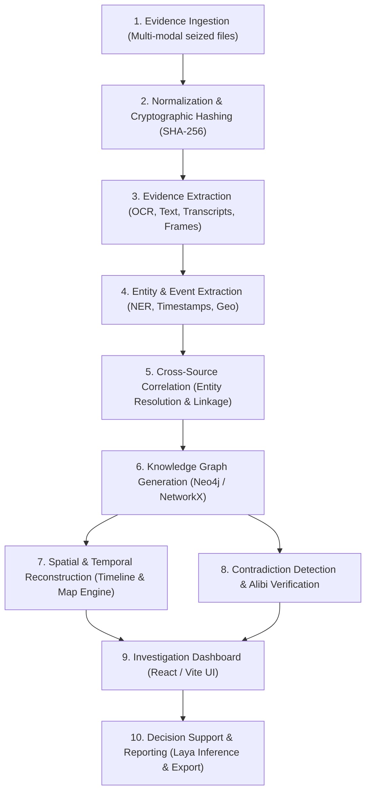

# SUTRAM Digital Forensics — System Architecture Overview

## 1. High-Level Architectural Flow

The SUTRAM platform automates the transformation of unstructured, multi-source digital evidence into a coherent, cross-correlated investigative graph and chronological reconstruction.

---

## 2. Phase Implementation Status

| Component | Architecture Layer | Current Phase Status | Description |
| :--- | :--- | :--- | :--- |
| **API Gateway & Core Config** | `backend/app/` | **Phase 0 (Implemented)** | FastAPI initialization, environment configuration, health check. |
| **Frontend Skeleton** | `apps/web/` | **Phase 0 (Implemented)** | React, TypeScript, Vite, Tailwind CSS layout & API client stub. |
| **Decision Service Shell** | `decision-service/` | **Phase 0 (Implemented)** | Node.js 22 LTS microservice skeleton with health endpoint. |
| **Shared Contracts** | `shared/` | **Phase 0 (Implemented)** | Canonical specifications for Case, Evidence, Entity, Event, Relationship. |
| **Evidence Ingestion API** | `backend/app/modules/ingestion` | *Planned (Phase 1)* | File upload, SHA-256 hashing, storage management. |
| **Extraction Pipeline** | `backend/app/modules/extraction` | *Planned (Phase 2)* | PaddleOCR, OpenCV frame extraction, document parsing. |
| **Entity & Event Extraction** | `backend/app/modules/extraction` | *Planned (Phase 2)* | spaCy NER, timestamp parser, geographic resolver. |
| **Cross-Source Correlation** | `backend/app/modules/correlation` | *Planned (Phase 3)* | Sentence Transformers, Levenshtein resolution, co-occurrence scoring. |
| **Knowledge Graph Engine** | `backend/app/modules/correlation` | *Planned (Phase 3)* | Neo4j graph persistence, relationship weighting. |
| **Crime Reconstruction** | `backend/app/modules/reconstruction` | *Planned (Phase 4)* | Chronological timeline generation, geospatial movement mapping. |
| **Contradiction Detection** | `backend/app/modules/reconstruction` | *Planned (Phase 4)* | Multi-source alibi verification and statement inconsistency flags. |
| **Laya / ONNX Decision Support**| `decision-service/` | *Planned (Phase 5)* | Local ONNX runtime inference for investigator hypothesis assessment. |
| **Investigation Reporting** | `backend/app/modules/reporting` | *Planned (Phase 5)* | Court-admissible PDF/JSON forensic report generation. |

---

## 3. Technology Stack Rationale

- **Python 3.12 + FastAPI:** Industry standard for high-performance forensic and AI pipelines with native asynchronous I/O and strict Pydantic type validation.
- **React + Vite + Tailwind:** High-responsiveness investigator interface capable of rendering complex timelines, force-directed graphs, and evidence media.
- **Node.js LTS (Decision Service):** Dedicated runtime for lightweight ONNX runtime execution and Laya decision model inference, isolating AI inference memory from main backend operations.
- **PostgreSQL 16:** Relational persistence for case metadata, user accounts, and immutable evidence audit logs.
- **Neo4j 5:** Native property graph database for sub-second relationship queries across millions of interconnected digital entities.
