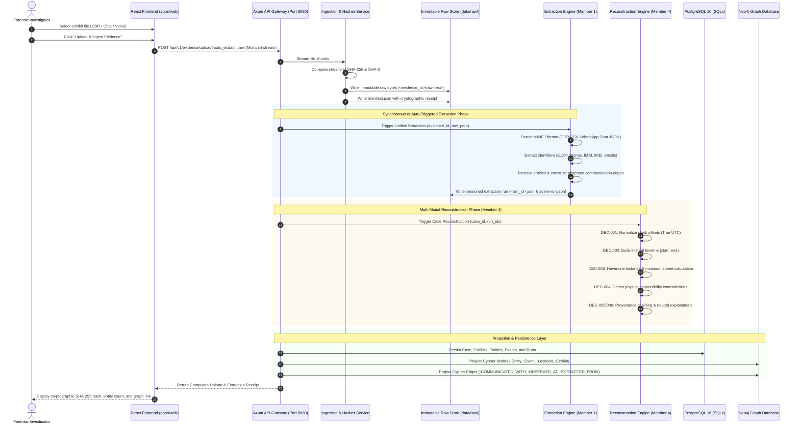

# YUKTI — Architecture and Data Flow Specification

**Project:** YUKTI (SUTRAM 2026)  
**Document ID:** ARCH-P2C-002  
**Version:** 1.0.0  
**Date:** 2026-11-20  

---

## 1. System Topology & Monorepo Structure

YUKTI operates as a multi-tier, modular forensic investigation monorepo with strict architectural boundaries:

```
SutramPrototype/
├── apps/
│   └── web/                         # React 19 + TypeScript + Vite + Tailwind CSS Frontend
│       ├── src/
│       │   ├── components/          # Reusable forensic UI widgets (Badge, Modal, Toast)
│       │   ├── features/
│       │   │   ├── workspace/       # Investigator Workspace (Graph, Timeline, Upload, Reports)
│       │   │   ├── landing/         # Cinematic public landing & demonstration page
│       │   │   └── reconstruction/  # Reconstruction visualization modules
│       │   ├── services/            # Backend API connectors (evidenceApi, graphApi, caseApi)
│       │   └── types/               # TypeScript domain contracts mirroring Rust DTOs
│       └── tests/                   # Vitest unit and integration test suites
│
├── backend-rust/                    # Sole Production Backend Runtime (Axum + Tokio)
│   ├── src/
│   │   ├── api/                     # REST routes (/cases, /evidence, /graph, /reconstruction)
│   │   ├── extraction/              # CDR, chat, NER, identifier normalization, entity resolution
│   │   ├── ingestion/               # Multipart streaming, SHA-256 verification, manifest storage
│   │   ├── models/                  # Strong Rust domain types, DTOs, and serialization contracts
│   │   ├── persistence/             # PostgreSQL repositories (SQLx) & filesystem fallback
│   │   ├── graph/                   # Neo4j projection engine, Cypher queries, graph models
│   │   └── reconstruction/          # Member 4 reconstruction engines (DEC-001 - DEC-006)
│   └── tests/                       # 117 Rust unit, integration, graph, and reconstruction tests
│
├── backend/                         # Python 3.12 + FastAPI Transitional Reference Implementation
│   ├── app/                         # Behavioral reference implementations for extraction & models
│   └── tests/                       # 144 passing pytest test cases verifying reference behavior
│
├── decision-service/                # Node.js 22 LTS + TypeScript Service (Future Laya / ONNX runtime)
│   └── src/                         # Forensic decision rule evaluator contracts
│
├── shared/                          # Canonical data contracts, JSON schemas, and shared enums
│   └── schemas/                     # Shared JSON schema contracts across all services
│
└── data/                            # Persistent evidence, synthetic datasets, and exhibits
    ├── raw/                         # Immutable raw evidence storage (read-only after hash)
    ├── derived/                     # Extraction runs, manifest metadata, and reconstruction results
    └── synthetic/                   # Synthetic test fixtures (sample_cdr.csv, sample_chat_export.json)
```

---

## 2. End-to-End Data Pipeline Flow

The digital evidence lifecycle follows a strict forensic pipeline:



---

## 3. Module Boundaries & Interaction Principles

### 3.1 Backend vs Frontend Separation
- The frontend (`apps/web`) performs zero cryptographic hashing, zero forensic timestamp normalization, and zero contradiction calculations. All heavy lifting, business logic, and forensic decision evaluations reside strictly within `backend-rust`.
- The frontend acts strictly as a presentation, navigation, and investigator interrogation interface.
- Frontend network services communicate through clean REST interfaces using JSON payloads and typed DTOs defined in `apps/web/src/types/`.

### 3.2 Production Rust Backend vs Reference Python Backend
- `backend-rust` is the canonical production backend. It possesses full feature parity with, and exceeds the performance and memory safety of, the initial Python prototype.
- `backend` (Python FastAPI) is maintained as a read-only behavioral reference to ensure legacy algorithm compliance and to run reference comparison tests (`pytest backend/tests`).
- No new features are developed in Python; all new endpoints, graph projections, and data persistence pipelines reside in Rust.

### 3.3 Relational vs Graph Database Projections
- **PostgreSQL 16 (Relational System of Record):** Stores master case files, evidence manifests, cryptographic hashes, audit logs, and versioned reconstruction snapshots. Relational constraints guarantee relational consistency and auditability.
- **Neo4j 5.26 (Knowledge Graph Representation):** Provides high-performance graph traversal for cross-source entity correlation, multi-hop relationship exploration, community clustering, and visual investigation.
- If Neo4j or PostgreSQL is temporarily unreachable (e.g. in development environments without running Docker daemons), the backend automatically falls back to filesystem JSON storage and in-memory graph models without panicking or dropping data.

---

## 4. Cryptographic & Forensic Safety Guardrails

1. **Raw Evidence Immutability:** Raw files written to `data/raw/<evidence_id>/` have their permissions set to read-only. The server never mutates an exhibit once written.
2. **Deterministic Cryptographic Receipts:** Every upload returns a receipt containing:
   - `evidence_id`: Canonical UUIDv4
   - `sha256_hash`: Lowercase 64-character hexadecimal digest
   - `byte_size`: Exact byte count verified on disk
   - `ingested_at`: UTC ISO 8601 timestamp
3. **Decoupled Inferred vs Observed:**
   - In graph projections and timeline models, edges representing observed data (e.g. phone call logged on tower) are strictly typed as `OBSERVED_COMMUNICATION` with high certainty.
   - Edges representing heuristic entity resolution (e.g. email sharing same handle as username) are typed as `POTENTIAL_COREF` with explicit decimal confidence scores, never asserted as factual identity.
