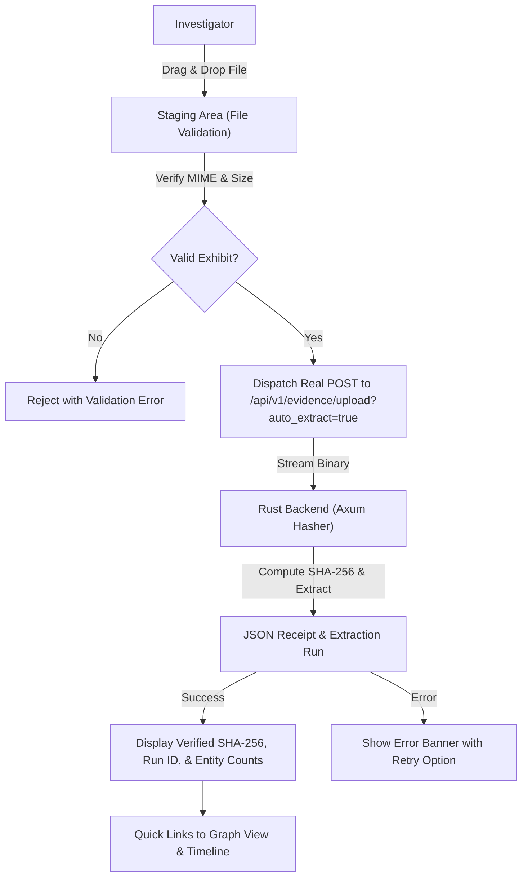

# YUKTI — Frontend Workflow and Investigator Workspace Report

**Project:** YUKTI (SUTRAM 2026)  
**Document ID:** UI-P2C-007  
**Version:** 1.0.0  
**Date:** 2026-11-20  

---

## 1. User Interface Architecture & Design System

The YUKTI investigator frontend (`apps/web`) is built with **React 19**, **TypeScript** (enforcing `"strict": true`), **Vite**, and **Tailwind CSS**. It delivers a high-contrast, forensic-grade dark interface designed for clarity, data density, and evidentiary rigor.

```
apps/web/src/
├── features/
│   ├── workspace/
│   │   ├── components/         # Workspace headers, tabs, navigation rail, badges
│   │   ├── pages/              # Primary investigator views
│   │   │   ├── EvidenceUploadPanel.tsx  # Real evidence upload & extraction console
│   │   │   ├── KnowledgeGraphView.tsx   # Interactive Cytoscape knowledge graph
│   │   │   ├── TimelineView.tsx         # Chronological event reconstruction
│   │   │   ├── SpatialMapView.tsx       # Geographical trajectory map
│   │   │   ├── ContradictionsPanel.tsx  # Physical impossibility lead reviewer
│   │   │   └── ReportsView.tsx          # Judicial forensic export generator
│   │   ├── data/
│   │   │   └── repository.ts   # Unified workspace data layer (API + Synthetic fallback)
│   │   └── context/            # Case and workspace state providers
│   ├── landing/                # Public cinematic showcase & demonstration view
│   └── reconstruction/         # Specialized forensic reconstruction widgets
├── services/
│   ├── evidenceApi.ts          # Multipart streaming upload, fetchCaseEvidence
│   ├── graphApi.ts             # Graph neighborhood and path query client
│   └── reconstructionApi.ts    # Reconstruction trigger and result client
```

---

## 2. Real Evidence Upload & Extraction Workflow

Prior to Phase 2C, the upload panel simulated file ingestion with mock timeouts. In Phase 2C, the upload pipeline was fully upgraded to a **live multipart streaming integration**:



### 2.1 Key Capabilities of `EvidenceUploadPanel.tsx`
1. **Real Multipart Streaming:** Sends the selected binary payload via `fetch` as `multipart/form-data` without overriding `Content-Type` headers, enabling the browser to insert boundary delimiters.
2. **Per-File Status Lifecycle:** Each file moves deterministically through `'idle'` $\rightarrow$ `'uploading'` $\rightarrow$ `'success'` (or `'error'`).
3. **Receipt & Cryptographic Verification:** On completion, the UI displays the server-computed SHA-256 hash (truncated with copy-to-clipboard), the assigned `evidence_id`, and extraction summary counts (`entity_count`, `event_count`, `relationship_count`).
4. **Resilient Error & Retry:** Network or parsing errors surface an inline alert with a one-click "Retry" button.
5. **Synthetic vs Live Scoping:** The synthetic benchmark case (`CASE-026`) features an explanatory banner protecting its pre-loaded demonstration data, with a toggle or live case selection allowing real uploads.

---

## 3. Knowledge Graph Visualization (`KnowledgeGraphView.tsx`)

- **Rendering Engine:** Cytoscape.js with force-directed physics layout (`cose` / `cola`).
- **Entity Taxonomy Styling:**
  - `PERSON`: Slate blue circle with user avatar.
  - `PHONE`: Cyan circle with phone handset badge.
  - `LOCATION` / `CELL_TOWER`: Amber marker representing geographic towers.
  - `EXHIBIT`: Dark purple document icon.
- **Evidentiary Distinctions:**
  - Solid edges represent hard observed interactions (e.g. telecom CDR voice calls).
  - Dashed amber edges represent heuristic coreference links, annotated with confidence percentages.
- **Interactivity:** Clicking any node reveals an investigator sidebar detailing metadata, active timestamps, connected exhibits, and 1-hop neighbor counts.

---

## 4. Timeline, Spatial Reconstruction & Judicial Export Gate

1. **Chronological Timeline (`TimelineView.tsx`):**
   - Renders events in strict UTC chronological order.
   - Visually indicates uncertainty windows (e.g. $[t - 15\text{s}, t + 15\text{s})$) for events derived from imprecise device clocks.
2. **Spatial Map (`SpatialMapView.tsx`):**
   - Renders cell tower locations, azimuth coverage cones, and transit vectors.
   - Highlights trajectory segments where implied speed exceeds the physical threshold ($120\text{ km/h}$).
3. **Judicial Export Safeguard (`ReportsView.tsx`):**
   - Inspects the case reconstruction status for active contradiction leads.
   - If unresolved physical impossibilities remain, the export engine displays the prominent amber **`SHIP_EXPORT_BLOCKED`** badge, preventing unverified conclusions from being printed for court proceedings.

---

## 5. Test Suite Verification

The frontend test suite was executed using Vitest:
- Total Test Files: **20 test files**
- Total Tests: **264 passed; 0 failed**
- Unit & Component Coverage: Includes all workspace pages, `EvidenceUploadPanel.test.tsx` (4 tests), `workspace.integration.test.tsx` (48 tests), graph utilities, and report generators.
- Production Build: `npm --prefix apps/web run build` completed cleanly in **23.61s**.
