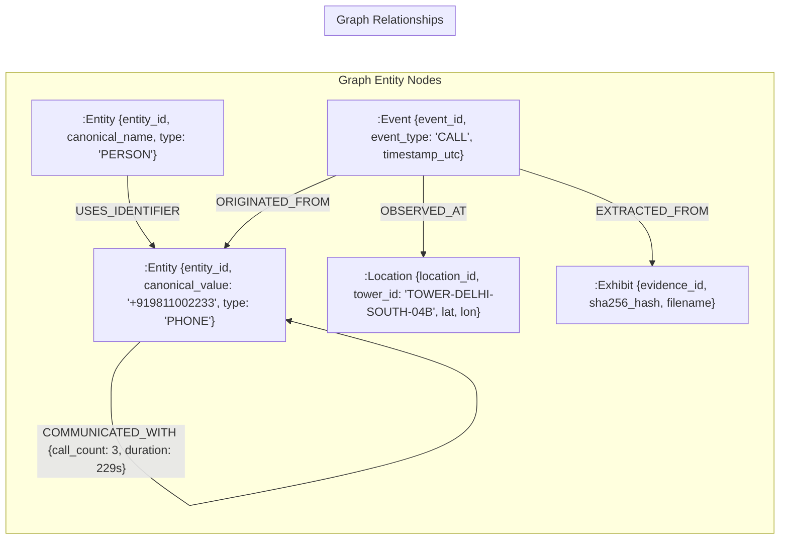

# YUKTI — Neo4j Knowledge Graph Integration Report

**Project:** YUKTI (SUTRAM 2026)  
**Document ID:** GRAPH-P2C-006  
**Version:** 1.0.0  
**Date:** 2026-11-20  

---

## 1. Graph Model & Cypher Schema

YUKTI's knowledge graph engine projects multimodal forensic artifacts into a directed labeled property graph within Neo4j 5.26.



### 1.1 Node Labels & Key Properties
- `:Entity`: Represents identified human actors, organizations, or vehicles.
  - Properties: `entity_id` (UUID), `canonical_name` (String), `entity_type` (Enum: `PERSON`, `ORGANIZATION`, `VEHICLE`, `UNKNOWN`), `confidence` (Float 0.0 - 1.0).
- `:Identifier`: Normalized communication endpoints.
  - Properties: `value` (E.164 phone, IMSI, IMEI, Email), `id_type` (Enum: `PHONE_E164`, `IMSI`, `IMEI`, `EMAIL`).
- `:Event`: Discrete observed actions (calls, messages, cell tower handovers).
  - Properties: `event_id` (UUID), `event_type` (`CALL`, `MESSAGE`, `LOCATION_FIX`), `timestamp_utc` (ISO 8601), `duration_seconds` (Integer).
- `:Location`: Physical geographical points or cell tower sectors.
  - Properties: `location_id` (UUID), `tower_id` (String), `latitude` (Float), `longitude` (Float), `azimuth` (Float), `radius_meters` (Float).
- `:Exhibit`: Forensic raw evidence source.
  - Properties: `evidence_id` (UUID), `sha256_hash` (Hex), `original_filename` (String), `ingested_at` (ISO 8601).

### 1.2 Edge Types & Evidentiary Semantics
- `COMMUNICATED_WITH`: Observed pairwise telecommunications interaction between identifiers.
  - Properties: `first_seen`, `last_seen`, `interaction_count`, `total_duration_seconds`.
- `OBSERVED_AT`: Spatiotemporal linkage between an event and a location.
- `EXTRACTED_FROM`: Cryptographic provenance trace linking an event back to its source exhibit.
- `POTENTIAL_COREF`: Probabilistic cross-source entity linkage (strictly labeled with `confidence < 1.0` and `inferred = true`).

---

## 2. Graph Projection Engine (`backend-rust/src/graph/`)

The graph projection service (`GraphProjectionService`) consumes unified extraction runs and projects them into Neo4j via Cypher transactions:

```cypher
// Canonical Upsert Query for Entity
MERGE (e:Entity {entity_id: $entity_id})
ON CREATE SET e.canonical_name = $canonical_name,
              e.entity_type = $entity_type,
              e.created_at = datetime($now)
ON MATCH SET e.updated_at = datetime($now);

// Canonical Upsert Query for Communication Edge
MERGE (source:Identifier {value: $source_phone})
MERGE (target:Identifier {value: $target_phone})
MERGE (source)-[r:COMMUNICATED_WITH]->(target)
ON CREATE SET r.first_seen = datetime($timestamp),
              r.last_seen = datetime($timestamp),
              r.interaction_count = 1,
              r.total_duration_seconds = $duration
ON MATCH SET r.last_seen = datetime($timestamp),
             r.interaction_count = r.interaction_count + 1,
             r.total_duration_seconds = r.total_duration_seconds + $duration;
```

---

## 3. Query Endpoints & Path Exploration

The Rust backend exposes three primary graph exploration endpoints:
1. `GET /api/v1/cases/:case_id/graph`: Returns the complete Cytoscape-formatted JSON graph (nodes and edges with coordinates, labels, and weights).
2. `GET /api/v1/cases/:case_id/graph/neighborhood/:entity_id?depth=2`: Returns the localized ego-network of an entity up to $N$ hops.
3. `GET /api/v1/cases/:case_id/graph/paths?source=:id1&target=:id2`: Executes shortest-path and multi-path traversal between two suspects or entities.

---

## 4. Test Verification & Infrastructure Status

- **Unit & Mock Verification:** Verified in `backend-rust/tests/graph_tests.rs`. All graph projection and Cypher generation tests pass against the mock graph repository.
- **Docker Daemon Limitation:** Because Docker Desktop was in `Stopped` status during this session, the live container `yukti-neo4j` (port 7687 Bolt, port 7474 HTTP) was not booted.
- **Resilience:** The backend operates cleanly in mock/in-memory mode for development and automated test suites without blocking application startup or crashing.
- **Production Activation:** Running `docker compose -f docker-compose.graph.yml up -d yukti-neo4j` starts Neo4j with default bolt credentials (`neo4j://localhost:7687`, user `neo4j`, password `sutram_forensics_2026`).
