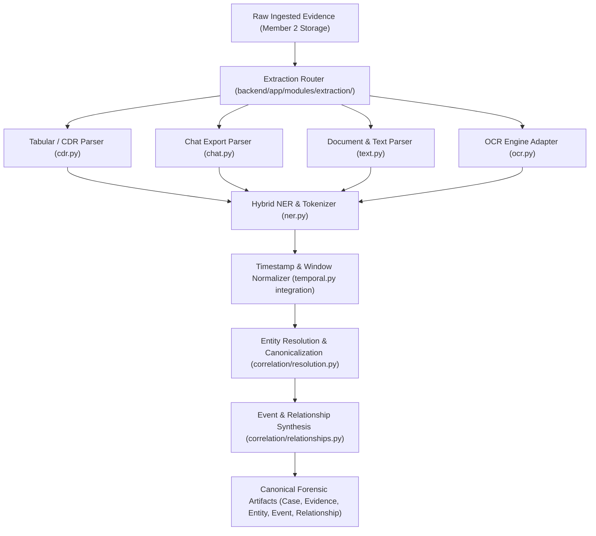

# SUTRAM Phase 1A — Evidence Extraction Blueprint & Contract Review

**Author:** Member 1 (AI/ML & Evidence Intelligence)  
**Date:** 2026-11-17  
**Monorepo Target:** SUTRAM 2026 Core Contracts, Extraction & Correlation Pipelines  
**Status:** `REVIEW & PROPOSAL` (Awaiting Collaborative Team Review)

---

## 1. Executive Summary

As Member 1 (AI/ML and Evidence Intelligence), this review establishes the technical blueprint and contract foundation for the automated extraction and cross-source correlation pipeline in the **SUTRAM Digital Forensics** platform.

This review directly interfaces with Member 4's (Swastik) reconstruction engine and contract proposals (`docs/member-4/phase-3c-contract-decisions.md`). It provides a comprehensive audit of the six proposed architectural decisions (DEC-001 through DEC-006), identifies critical boundary inconsistencies and cross-platform execution bottlenecks (including Windows timezone dependency requirements), specifies canonical data model mappings, and outlines the practical architecture for Phase 1 extraction without premature machine learning dependency bloat.

---

## 2. Current Repository State

- **Branch Policy:** Strictly single-branch `main` at commit `179abe0` (synchronized with `origin/main`). No auxiliary or feature branches exist.
- **Backend Architecture:** Python 3.12 + FastAPI managed via `uv`. Health check endpoint operational.
- **Frontend Architecture:** React 18 + TypeScript (strict mode) + Vite + Tailwind CSS in `apps/web/`.
- **Decision Service:** Node.js 22 LTS microservice skeleton in `decision-service/` for future Laya / ONNX inference.
- **Contract Layers:** Canonical specifications exist in documentation (`shared/schemas/README.md`, `shared/enums/README.md`, `shared/examples/README.md`), but Python Pydantic models for `Case`, `Evidence`, `Entity`, `Event`, and `Relationship` are **not yet implemented** in `backend/app/schemas/`.
- **Reconstruction State:** Member 4 has committed full implementations of temporal, spatial, contradiction, and video reconstruction modules with 141 tests in `backend/tests/reconstruction/`.

---

## 3. Swastik's Verified Implementation Summary

A direct code-level audit was conducted across Member 4's implementation commits:
- `533ea183`: Reconstruction implementation (`temporal.py`, `spatial.py`, `video.py`, `contradictions.py`, `reconstruction.py`).
- `8210eb84`: Video test skip fallback when FFmpeg/FFprobe binaries are missing.
- `179abe08`: CI update installing dev dependencies during `uv sync`.

### Implementation vs. Proposal Audit

| Component | File Path | Actual Code Status | Test Coverage | Integration Dependency / Gap |
| :--- | :--- | :--- | :--- | :--- |
| **Temporal Engine** | `backend/app/modules/reconstruction/temporal.py` | Fully implemented (623 lines). Parses ISO 8601, localizes timezones strictly, applies clock offsets, floors calendar intervals, computes pairwise overlaps. | 41 tests in `test_temporal.py` | Requires `zoneinfo` IANA data. On Windows hosts lacking system tzdata, requires the `tzdata` Python package. |
| **Spatial Engine** | `backend/app/modules/reconstruction/spatial.py` | Fully implemented (579 lines). Haversine distance, speed evaluation, trajectory reconstruction, tracking unlocated events. | 26 tests in `test_spatial.py` | Fully self-contained. Pure mathematical implementation. |
| **Contradiction Engine** | `backend/app/modules/reconstruction/contradictions.py` | Fully implemented (681 lines). Detects speed threshold exceedance and temporal activity overlap leads; generates `CONTRADICTS` relationships with `is_observed=False`. | 24 tests in `test_contradictions.py` | Self-contained. Emits `DerivedContradictionRelationship`. |
| **Video Engine** | `backend/app/modules/reconstruction/video.py` | Fully implemented (848 lines). FFprobe metadata extraction, keyframe/interval frame extraction, pre/post SHA-256 verification. | 50 tests in `test_video.py` | Requires external `ffmpeg` and `ffprobe` binaries on the host system PATH. Tests gracefully skip if binaries are absent. |
| **Reconstruction DTOs** | `backend/app/schemas/reconstruction.py` | Fully implemented (883 lines). Comprehensive Pydantic models for windows, segments, leads, and video artifacts. | Covered by all 141 reconstruction tests | Uses `extract_field()` helper to tolerate untyped dictionary inputs because core schemas (`Event`, `Evidence`) are not yet formal Pydantic classes. |
| **Contract Decisions** | `docs/member-4/phase-3c-contract-decisions.md` | **Proposed Only** (232 lines). 6 formal decisions documented but awaiting consensus before modifying `shared/schemas/`. | N/A | Awaiting formal sign-off from Member 1, Member 2, and Member 3. |

---

## 4. Audit of the Six Proposed Contract Decisions (DEC-001 to DEC-006)

### DEC-001: Clock Offset Convention
- **Proposed Convention:** Additive clock correction:
  $$\mathbf{t}_{\text{UTC}} = \mathbf{t}_{\text{device\_localized\_to\_UTC}} + \text{clock\_offset\_seconds}$$
  - Fast clock (+120s): `clock_offset_seconds = -120.0`
  - Slow clock (45s slow): `clock_offset_seconds = +45.0`
- **Member 1 Audit & Extraction Impact:**
  - **APPROVED.** The extraction engine frequently extracts timestamps from raw evidence (e.g., chat message headers, phone call records, stamped receipts, CCTV OSD text).
  - The extraction pipeline **must strictly preserve the raw, uncorrected timestamp string** (e.g., `"2026-11-10 21:47:00"`) and its observed timezone representation in extraction artifacts.
  - Normalized UTC timestamps must be derived by applying the evidence item's `clock_offset_seconds`.
  - **Forensic Guarantee:** If an investigator subsequently refines the measured clock drift of an evidentiary device, the extraction text remains immutable, and only the derived normalized event window requires recomputation.

---

### DEC-002: TimePrecision Semantics
- **Proposed Canonical Values:** `EXACT_SECOND`, `MINUTE`, `HOUR`, `DAY`, `ESTIMATED`.
- **Precision vs. Accuracy Distinction:**
  - *Precision:* Granularity/resolution emitted by the source modality (e.g., seconds for CCTV PTS, minute for telephony CDR, date for financial records).
  - *Accuracy:* Closeness to true UTC, governed by calibration and `clock_offset_seconds`.
- **Member 1 Audit & Extraction Impact:**
  - **APPROVED IN PRINCIPLE WITH ONE MANDATORY CORRECTION.**
  - Extractors must classify precision based on source formatting:
    - CCTV frame / PTS $\rightarrow$ `EXACT_SECOND`
    - WhatsApp / Telegram / SMS export timestamp ($HH:MM$) $\rightarrow$ `MINUTE`
    - Cell tower CDR rounded to minute $\rightarrow$ `MINUTE`
    - Bank statement / CDR date-only record $\rightarrow$ `DAY`
    - Witness testimony ("around 9 PM") $\rightarrow$ `ESTIMATED` (with default or explicit uncertainty window).
  - **Boundary Inconsistency Identified:**
    - Swastik's decision text in line 167 states: $\text{window\_start\_utc} \le \text{nominal\_utc} \le \text{window\_end\_utc}$.
    - In `backend/app/modules/reconstruction/temporal.py` (line 298): `if not (start_utc <= nominal_utc <= end_utc): raise ValueError(...)`.
    - However, all intervals in SUTRAM are mathematically defined as **half-open** $[start, end)$ where $start \le t < end$. Allowing `nominal_utc == end_utc` places the nominal instant exactly on the exclusive upper boundary, violating half-open semantics!
    - **Member 1 Recommendation:** Amend the validation rule to strictly enforce:
      $$\mathbf{window\_start\_utc} \le \mathbf{nominal\_utc} < \mathbf{window\_end\_utc}$$

---

### DEC-003: RelationType Taxonomy
- **Proposed Values:** `COMMUNICATED_WITH`, `CALL_MADE`, `PRESENT_AT`, `CO_OCCURRED_WITH`, `OWNS`, `ASSOCIATE_OF`, `CONTRADICTS`.
- **Member 1 Audit & Extraction Impact:**
  - **APPROVED WITH EXPLICIT OBSERVED VS. INFERRED MAPPING.**
  - Extraction and correlation pipelines generate relationships across two strictly distinct tiers:
    1. **Directly Observed Relations (`is_observed = True`):**
       - `COMMUNICATED_WITH`: Extracted directly from SMS, chat transcripts, email headers.
       - `CALL_MADE`: Directional telephony extracted from CDR logs (Caller $\xrightarrow{\text{CALL\_MADE}}$ Callee).
       - `PRESENT_AT`: Direct sighting of an entity (Person, Vehicle, Device) at a discrete Event or Location.
       - `CO_OCCURRED_WITH`: Direct co-presence observed in the same physical evidence frame or message group (e.g., two persons in a CCTV frame).
       - `OWNS`: Extracted from subscriber registration records, vehicle registration databases, or bank account ownership.
    2. **Analytically Inferred Relations (`is_observed = False`):**
       - `ASSOCIATE_OF`: Inferred by correlation clustering or multi-hop communication frequency.
       - `CONTRADICTS`: Emitted strictly by Member 4's contradiction engine when physical transit or temporal overlap thresholds are breached.
  - This clear mapping eliminates duplication and enforces forensic immutability.

---

### DEC-004: `Relationship.weight` Nullability & Provenance
- **Proposed Contract:** `weight: Optional[float] = None` (nullable; never default null to `0.0`).
- **Member 1 Audit & Extraction Impact:**
  - **APPROVED.** In machine learning and NLP pipelines, confidence scores operate across different semantic dimensions:
    1. **Entity Extraction Confidence ($C_{ext} \in [0.0, 1.0]$):** Model confidence that a text span represents an entity (e.g., spaCy NER scoring 0.94 on a name). Belongs strictly on `Entity.confidence`.
    2. **Entity Resolution Similarity ($S_{res} \in [0.0, 1.0]$):** String/embedding similarity score between two entity mentions (e.g., Jaro-Winkler distance between `"Vikram S."` and `"Vikram Sharma"`). Belongs on resolution linkage candidates.
    3. **Observed Relationship Weight:** For hard observed facts (e.g. verified CDR record), relationship weight is `1.0` (or `None`).
    4. **Contradiction Leads:** Physical contradictions (e.g. required transit speed of 427 km/h) are analytical findings, not statistical hypotheses. Fabricating a numeric confidence score (e.g., `0.95`) violates Forensic Principle #5. Setting `weight = None` for contradictions is forensically necessary.

---

### DEC-005: Event Duration & Uncertainty Representation
- **Proposed Fields:** `duration_seconds: Optional[float]`, `uncertainty_window_start: Optional[str]`, `uncertainty_window_end: Optional[str]`.
- **Duration vs. Uncertainty Distinction:**
  - *Duration:* Physical runtime of the event activity (e.g., telephony call lasting 184 seconds, or CCTV motion lasting 25 seconds).
  - *Uncertainty Window:* Epistemic interval during which the event is known to have started or occurred (e.g., witness sighting between 14:00 and 14:30).
- **Member 1 Audit & Extraction Impact:**
  - **APPROVED.** For extraction modules:
    - **CDR Extraction:** Call start time is `nominal_utc`; call duration is stored in `duration_seconds = 184.0`; precision is `MINUTE` or `EXACT_SECOND`. The uncertainty window covers the timestamp precision, while `duration_seconds` represents the activity length.
    - **Chat Transcripts:** Message send time is `nominal_utc`; duration is `None` (instantaneous).
    - **Document Extraction (FIR / Statement):** A burglary reported "between 22:00 and 04:00" has `uncertainty_window_start = 22:00` and `uncertainty_window_end = 04:00`, while the burglary duration remains unknown (`None`).

---

### DEC-006: Evidence Metadata Standards
- **Standardized Keys:** `source_timezone`, `clock_offset_seconds`, `recording_start_timestamp`, `device_coordinates`.
- **Member 1 Audit & Extraction Impact:**
  - **APPROVED.** Clear division of responsibility:
    - **Member 2 (Ingestion):** Responsible for accepting, storing, and validating metadata during file upload.
    - **Member 1 (Extraction):** Reads `source_timezone` and `clock_offset_seconds` from `Evidence.metadata` to normalize all extracted timestamps.
    - **Member 4 (Reconstruction):** Reads `recording_start_timestamp` and `device_coordinates` to generate spatio-temporal trajectories and frame timestamps.

---

## 5. Master Contract Recommendations from Member 1

```
+-------------------------------------------------------------------------------------------------+
| DECISION SUMMARY & MEMBER 1 VERDICT                                                             |
+---------+-----------------------------------+--------------------+------------------------------+
| ID      | Topic                             | Member 1 Verdict   | Proposed Amendment           |
+---------+-----------------------------------+--------------------+------------------------------+
| DEC-001 | Clock Offset Convention           | PROPOSED (ACCEPT)  | Adopt additive convention    |
| DEC-002 | TimePrecision Semantics           | PROPOSED (AMEND)   | Enforce window_start <= t <  |
|         |                                   |                    | window_end (strict half-open)|
| DEC-003 | RelationType Taxonomy             | PROPOSED (ACCEPT)  | Map observed vs inferred     |
| DEC-004 | Relationship.weight Nullability   | PROPOSED (ACCEPT)  | Separate C_ext, S_res, weight|
| DEC-005 | Event Duration & Uncertainty      | PROPOSED (ACCEPT)  | Explicit duration vs window  |
| DEC-006 | Evidence Metadata Standards       | PROPOSED (ACCEPT)  | Standardize 4 metadata keys  |
+---------+-----------------------------------+--------------------+------------------------------+
```

---

## 6. Technical Inconsistencies & Gaps Discovered

### 1. Inconsistency in Explicit Uncertainty Window Validation
In `backend/app/modules/reconstruction/temporal.py` line 298 and `phase-3c-contract-decisions.md` line 167:
```python
# CURRENT IMPLEMENTATION:
if not (start_utc <= nominal_utc <= end_utc):
    raise ValueError(...)
```
Because the interval is strictly half-open $[start, end)$, any instant equal to $end$ is outside the interval. The validation must be updated in Phase 1B to:
```python
# PROPOSED CANONICAL VALIDATION:
if not (start_utc <= nominal_utc < end_utc):
    raise ValueError(
        f"Nominal UTC timestamp ({nominal_utc.isoformat()}) falls outside half-open "
        f"uncertainty window [{start_utc.isoformat()}, {end_utc.isoformat()})."
    )
```

### 2. Cross-Platform Host Dependency: Missing `tzdata` on Windows
- During test execution on Windows, all 55 tests in `test_temporal.py`, `test_spatial.py`, and `test_contradictions.py` failed with:
  `ModuleNotFoundError: No module named 'tzdata'` and `ZoneInfoNotFoundError: 'No time zone found with key UTC'`.
- **Root Cause:** Unlike Linux/macOS, Windows does not bundle a system IANA timezone database. Python's standard library `zoneinfo` searches the system first, and falls back to the PyPI package `tzdata`.
- In `backend/pyproject.toml`, `tzdata` is currently missing from `dependencies`.
- **Resolution for Phase 1B:** Add `tzdata>=2024.1` to `backend/pyproject.toml` so that temporal normalization runs reliably across all developer workstations (Windows and Linux).

### 3. Missing Canonical Schemas in Backend and Frontend
- `backend/app/schemas/` contains `health.py` and `reconstruction.py`. The fundamental domain entities `Case`, `Evidence`, `Entity`, `Event`, and `Relationship` are completely absent as Pydantic models.
- `apps/web/src/types/index.ts` contains `CaseStatus`, `EvidenceType`, `EntityType`, and `CaseSummary`, but lacks `Entity`, `Event`, `Evidence`, `Relationship`, `TimePrecision`, and `RelationType`.

---

## 7. Current Extraction and Correlation Implementation Gaps

| Domain | Expected Functionality | Current State | Gap / Required Action |
| :--- | :--- | :--- | :--- |
| **Document Text Extraction** | Extract raw text from TXT, JSON chat exports, CSV CDR records | `backend/app/modules/extraction/` contains only `__init__.py` | Build modular format parsers (`text.py`, `cdr.py`, `chat.py`). |
| **OCR Pipeline** | Extract text and bounding boxes from scanned PDFs and images | Not implemented | Design abstracted `BaseOCREngine` with pluggable OCR backends. |
| **Named Entity Recognition** | Extract Person names, Phone numbers, Locations, Organizations, Identifiers | Not implemented | Build hybrid NER: deterministic regex for phones/IMEI/IMSI + spaCy NLP for entities. |
| **Event Extraction** | Convert timestamped records into canonical `Event` objects with uncertainty windows | Not implemented | Connect extraction outputs to Member 4's `compute_uncertainty_window()`. |
| **Entity Resolution** | Deduplicate and resolve multi-source mentions to canonical entities | `backend/app/modules/correlation/` contains only `__init__.py` | Build deterministic resolution (E.164 phone normalizer) and fuzzy matching module. |
| **Relationship Extraction** | Generate observed edges between entities and events | Not implemented | Map parsed communications to `CALL_MADE`, `COMMUNICATED_WITH`, and `PRESENT_AT`. |

---

## 8. Proposed Member 1 Extraction Architecture

The extraction system is structured into layered, decoupled modules ensuring forensic reproducibility and strict immutability:



### Module Responsibilities:

1. **`backend/app/modules/extraction/router.py`:**
   Inspects `Evidence.source_type` and dispatches to specialized extractors.
2. **`backend/app/modules/extraction/cdr.py`:**
   Parses telephony Call Detail Records. Extracts caller, callee, cell tower IDs, call timestamps, and durations.
3. **`backend/app/modules/extraction/chat.py`:**
   Parses instant messaging exports (WhatsApp, Telegram, SMS). Extracts participants, message bodies, timestamps, and media attachment references.
4. **`backend/app/modules/extraction/ner.py`:**
   Hybrid extractor:
   - **Deterministic Rules:** International phone numbers (E.164), IMEI (15 digits), IMSI, email addresses, IP addresses, MAC addresses.
   - **Statistical NLP (spaCy):** Person names, organizations, and geographical locations.
5. **`backend/app/modules/correlation/resolution.py`:**
   Normalizes entities into canonical records:
   - Phone numbers normalized to E.164 (e.g. `09811002233` and `+91 98110 02233` resolve to `+919811002233`).
   - Alias tracking: Links mentions across sources to a single `canonical_name` while recording all original text representations in `aliases`.
6. **`backend/app/modules/correlation/relationships.py`:**
   Synthesizes observed relationships:
   - Caller to Callee $\rightarrow$ `relation_type = "CALL_MADE"`, `is_observed = True`.
   - Chat sender to receiver $\rightarrow$ `relation_type = "COMMUNICATED_WITH"`, `is_observed = True`.
   - Entity to Cell Tower / Location $\rightarrow$ `relation_type = "PRESENT_AT"`, `is_observed = True`.

---

## 9. Dependency Boundary with Member 2 (Backend & Data Engineering)

To enable the extraction pipeline without cross-module coupling, Member 2 must provide the following contract guarantees:

1. **Evidence Record Contract:**
   When extraction is invoked, Member 2's service must provide a populated `Evidence` object or schema containing:
   - `evidence_id: str` (UUID)
   - `case_id: str` (UUID)
   - `source_type: EvidenceType` (e.g., `CDR`, `CHAT_EXPORT`, `DOCUMENT_SCAN`, `CCTV`)
   - `storage_uri: str` (accessible local filesystem path)
   - `sha256_hash: str` (pre-computed 64-hex cryptographic hash)
   - `metadata: dict` containing at least `source_timezone` and `clock_offset_seconds`
2. **File Integrity Guarantee:**
   The file pointed to by `storage_uri` must be immutable and read-only. Member 1 will re-verify the SHA-256 hash before extraction commences.
3. **Extraction Trigger Interface:**
   A programmatic service interface:
   ```python
   async def extract_evidence(evidence: Evidence) -> ExtractionResult: ...
   ```
   Member 1 will implement this service function without managing raw file uploads, HTTP multipart handling, or database persistence.
4. **Persistence Hand-off:**
   Member 1's extraction pipeline will return in-memory Pydantic models (`list[Entity]`, `list[Event]`, `list[Relationship]`). Member 2 will be responsible for persisting these into PostgreSQL and Neo4j.

---

## 10. Proposed First Extraction Vertical Slice (Phase 1B)

Rather than installing heavy OCR or deep learning dependencies prematurely, Member 1 proposes a **lean, robust, fully testable first vertical slice**:

### Modality: Call Detail Records (CDR) & Structured Chat Exports
1. **Inputs:**
   - Synthetic CDR CSV files in `data/synthetic/` (simulated telephony records with IMSI, IMEI, caller, callee, cell tower ID, duration, and timestamp).
   - Synthetic chat export JSON/text files (simulated WhatsApp/SMS transcripts).
2. **Extraction Capabilities:**
   - Deterministic phone number and IMEI/IMSI entity extraction.
   - E.164 phone normalization and entity resolution.
   - Cell tower location resolution into `GeoPoint` coordinates.
   - Event creation with nominal timestamps, `MINUTE` / `EXACT_SECOND` precision, and explicit `duration_seconds`.
   - Direct relationship extraction (`CALL_MADE`, `COMMUNICATED_WITH`, `PRESENT_AT`).
3. **Forensic Integrity:**
   - 100% provenance tracking: every entity and event links directly to `source_evidence_id`.
   - Full compatibility with Member 4's timeline and spatial reconstruction engines!
4. **Dependencies:**
   - Standard Python libraries (`csv`, `json`, `re`, `datetime`). Zero heavy ML weights required.

---

## 11. Testing and Acceptance Criteria

### Verification Gates for Phase 1B:
1. **Unit Tests:**
   - `test_cdr_extraction.py`: Verify that synthetic CDR CSVs yield correct callers, callees, durations, and cell tower coordinates.
   - `test_phone_resolution.py`: Verify that varied telephone formats (`+91-9811002233`, `09811002233`, `9811002233`) resolve to the same canonical entity.
   - `test_event_provenance.py`: Verify that every extracted event contains valid `source_evidence_id`, `time_window`, and `involved_entity_ids`.
2. **Integration Test with Member 4 Engines:**
   - Feed events extracted from synthetic CDRs directly into `temporal.reconstruct_timeline()` and `spatial.reconstruct_spatial_trajectories()`.
   - Confirm that Member 4's reconstruction pipelines process Member 1's extracted events without schema conversion errors.

---

## 12. Decisions Requiring Collaborative Team Approval

The following items are submitted for team consensus:
1. **Adoption of DEC-001 through DEC-006** with Member 1's amendment to DEC-002 (enforcing strict half-open interval validation: $start \le nominal < end$).
2. **Addition of `tzdata` Dependency:** Adding `tzdata>=2024.1` to `backend/pyproject.toml` to support multi-platform Windows/Linux execution.
3. **Implementation of Canonical Pydantic Schemas:** Formalizing `Case`, `Evidence`, `Entity`, `Event`, and `Relationship` Pydantic models in `backend/app/schemas/domain.py` in Phase 1B.
4. **Approval of First Extraction Vertical Slice:** Prioritizing CDR and chat extraction before incorporating optical character recognition (OCR) and vision pipelines.

---
*Report prepared in compliance with AGENTS.md and SUTRAM 2026 Forensic Guidelines.*
