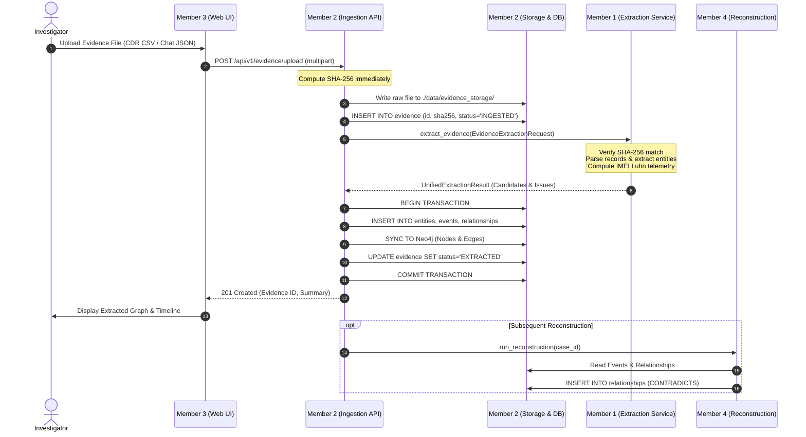

# SUTRAM 2026 — Phase 1C: Extraction & Backend Integration Interface Proposal
**Author:** Member 1 (AI/ML & Evidence Intelligence)  
**Collaborator Role:** Member 2 (Backend & Data Engineering)  
**Date:** November 18, 2026  
**Status:** `PROPOSED` (Internal Integration Proposal — Awaiting Team Review)  
**Target Monorepo Branch:** `main` (Local, uncommitted)

---

## 1. Executive Summary

This proposal establishes the technical integration contract between **Member 1** (AI/ML & Evidence Intelligence) and **Member 2** (Backend & Data Engineering). It formalizes the protocol by which Member 2's ingestion pipeline invokes Member 1's multimodal extraction engine, passes immutable evidence files, and consumes normalized identifiers, entity candidates, temporal events, and observed relationships for persistence into PostgreSQL and Neo4j.

In strict adherence to **AGENTS.md Section 2 and Section 6**, this document:
- Audits currently implemented vs. missing backend capabilities.
- Defines typed, validated Python and JSON input/output contracts.
- Enforces forensic provenance, data immutability, and checksum telemetry separation.
- Outlines an idempotent, fault-tolerant execution workflow.
- Preserves all cross-member decisions without unilateral schema modifications.

---

## 2. Current Backend Capability Audit (Member 2)

An exhaustive inspection of `backend/app/`, `backend/pyproject.toml`, and configuration files was conducted. The table below distinguishes implemented code from uninstantiated placeholders:

| Capability Area | Component Path / Target | Implemented Status | Current State & Technical Reality |
| :--- | :--- | :--- | :--- |
| **FastAPI Routes** | `backend/app/api/routes/` | **Partially Implemented** | Only `GET /health` exists (`health.py`). No evidence upload, ingestion, or case routes exist. |
| **Evidence Upload API** | `backend/app/api/routes/evidence.py` | **Missing** | No `multipart/form-data` endpoint, no upload handler, no payload validation. |
| **File Validation** | `backend/app/modules/ingestion/` | **Missing** | No MIME type sniffing, file extension allowlist, or file size quota checks in ingestion. |
| **SHA-256 Hashing** | Ingestion pipeline | **Missing in Member 2** | `compute_sha256()` exists only in Member 4's `video.py`. Ingestion has no hashing utility. |
| **Evidence Storage** | Storage Manager / Disk | **Placeholder Only** | `settings.EVIDENCE_STORAGE_PATH` exists in `config.py`. No directory creation or write manager. |
| **PostgreSQL Config** | `backend/app/core/config.py` | **Placeholder Only** | `DATABASE_URL` string configured. No SQLAlchemy engine, no sessionmaker, no connection pooling. |
| **Database Models** | `backend/app/models/` | **Missing** | `models/__init__.py` is empty (0 lines). No ORM tables for Cases, Evidence, Entities, Events. |
| **Database Migrations** | `backend/alembic/` | **Missing** | No Alembic environment, no `alembic.ini`, no migration revisions. |
| **Neo4j Configuration** | `backend/app/core/config.py` | **Placeholder Only** | `NEO4J_URI/USER/PASSWORD` strings configured. `neo4j` package not in `pyproject.toml`. |
| **Graph Persistence** | Graph Service | **Missing** | No Cypher query builder, no graph driver initialization, no node/edge writer. |

> [!IMPORTANT]
> The backend currently possesses only basic FastAPI boilerplate and health routing. Dependencies such as `sqlalchemy`, `asyncpg`, `alembic`, and `neo4j` are not yet installed in `pyproject.toml`.

---

## 3. Implemented Extraction Capability Audit (Member 1)

Member 1's extraction and correlation subsystem is implemented and verified locally via 122 passing backend tests:

| Extraction Capability | Implementation Module | Status | Forensic Verification Details |
| :--- | :--- | :--- | :--- |
| **CDR Extraction** | `backend/app/modules/extraction/cdr.py` | **Implemented & Tested** | Parses tabular Call Detail Records; extracts caller/receiver pairs, timestamps, call durations, and cell coordinates; logs rejected rows. |
| **Chat Extraction** | `backend/app/modules/extraction/chat.py` | **Implemented & Tested** | Parses structured JSON messaging exports; extracts sender/recipient IDs, timestamps, and message text; logs malformed messages. |
| **Pattern/NER Extraction** | `backend/app/modules/extraction/ner.py` | **Implemented & Tested** | Regex/keyword extraction for phone numbers, emails, IMEIs, IMSIs, and ambiguous 15-digit sequences; preserves context snippets and char offsets. |
| **IMEI Telemetry** | `backend/app/modules/extraction/ner.py` | **Implemented & Tested** | 3GPP TS 23.003 Luhn mod-10 check; sets `is_checksum_valid=True|False` on IMEIs; retains invalid candidates without rejection. |
| **IMSI Isolation** | `backend/app/modules/extraction/ner.py` | **Implemented & Tested** | ITU-T E.212 subscriber identities strictly protected from Luhn algorithm; `is_checksum_valid=None`. |
| **Confidence Decoupling** | `backend/app/schemas/extraction.py` | **Implemented & Tested** | `extraction_confidence` is strictly decoupled from checksum validity; deterministic regex outputs `None`. |
| **Phone Canonicalization** | `backend/app/modules/correlation/resolution.py` | **Implemented & Tested** | Deterministic E.164 normalization; strips domestic trunk '0' only with default prefix; refuses to guess ambiguous country codes. |
| **Identifier Deduplication**| `backend/app/modules/correlation/resolution.py` | **Implemented & Tested** | Groups duplicate raw mentions across records by canonical identifier; aggregates source evidence IDs and provenance reasons. |
| **Observed Relationships** | `backend/app/modules/correlation/relationships.py`| **Implemented & Tested** | Constructs `COMMUNICATED_WITH` relationship candidates from valid CDR calls and chat interactions with `is_observed=True`. |

---

## 4. Proposed Extraction Input Interface

Member 2's ingestion service will invoke the extraction engine via a single entrypoint function.

### 4.1 Function Signature
```python
async def extract_evidence(request: EvidenceExtractionRequest) -> UnifiedExtractionResult:
    """Execute modality-specific evidence extraction, normalization, and candidate generation.
    
    Reads from the immutable evidence storage path, verifies hash integrity, routes to
    the appropriate extractor, and returns structured extraction candidates.
    """
```

### 4.2 Input Contract DTO (`EvidenceExtractionRequest`)
```python
from pathlib import Path
from typing import Any, Optional
from pydantic import BaseModel, ConfigDict, Field


class EvidenceExtractionRequest(BaseModel):
    """Data transfer object passed by Member 2 to invoke evidence extraction."""

    model_config = ConfigDict(frozen=True)

    evidence_id: str = Field(
        description="Unique identifier of the ingested evidence item (UUID or URN)."
    )
    case_id: str = Field(
        description="Associated forensic case identifier."
    )
    source_type: str = Field(
        description="Modality classification: CALL_DETAIL_RECORD, CHAT_EXPORT, DOCUMENT_PDF, CCTV_VIDEO, etc."
    )
    original_filename: str = Field(
        description="Original name of the evidence file as uploaded by investigator."
    )
    storage_path: Path = Field(
        description="Absolute or relative path to the immutable raw file in evidence storage."
    )
    sha256_hash: str = Field(
        min_length=64,
        max_length=64,
        description="Cryptographic SHA-256 hash computed by Member 2 immediately upon file ingestion."
    )
    source_timezone: str = Field(
        default="UTC",
        description="IANA timezone (e.g. 'Asia/Kolkata') from Evidence.metadata per DEC-006."
    )
    clock_offset_seconds: float = Field(
        default=0.0,
        description="Signed additive clock correction in seconds per DEC-001 (nominal_utc = device_utc + offset)."
    )
    metadata: dict[str, Any] = Field(
        default_factory=dict,
        description="Additional technical and ingestion metadata from Evidence.metadata."
    )
```

### 4.3 Pre-Extraction Validation Protocol
Before initiating parsing, Member 1's service executes three non-negotiable checks:
1. **File Existence & Read-Only Access:** Confirms `storage_path` exists, is a regular file, and can be opened in read-only mode (`'rb'`). Modifying, overwriting, or truncating the file is physically impossible.
2. **Cryptographic Integrity Pre-Verification:** Re-computes `hashlib.sha256()` over the file bytes and asserts equality with `request.sha256_hash`. If a discrepancy is detected, extraction aborts with a fatal `HASH_MISMATCH` issue to protect the chain of custody.
3. **Modality Routing:** Inspects `request.source_type` and dispatches to the corresponding parser (`extract_cdr_from_csv` or `extract_chat_from_json`). Unsupported types return an `UNSUPPORTED_FORMAT` failure without throwing unhandled exceptions.

---

## 5. Proposed Extraction Output Interface

Member 1 returns a single unified DTO containing all extracted information, rejection telemetry, and provenance references.

### 5.1 Output Contract DTO (`UnifiedExtractionResult`)
```python
from enum import Enum
from typing import Any, Optional
from pydantic import BaseModel, ConfigDict, Field

from app.schemas.extraction import (
    ExtractedIdentifier,
    ExtractedEventCandidate,
    ProvisionalRelationshipCandidate,
    ExtractionValidationIssue,
)
from app.modules.correlation.resolution import ResolvedEntityCandidate


class ExtractionStatus(str, Enum):
    SUCCESS = "SUCCESS"                # All records parsed without issue
    PARTIAL_SUCCESS = "PARTIAL_SUCCESS"# Extracted valid records; logged non-fatal issues
    FAILED = "FAILED"                  # Critical failure (hash mismatch, unparseable file)


class UnifiedExtractionResult(BaseModel):
    """Complete structured output returned to Member 2 for database and graph persistence."""

    model_config = ConfigDict(frozen=True)

    evidence_id: str = Field(description="Origin Evidence ID matching the request.")
    case_id: str = Field(description="Origin Case ID matching the request.")
    status: ExtractionStatus = Field(description="Overall execution status.")
    
    # Core Extracted Intelligence (Provisional Models)
    identifiers: list[ExtractedIdentifier] = Field(
        default_factory=list,
        description="All discrete identifiers (phones, emails, IMEIs, IMSIs) with offsets and telemetry.",
    )
    resolved_entities: list[ResolvedEntityCandidate] = Field(
        default_factory=list,
        description="Deduplicated entity candidates grouped by canonical identifier with audit reasons.",
    )
    event_candidates: list[ExtractedEventCandidate] = Field(
        default_factory=list,
        description="Temporal event candidates extracted directly from records with raw timestamps.",
    )
    relationship_candidates: list[ProvisionalRelationshipCandidate] = Field(
        default_factory=list,
        description="Directly observed communication or interaction edges backed by evidence.",
    )
    
    # Forensic Audit & Data Quality Telemetry
    validation_issues: list[ExtractionValidationIssue] = Field(
        default_factory=list,
        description="All malformed rows, missing fields, or parse anomalies logged with raw values.",
    )
    total_records_processed: int = Field(ge=0, description="Total rows/messages examined.")
    valid_records_count: int = Field(ge=0, description="Count of successfully parsed records.")
    rejected_records_count: int = Field(ge=0, description="Count of rejected or malformed records.")
    
    # Execution Provenance
    extractor_name: str = Field(description="Name and version of extraction engine (e.g. 'cdr_extractor:1.0.0').")
    processing_time_ms: float = Field(ge=0.0, description="Elapsed execution time in milliseconds.")
```

### 5.2 Provisional DTOs vs. Canonical Shared Contracts
Member 1 intentionally outputs **provisional candidate models** rather than canonical database entities:

| Dimension | Member 1 Provisional DTOs | Member 2 Canonical DB Models |
| :--- | :--- | :--- |
| **Entity Representation** | `ResolvedEntityCandidate` (grouped identifiers, mentions, and reasons) | `Entity` (database table / Neo4j node with permanent UUID) |
| **Event Representation** | `ExtractedEventCandidate` (unadjusted timestamp string, raw party IDs) | `Event` (normalized UTC instant, validated precision, DB FKs) |
| **Relationship** | `ProvisionalRelationshipCandidate` (observed communication candidate) | `Relationship` (Neo4j edge with source/target entity UUIDs) |
| **Persistence Role** | Intermediate extraction transfer objects; ephemeral. | Single source of truth in PostgreSQL and Neo4j. |

Member 2 is responsible for assigning canonical UUIDs and inserting these records into persistent storage.

---

## 6. Evidence Provenance Requirements

In accordance with **Forensic Integrity Principle #3 (Chain of Custody)**, every extracted element must retain unbroken cryptographic and positional linkage to the original evidence file:

```
┌─────────────────────────────────────────────────────────────────────────────┐
│                       CANONICAL PROVENANCE LINKAGE                          │
├─────────────────────────────────────────────────────────────────────────────┤
│ Evidence Item: evidence_id ("ev-cdr-001") ── SHA-256 ("c874a7c8b0e0...")   │
│   └── Source Record: source_record_id ("rec-0042") (CSV Row #42)            │
│         ├── Location: location_reference ("char_offset:12-27" / "col:caller")│
│         ├── Context Snippet: "Caller +919811002233 dialed target at..."     │
│         └── Checksum Telemetry: is_checksum_valid = True                    │
└─────────────────────────────────────────────────────────────────────────────┘
```

1. **`source_evidence_id`:** Must match the cryptographically bound `Evidence.id`.
2. **`source_record_id`:** Indicates the row index (e.g. `"row:42"`) in tabular data or message UUID (e.g. `"msg:003"`) in chat exports.
3. **`location_reference`:** Precise character span (`"char_offset:start-end"`) or column header (`"column:phone"`).
4. **`context_snippet`:** Preserves a 30–50 character surrounding window to allow investigators to visually audit the text context in Member 3's UI.

---

## 7. Extraction and Persistence Responsibility Boundaries



---

## 8. Error-Handling Requirements

The integration service must handle standard failure scenarios without data corruption:

| Failure Scenario | Trigger Condition | System Behavior & Fallback | Evidence Store Impact |
| :--- | :--- | :--- | :--- |
| **`FILE_NOT_FOUND`** | `storage_path` does not exist on disk | Abort extraction immediately. Return `status=FAILED` with explicit error message. | None. Ingestion record flagged as corrupted. |
| **`HASH_MISMATCH`** | File bytes SHA-256 $\ne$ `request.sha256_hash` | Abort immediately. Log critical forensic violation. Return `status=FAILED`. | File untouched. Investigation alerted to possible tampering. |
| **`UNSUPPORTED_FORMAT`** | `source_type` not recognized or unsupported | Return `status=FAILED` with `UNSUPPORTED_SOURCE_TYPE` issue. | File untouched. Evidence status marked `UNSUPPORTED`. |
| **`MALFORMED_RECORDS`** | Syntax error in specific CSV rows or JSON entries | Continue processing valid rows. Append raw unparsed strings to `validation_issues`. Return `PARTIAL_SUCCESS`. | Valid records saved; malformed records preserved in audit log. |
| **`PARSER_EXCEPTION`** | Unhandled exception during extraction logic | Wrap in try/except; return `status=FAILED` with diagnostic traceback. Never crash process. | File untouched. No partial database artifacts committed. |
| **`PERSISTENCE_FAILURE`** | PostgreSQL or Neo4j write fails after extraction | Member 2 rolls back DB transaction. Evidence record status set to `EXTRACTION_FAILED`. | Raw evidence file remains intact in storage. Retryable. |
| **`EXTRACTION_TIMEOUT`** | File size exceeds processing budget (> 60s) | Terminate extraction worker; return `status=FAILED` with `TIMEOUT` code. | File untouched. Job can be scheduled for async processing. |

---

## 9. Duplicate Processing and Idempotency Considerations

In forensic workflows, investigators frequently re-analyze evidence files (e.g. after adding custom keywords or updating clock offset metadata).

### 9.1 Determinism
Member 1's extraction engine is **strictly deterministic**:
$$\text{extract\_evidence}(\text{request})_1 \equiv \text{extract\_evidence}(\text{request})_2$$
Given the same immutable file and parameters, the output candidates, offsets, and checksum flags are bit-for-bit identical.

### 9.2 Member 2 Idempotent Persistence Protocol
To support safe re-extraction without duplicating entities or creating orphaned graph nodes:
1. **Never Touch Raw Evidence:** The original file and its `Evidence` master record are never deleted or modified.
2. **Transaction-Scoped Replacement:** When re-running extraction on an existing `evidence_id`:
   ```sql
   BEGIN;
   -- 1. Remove previously derived candidates for this evidence item
   DELETE FROM relationships WHERE source_evidence_id = :evidence_id;
   DELETE FROM events WHERE source_evidence_id = :evidence_id;
   DELETE FROM extraction_issues WHERE evidence_id = :evidence_id;
   
   -- 2. Insert fresh candidates from UnifiedExtractionResult
   INSERT INTO events (...) VALUES (...);
   INSERT INTO relationships (...) VALUES (...);
   INSERT INTO extraction_issues (...) VALUES (...);
   
   -- 3. Update evidence state
   UPDATE evidence SET last_extracted_at = NOW(), status = 'EXTRACTED' WHERE id = :evidence_id;
   COMMIT;
   ```
3. **Neo4j Graph Synchronization:** Member 2 executes `MERGE` statements on canonical entity identifiers (e.g. phone numbers in E.164 format) rather than blind `CREATE`, ensuring nodes are updated rather than duplicated.

---

## 10. Member Responsibility Matrix

| Team Member | Official Role | Primary Module Ownership | Ingestion & Extraction Deliverables |
| :--- | :--- | :--- | :--- |
| **Member 1** | AI/ML & Evidence Intelligence | `backend/app/modules/extraction/`<br/>`backend/app/modules/correlation/` | • `extract_evidence()` service implementation.<br/>• Modality extractors (CDR, Chat, PDF, OCR).<br/>• Entity deduplication & phone normalization.<br/>• IMEI/IMSI checksum validation telemetry. |
| **Member 2** | Backend & Data Engineering | `backend/app/api/`<br/>`backend/app/models/`<br/>`backend/app/services/`<br/>PostgreSQL & Neo4j | • `POST /api/v1/evidence/upload` route.<br/>• Immediate SHA-256 calculation & file storage.<br/>• Invocation of `extract_evidence()`.<br/>• Database transaction management & Neo4j graph write. |
| **Member 3** | Frontend & Visualization | `apps/web/` | • Multi-file drag-and-drop evidence upload UI.<br/>• Extraction validation issue visualization.<br/>• Interactive Knowledge Graph (Cytoscape/D3).<br/>• Chronological timeline & spatial views. |
| **Member 4** | Forensic Intelligence & Integration | `backend/app/modules/reconstruction/`<br/>`decision-service/` (Laya/ONNX) | • Video/CCTV frame extraction & timestamp OCR.<br/>• Temporal alignment (`temporal.py`).<br/>• Spatial reconstruction (`spatial.py`).<br/>• Contradiction detection (`contradictions.py`). |

> [!NOTE]
> Swastik is formally designated as **Member 4** (Forensic Intelligence & Integration). He does **not** own Member 2's backend database or upload API responsibilities. Member 2 remains a dedicated, separate role.

---

## 11. Contract Decisions Requiring Team Approval

The following decisions directly govern the interface between Member 1 and Member 2 and require team sign-off before modifying `shared/schemas/`:

```
┌─────────────────────────────────────────────────────────────────────────────┐
│                       CONTRACT DECISION DEPENDENCIES                        │
├─────────────┬─────────────────────────────────┬─────────────────────────────┤
│ Decision ID │ Topic                           │ Integration Impact          │
├─────────────┼─────────────────────────────────┼─────────────────────────────┤
│ DEC-001     │ Clock Offset Sign Convention    │ Member 2 must pass signed   │
│             │ (True = Device + Offset)        │ additive offset to M1 / M4. │
├─────────────┼─────────────────────────────────┼─────────────────────────────┤
│ DEC-002     │ TimePrecision Enums             │ DB column enum values for   │
│             │ (EXACT_SECOND, MINUTE, etc.)    │ events must match extractor.│
├─────────────┼─────────────────────────────────┼─────────────────────────────┤
│ DEC-003     │ RelationType Superset           │ Neo4j edge labels must      │
│             │ (COMMUNICATED_WITH, etc.)       │ include all 7 relation types│
├─────────────┼─────────────────────────────────┼─────────────────────────────┤
│ DEC-004     │ Relationship.weight Nullability │ DB and Neo4j weight must be │
│             │ (weight: Optional[float] = None)│ nullable for contradictions.│
├─────────────┼─────────────────────────────────┼─────────────────────────────┤
│ DEC-005     │ Event Duration & Uncertainty    │ DB events table must store  │
│             │ (duration_seconds, windows)     │ duration_seconds & windows. │
├─────────────┼─────────────────────────────────┼─────────────────────────────┤
│ DEC-006     │ Evidence Metadata Schema        │ Ingestion must store IANA   │
│             │ (source_timezone, coordinates)  │ timezone & offset keys.     │
├─────────────┼─────────────────────────────────┼─────────────────────────────┤
│ M1-PROP-001 │ UTC ISO 8601 Strings ('Z')      │ Extractor & API serialize   │
│             │                                 │ timestamps ending in 'Z'.   │
├─────────────┼─────────────────────────────────┼─────────────────────────────┤
│ M1-PROP-002 │ GeoJSON [longitude, latitude]   │ Extracted coordinates stored│
│             │                                 │ in [lon, lat] order.        │
├─────────────┼─────────────────────────────────┼─────────────────────────────┤
│ M1-PROP-003 │ Bounded Confidence [0.0, 1.0]   │ Checksum telemetry kept     │
│             │ & Checksum Decoupling           │ decoupled from confidence.  │
├─────────────┼─────────────────────────────────┼─────────────────────────────┤
│ M1-PROP-004 │ Provenance URN Format           │ Source pointers use uniform │
│             │                                 │ urn:sutram:evidence:...     │
└─────────────┴─────────────────────────────────┴─────────────────────────────┘
```

---

## 12. Integration Sequence

When development authorization is granted, the integration should proceed in three stages:

### Stage 1: Ingestion Endpoint & Storage (Member 2)
1. Install `python-multipart` and configure file upload directory.
2. Implement `POST /api/v1/evidence/upload`:
   - Saves file to `./data/evidence_storage/{case_id}/{evidence_id}.bin`.
   - Computes SHA-256 during streaming upload.
   - Saves initial metadata record.

### Stage 2: In-Memory Extraction Pipeline Wiring (Members 1 & 2)
1. Expose `extract_evidence()` as an importable service in `backend/app/services/extraction_service.py`.
2. Connect `upload` route to call `extract_evidence()` in-process.
3. Return `UnifiedExtractionResult` in API response to verify end-to-end data flow without database dependencies.

### Stage 3: Database & Graph Persistence (Member 2)
1. Add `sqlalchemy`, `asyncpg`, and `alembic` to `pyproject.toml`.
2. Create PostgreSQL tables for `cases`, `evidence`, `entities`, `events`, `relationships`.
3. Add `neo4j` driver and create graph sync worker.
4. Implement atomic persistence of extraction candidates.

---

## 13. Testing and Acceptance Criteria

Before declaring integration complete, the team must verify:
1. **Immutability Test:** Ingest `sample_cdr.csv`. Assert file timestamp, permissions, and SHA-256 are unchanged after extraction.
2. **Hash Mismatch Defense:** Invoke extraction with an invalid SHA-256 hash. Assert extraction aborts with `status=FAILED` and no entities are saved.
3. **Telemetry Fidelity:** Assert extracted IMEIs contain `is_checksum_valid=True|False` and IMSIs contain `is_checksum_valid=None` in database columns.
4. **Idempotent Re-Run:** Extract the same file twice. Assert entity and event counts in PostgreSQL and Neo4j remain identical (no duplicated rows).
5. **Partial Success Recovery:** Ingest a CSV containing 3 valid rows and 2 malformed rows. Assert valid rows are persisted and malformed rows are stored in `extraction_issues`.

---

## 14. Outstanding Questions for Member 2

To finalize the integration service implementation, Member 2 must provide answers to the following engineering questions:
1. **Async vs. Sync Upload:** Should evidence extraction execute synchronously during the upload HTTP request (acceptable for files $< 5\text{MB}$ in development), or should it run as a FastAPI `BackgroundTask` returning `202 Accepted`?
2. **Database Primary Keys:** Will Member 2 use UUIDv4 strings or integer auto-increment IDs for `cases` and `evidence`? (Member 1 strongly recommends UUIDv4 strings to align with URN provenance).
3. **ORM Selection:** Will Member 2 use SQLAlchemy 2.0 async ORM, SQLModel, or Tortoise ORM?
4. **Neo4j Node Label Convention:** Should entity nodes be labeled generically as `:Entity` with a `type` property, or labeled by their specific category (e.g. `:PhoneNumber`, `:Person`, `:Email`)?

---

## 15. Recommendation for Next Phase

1. Deliver this integration proposal for review by Member 2, Member 3, and Member 4.
2. Maintain all current local Member 1 changes on `main` without committing or pushing.
3. Await Member 2's implementation of the basic upload route skeleton before proceeding with Phase 1C code implementation.
