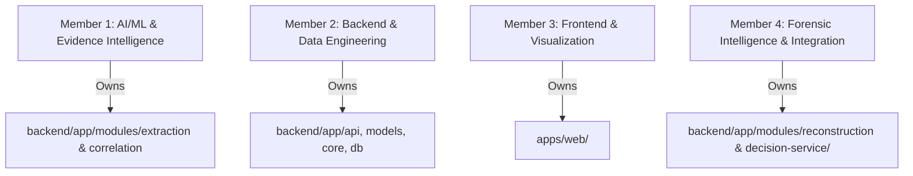

# Team Onboarding & 4-Member Responsibility Matrix

Welcome to the **SUTRAM 2026** engineering team. This document specifies member roles, module ownership, and day-to-day operations.

---

## 1. Member Ownership Matrix



### Member 1: AI/ML and Evidence Intelligence
- **Primary Domain:** `backend/app/modules/extraction/` and `backend/app/modules/correlation/`
- **Responsibilities:**
  - Optical Character Recognition (PaddleOCR) for seized documents and mobile screenshots.
  - Named Entity Recognition (spaCy NER) for identifying persons, organizations, phone numbers, and locations.
  - Event extraction and relationship parsing.
  - Cross-source entity resolution (Sentence Transformers, fuzzy matching, deduplication).
  - Cross-modality similarity scoring.

### Member 2: Backend and Data Engineering
- **Primary Domain:** `backend/app/api/`, `backend/app/models/`, `backend/app/services/`, PostgreSQL, and Neo4j
- **Responsibilities:**
  - FastAPI routing architecture, authentication, and core application configuration.
  - Relational schema design, migrations, and PostgreSQL persistence for Case and Evidence records.
  - Neo4j graph schema design, Cypher queries, and graph synchronization.
  - Secure file ingestion endpoints, SHA-256 integrity verification, and storage paths.
  - Backend integration testing and API performance tuning.

### Member 3: Frontend and Visualization
- **Primary Domain:** `apps/web/`
- **Responsibilities:**
  - Interactive investigator dashboard (React + TypeScript + Vite + Tailwind CSS).
  - Multi-file evidence drag-and-drop upload interface with progress & checksum indicators.
  - Knowledge graph interactive visualization (Cytoscape / Force Graph / D3).
  - Multi-track chronological timeline visualization.
  - Geospatial mapping interface for movement reconstruction.
  - Investigative report viewing and PDF export rendering.

### Member 4: Forensic Intelligence and Integration
- **Primary Domain:** `backend/app/modules/reconstruction/` and `decision-service/`
- **Responsibilities:**
  - Video and CCTV frame extraction, timestamp OCR, and motion event detection (OpenCV).
  - Timestamp normalization across inconsistent timezones and device clocks.
  - Spatial movement reconstruction and pathing.
  - Contradiction detection engine (alibi discrepancy analysis, mutually exclusive statements).
  - Decision service integration (Laya / ONNX runtime for hypothesis validation).
  - End-to-end integration and system sanity checks.

---

## 2. Onboarding Steps for Every Member

### Step 1: Clone the Single Source of Truth
```bash
git clone https://github.com/NotKrish019/SutramPrototype.git
cd SutramPrototype
```

### Step 2: Environment Setup
```bash
# Copy the environment template
cp .env.example .env
```

### Step 3: Toolchain Setup
- **Python Backend:**
  ```bash
  cd backend
  uv sync
  uv run pytest
  ```
- **React Frontend:**
  ```bash
  cd apps/web
  npm ci
  npm run test
  ```
- **Decision Service:**
  ```bash
  cd decision-service
  npm ci
  npm run test
  ```

---

## 3. Collaborative Rules

1. **One Monorepo, One Branch:** All 4 members work in the same folder structure on branch `main`. Never initialize a separate project or alternate branch.
2. **Schema Consensus:** If you need to add or adjust a field in `Case`, `Evidence`, `Entity`, `Event`, or `Relationship`, post a proposal in the shared channel and update `shared/schemas/README.md` only after team consensus.
3. **Respect Module Boundaries:** Do not edit another member's module files without checking in.
4. **Clean Commits:**
   ```bash
   git pull --rebase origin main
   git commit -m "feat(module): description"
   git pull --rebase origin main
   git push origin main
   ```
