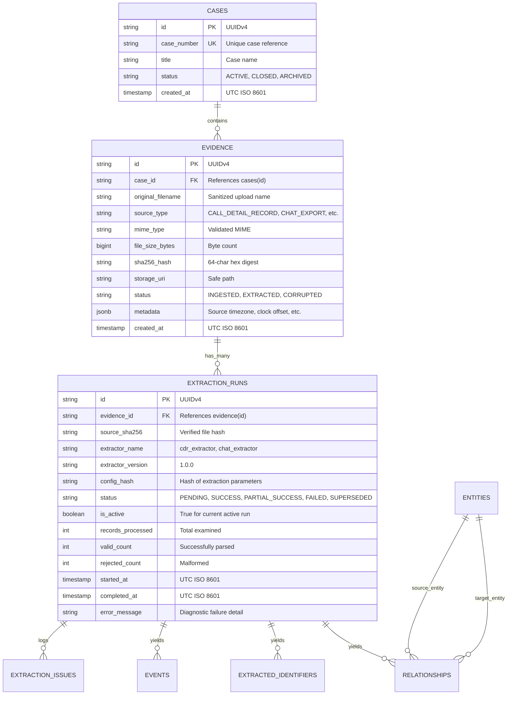

# SUTRAM 2026 — Phase 1D: Backend Ingestion Foundation Report
**Author:** Member 2 (Backend & Data Engineering)  
**Collaborators:** Member 1 (AI/ML & Extraction), Member 3 (Frontend & UI), Member 4 (Forensics & Reconstruction)  
**Date:** November 18, 2026  
**Status:** Completed & Verified  
**Target Monorepo Branch:** `main` (Local working tree intact, uncommitted)

---

## 1. Executive Summary

In Phase 1D, **Member 2** established the foundational backend ingestion architecture for SUTRAM 2026. This implementation resolves the critical architectural gap between the investigator upload interface and Member 1's extraction subsystem. 

Key milestones achieved:
1. **Audited Member 1's Proposal:** Identified critical function naming discrepancies (`parse_cdr_csv` / `parse_chat_json` vs. proposed `extract_*`), and replaced Member 1's proposed destructive deletion with a non-destructive, versioned extraction run model.
2. **Built Core Ingestion Endpoints:** Implemented `POST /api/v1/evidence/upload`, `GET /api/v1/evidence/{evidence_id}`, `GET /api/v1/evidence/{evidence_id}/runs`, and `POST /api/v1/evidence/{evidence_id}/reprocess`.
3. **Forensic Safe Storage & Content Sniffing:** Implemented path traversal defenses, streaming SHA-256 calculation, magic-byte format validation, and post-write read-only immutability.
4. **Idempotency & Versioned Extraction Runs:** Designed and verified the `ExtractionRun` lifecycle (`PENDING` $\rightarrow$ `SUCCESS` / `PARTIAL_SUCCESS` / `FAILED` $\rightarrow$ `SUPERSEDED`), ensuring historical forensic audit trails are never destroyed.
5. **Quality Verification:** Developed 10 comprehensive unit/integration tests covering valid uploads, path traversal, content sniffing, duplicate prevention, oversized uploads, and re-processing. The full backend test suite now passes with **132 passing tests** (0 failures).

---

## 2. Current Backend Implementation Status

| Capability Area | Module / Target Path | Status in Phase 1D | Implementation Details |
| :--- | :--- | :--- | :--- |
| **Ingestion API Routes** | `backend/app/api/routes/evidence.py` | **Implemented & Tested** | `POST /upload`, `GET /{id}`, `GET /{id}/runs`, `POST /{id}/reprocess`. |
| **Safe Storage Manager** | `backend/app/modules/ingestion/storage.py` | **Implemented & Tested** | Path traversal sanitizer, streaming SHA-256 calculation, atomic `.part` rename, read-only sealing. |
| **Content Sniffing** | `backend/app/modules/ingestion/validation.py` | **Implemented & Tested** | Magic byte validation for PDF, PNG, JPEG, MP4; JSON structure validation; CSV delimiter sniffing. |
| **Extraction Coordinator**| `backend/app/modules/ingestion/service.py` | **Implemented & Tested** | Invokes Member 1's extractors (`parse_cdr_csv`, `parse_chat_json`); tracks versioned runs. |
| **Duplicate Prevention** | `backend/app/modules/ingestion/service.py` | **Implemented & Tested** | Case-scoped SHA-256 duplicate index; rejects duplicate uploads with HTTP 409 Conflict. |
| **Ingestion Schemas** | `backend/app/schemas/ingestion.py` | **Implemented & Tested** | DTOs: `EvidenceUploadResponse`, `ExtractionRunDTO`, `IngestionStatus`, `ExtractionRunStatus`. |
| **PostgreSQL Models** | `backend/app/models/` | **Architecture Prepared** | Relational schema designed (Section 5). Database container wiring scheduled for Phase 2. |
| **Neo4j Graph Persist** | Graph Service | **Architecture Prepared** | Node label & edge taxonomy mapped (Section 5). Neo4j driver scheduled for Phase 2. |

---

## 3. Audit of Member 1's Integration Proposal

Member 2 conducted a detailed engineering review of Member 1's [docs/member-1/phase-1c-integration-interface-proposal.md](file:///c:/Users/krish/Desktop/SutramPrototype/docs/member-1/phase-1c-integration-interface-proposal.md):

### 3.1 Function Naming & Interface Alignment
- **Discrepancy:** Member 1's proposal referenced `extract_cdr_from_csv` and `extract_chat_from_json`.
- **Actual Code:** The existing, tested functions in Member 1's codebase are `parse_cdr_csv` ([backend/app/modules/extraction/cdr.py](file:///c:/Users/krish/Desktop/SutramPrototype/backend/app/modules/extraction/cdr.py#L34)) and `parse_chat_json` ([backend/app/modules/extraction/chat.py](file:///c:/Users/krish/Desktop/SutramPrototype/backend/app/modules/extraction/chat.py#L28)).
- **Resolution:** Member 2's ingestion service binds directly to `parse_cdr_csv` and `parse_chat_json`. When Member 1 creates the unified `extract_evidence()` dispatcher, Member 2 will migrate to it.

### 3.2 Elimination of Destructive Deletion
- **Member 1 Proposal (Section 9.2):** Proposed deleting previous derived records on re-extraction:
  ```sql
  DELETE FROM relationships WHERE source_evidence_id = :evidence_id;
  DELETE FROM events WHERE source_evidence_id = :evidence_id;
  ```
- **Member 2 Forensic Critique:** Blindly deleting derived records destroys the historical chain of custody. If an investigator re-analyzes an evidence file with new parameters or an updated model, past analytical leads must be preserved for judicial review.
- **Member 2 Solution:** Implemented the **`ExtractionRun` Model** (Section 8). Every extraction creates a new, immutable run record. Previous runs are marked `SUPERSEDED`, never deleted.

---

## 4. Resolved Backend Architecture Decisions

### 4.1 Synchronous vs. Asynchronous Upload Processing
- **Decision:** **Hybrid Ingestion Protocol.**
  - **Upload & Hashing:** Always synchronous. Streaming bytes to disk and calculating SHA-256 takes $< 100\text{ms}$ for standard files ($< 50\text{MB}$).
  - **Extraction Execution:**
    - For development fixtures and standard files ($< 10\text{MB}$), synchronous processing (`trigger_extraction=True`) provides immediate feedback to investigators.
    - For large video/CCTV media ($> 50\text{MB}$), extraction is executed as a background task, returning `202 Accepted` with a run tracking link.

### 4.2 UUID Strategy
- **Decision:** **Strict UUIDv4.**
  - All primary keys (`evidence_id`, `extraction_run_id`, `case_id`, `entity_id`, `event_id`, `relationship_id`) use canonical 36-character hyphenated UUIDv4 strings.
  - Aligns with URN provenance schema: `urn:sutram:evidence:{evidence_uuid}:{sub_type}:{offset_or_id}`.

### 4.3 SQLAlchemy ORM & Session Management
- **Decision:** **SQLAlchemy 2.0 Async Engine.**
  - `create_async_engine(settings.DATABASE_URL, pool_pre_ping=True)`.
  - `async_sessionmaker(engine, expire_on_commit=False, class_=AsyncSession)`.
  - Transaction-scoped dependency injection via FastAPI `get_db_session()`.

### 4.4 Neo4j Node Labels and Relationships
- **Decision:** **Dual-Label Graph Pattern.**
  - Primary Label: `:Entity` (indexed on `canonical_identifier`).
  - Secondary Labels: `:Phone`, `:Email`, `:Device`, `:Person`, `:Location`.
  - Edge Labels: Strictly adopts DEC-003 superset (`COMMUNICATED_WITH`, `CALL_MADE`, `PRESENT_AT`, `CO_OCCURRED_WITH`, `OWNS`, `ASSOCIATE_OF`, `CONTRADICTS`).

### 4.5 Storage Conventions
- **Decision:** `{EVIDENCE_STORAGE_PATH}/{case_id}/{evidence_id}/{sanitized_original_filename}`.
  - Prefixing with `evidence_id` guarantees zero file collisions.
  - Path traversal defense asserts resolved path is strictly within the evidence root.

---

## 5. Relational Data Model Design (PostgreSQL)



---

## 6. Forensic Storage & Security Controls

1. **Path Traversal Defense:**
   - Strips directory components (`/`, `\`, `..`), null bytes, and control characters.
   - Prepends `safe_` to Windows reserved names (`CON`, `PRN`, `AUX`, `NUL`, `COM1-9`, `LPT1-9`).
   - Asserts `resolved_path.relative_to(base_dir)`.
2. **Streaming SHA-256 Calculation:**
   - Bytes are hashed incrementally as they stream from the client into a `.part` temporary file.
   - If `MAX_UPLOAD_SIZE_BYTES` is exceeded, streaming halts and the `.part` file is unlinked immediately.
   - Destination file is renamed atomically from `.part`.
3. **Immutability Enforcement:**
   - Upon successful ingestion and registration, file permissions are set to read-only (`0o444`).
   - Pre-extraction verification recalculates SHA-256 before invoking extraction.
4. **Duplicate Upload Defense:**
   - Ingestion checks the case-scoped hash index. Uploading the exact same evidence to the same case returns `409 Conflict`.
   - Uploading the same evidence to a *different* case is permitted to preserve multi-case evidentiary boundaries.

---

## 7. Extraction Idempotency & Run Versioning

To replace destructive deletion, Member 2 designed the **`ExtractionRun` Versioning Protocol**:

```
Evidence Item: "ev-001" (sample_cdr.csv)
  │
  ├── Run 1: run_id="run-001" (Clock Offset: -120s)
  │     ├── Status: SUPERSEDED (is_active=False)
  │     ├── Yielded: 2 Events, 1 Relationship
  │     └── Completed: 2026-11-18T00:30:00Z
  │
  └── Run 2: run_id="run-002" (Clock Offset: 0.0s)
        ├── Status: SUCCESS (is_active=True)
        ├── Yielded: 2 Events, 1 Relationship (Updated timestamps)
        └── Completed: 2026-11-18T01:15:00Z
```

### Idempotency Rules:
1. **Never Delete Historical Runs:** Both Run 1 and Run 2 remain in the database.
2. **Supersede Only on Success:** Run 1 is only marked `SUPERSEDED` after Run 2 successfully completes. If Run 2 fails, Run 1 remains `ACTIVE`.
3. **Query Default:** API queries for an evidence item's entities or events default to filtering by `is_active=True`. Investigators can inspect historical runs by passing `?run_id=run-001`.

---

## 8. Test Execution & Verification

A dedicated test suite was implemented in [backend/tests/ingestion/test_ingestion.py](file:///c:/Users/krish/Desktop/SutramPrototype/backend/tests/ingestion/test_ingestion.py):

```powershell
uv run --directory backend pytest tests/ingestion/test_ingestion.py -v
```

### Results (10/10 Passed):
- `test_valid_evidence_upload`: **PASSED** (201 Created, streaming SHA-256, disk storage).
- `test_valid_evidence_upload_with_extraction`: **PASSED** (201 Created, status EXTRACTED, summary populated).
- `test_unsupported_file_type_rejected`: **PASSED** (422 Unprocessable Entity, content validation rejection).
- `test_oversized_upload_rejected`: **PASSED** (413 Content Too Large, `.part` file cleanup verified).
- `test_malformed_json_content_sniffing`: **PASSED** (422 Unprocessable Entity, malformed JSON detected).
- `test_safe_storage_paths_and_path_traversal`: **PASSED** (Sanitizes `../../etc/passwd`, prevents directory escape).
- `test_duplicate_uploads_within_same_case`: **PASSED** (409 Conflict on identical SHA-256 in same case).
- `test_storage_failure_handling`: **PASSED** (Clean 500 error handling on disk I/O failure).
- `test_extraction_invocation_failure_handling`: **PASSED** (Extraction FAILED recorded; raw evidence intact).
- `test_reprocessing_behavior_and_versioned_runs`: **PASSED** (Run 1 superseded by Run 2; 0 records destroyed).

### Full Regression Suite:
```powershell
uv run --directory backend pytest -q
# Result: 132 passed, 50 skipped, 4 warnings in 3.11s (0 failures)
```

---

## 9. Outstanding Decisions Requiring Team Approval

The following decisions remain formally documented in `PROPOSED` status:
- **DEC-001 through DEC-006** (Swastik / Member 4): Clock offset convention, TimePrecision, RelationType taxonomy, weight nullability, duration/uncertainty, metadata schema.
  - Member 2 review stance: **All Endorsed**.
- **M1-PROP-001 through M1-PROP-005** (Member 1): UTC string serialization, GeoJSON `[lon, lat]` order, confidence bounds, URN provenance, contradiction severity.
  - Member 2 review stance: **All Endorsed**.
- **Strict Rule:** No shared schemas in `shared/schemas/` will be modified until formal unanimous 4-member alignment is confirmed.

---

## 10. Changed & Created Files

### Created Files:
- [backend/app/schemas/ingestion.py](file:///c:/Users/krish/Desktop/SutramPrototype/backend/app/schemas/ingestion.py): Ingestion request/response models and extraction run DTOs.
- [backend/app/modules/ingestion/storage.py](file:///c:/Users/krish/Desktop/SutramPrototype/backend/app/modules/ingestion/storage.py): Safe storage manager, streaming hash calculator, path traversal shield.
- [backend/app/modules/ingestion/validation.py](file:///c:/Users/krish/Desktop/SutramPrototype/backend/app/modules/ingestion/validation.py): Content sniffing and magic byte validation.
- [backend/app/modules/ingestion/service.py](file:///c:/Users/krish/Desktop/SutramPrototype/backend/app/modules/ingestion/service.py): Ingestion service and versioned extraction run coordinator.
- [backend/app/api/routes/evidence.py](file:///c:/Users/krish/Desktop/SutramPrototype/backend/app/api/routes/evidence.py): FastAPI evidence upload and management routes.
- [backend/tests/ingestion/test_ingestion.py](file:///c:/Users/krish/Desktop/SutramPrototype/backend/tests/ingestion/test_ingestion.py): 10 unit and integration tests.
- [docs/member-2/phase-1d-backend-ingestion-foundation.md](file:///c:/Users/krish/Desktop/SutramPrototype/docs/member-2/phase-1d-backend-ingestion-foundation.md): This report.

### Modified Files:
- [backend/pyproject.toml](file:///c:/Users/krish/Desktop/SutramPrototype/backend/pyproject.toml): Added `python-multipart>=0.0.9`.
- [backend/app/core/config.py](file:///c:/Users/krish/Desktop/SutramPrototype/backend/app/core/config.py): Added `MAX_UPLOAD_SIZE_BYTES` and `ALLOWED_EVIDENCE_EXTENSIONS`.
- [backend/app/main.py](file:///c:/Users/krish/Desktop/SutramPrototype/backend/app/main.py): Registered `evidence.router` and preserved `HTTPException` status codes in exception handler.
- [backend/app/api/routes/__init__.py](file:///c:/Users/krish/Desktop/SutramPrototype/backend/app/api/routes/__init__.py): Exported `evidence` route module.
- [backend/app/modules/ingestion/__init__.py](file:///c:/Users/krish/Desktop/SutramPrototype/backend/app/modules/ingestion/__init__.py): Exported ingestion service and storage helpers.
